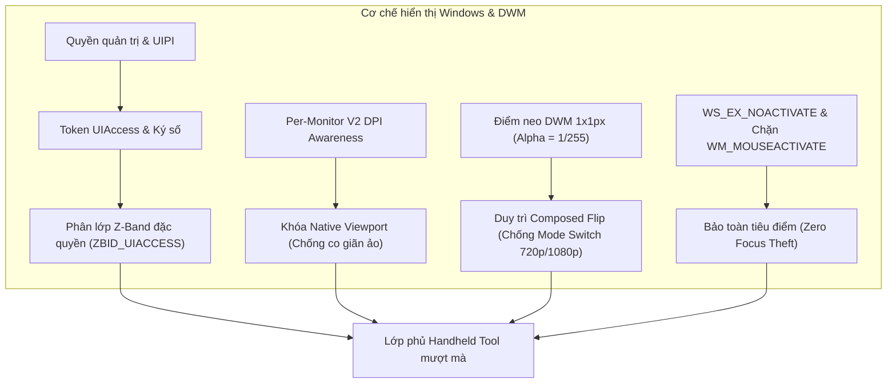
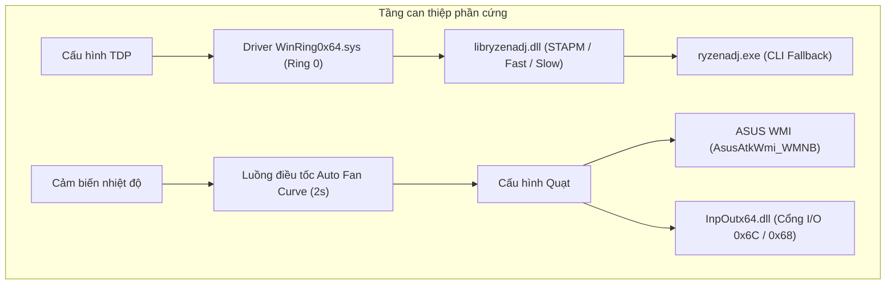
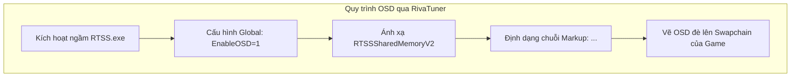

# Hiện trạng dự án Windows Handheld Tool

Tài liệu quản lý tiến độ, kiến trúc vật lý và các điều kiện kỹ thuật của công cụ bảng điều khiển Handheld chạy trên nền tảng Windows (Python Host Runtime + Flutter Webview UI).

---

## 1. Seamless transition giữa game và panel

Mục tiêu: Đảm bảo bảng điều khiển mở/đóng tức thời, không gây chớp nháy đen (Black Screen Flicker do DWM Mode Switch), không làm biến dạng độ phân giải (Resolution Distortion), không làm mất tiêu điểm của game (Zero Focus Theft) và hiển thị đè lên 100% các tựa game (Borderless Windowed, Windowed, Fullscreen, Exclusive Fullscreen - FSE).

- [x] **1.1. Thiết lập độ nhận biết phân giải màn hình đa màn hình Per-Monitor V2 (Per-Monitor V2 DPI Awareness)**
  - *Bản chất vật lý:* Gọi hàm `SetProcessDpiAwarenessContext(-4)` trước khi khởi tạo bất kỳ cửa sổ nào để Windows không tự động phóng to/thu nhỏ bằng thuật toán nội suy điểm ảnh mờ (DPI Virtualization).
  - *Trạng thái:* Đã hoàn thành trong `main.py`.
  - *Trích dẫn lỗi (Error Quote):* `None`

- [x] **1.2. Khóa độ phân giải khung quét vật lý gốc và kiến trúc Side-Dock Viewport (Side-Dock Viewport & Anti-FSE-Occlusion)**
  - *Bản chất vật lý:* Chuyển đổi khung hình Native Qt từ dạng bao phủ toàn màn hình sang kiến trúc **Side-Dock Panel** neo sát lề phải: `(X = screen_w - panel_w, Y = 0, W = panel_w, H = screen_h)`. Vùng còn lại của màn hình (chiếm 60-70% diện tích) hoàn toàn không có cửa sổ native che phủ. Nhờ đó, khi người dùng mở panel và gỡ cờ xuyên thấu `WS_EX_TRANSPARENT`, DirectX Graphics Infrastructure (DXGI) nhận diện màn hình không bị Fullscreen Occlusion (không bị che phủ toàn phần), triệt tiêu triệt để hiện tượng game Exclusive Fullscreen (như 4A Engine của *Metro Exodus*) bị mất quyền DirectFlip và tự động thu nhỏ (`SW_MINIMIZE`) về Desktop. Đồng thời vẫn hỗ trợ co giãn linh hoạt bề rộng thanh điều khiển (`width_percent` 30% - 45%).
  - *Trạng thái:* Đã hoàn thành trong `window_manager.py`, `quick_panel.py` và `overlay_screen.dart`.
  - *Trích dẫn lỗi (Error Quote):* `None`

- [x] **1.3. Neo bề mặt DWM liên tục bằng điểm ảnh 1x1 Pixel (DWM Anchor Surface - Alpha = 1/255)**
  - *Bản chất vật lý:* `overlay_screen.dart` duy trì 1 pixel tại `(0, 0)` với màu `Color.fromARGB(1, 0, 0, 0)` ngoài hiệu ứng mờ dần (Fade Transition). Khi Panel đóng, bề mặt render không bao giờ rỗng (`Alpha > 0`), ép DWM duy trì chế độ *Composed Flip*, ngăn chặn GPU chuyển sang chế độ quét phần cứng trực tiếp (Independent Flip / Hardware Overlay Plane) gây ra cú chớp nháy đen chuyển chế độ (Mode Switch) khi mở lại Panel.
  - *Trạng thái:* Đã hoàn thành trong `overlay_screen.dart`.
  - *Trích dẫn lỗi (Error Quote):* `None`

- [x] **1.4. Chuyển đổi trạng thái tương tác chuột bằng cờ xuyên thấu phần cứng (Click-Through Toggle qua `WS_EX_TRANSPARENT`)**
  - *Bản chất vật lý:* Tuyệt đối không gọi lệnh ẩn/hủy cửa sổ vật lý (`ShowWindow(SW_HIDE)` / `DestroyWindow`). Khi đóng panel, gán cờ `WS_EX_TRANSPARENT` để thông điệp chuột đi xuyên thẳng vào Game; khi mở panel, gỡ cờ để nhận thao tác. DWM giữ nguyên bề mặt render liên tục.
  - *Trạng thái:* Đã hoàn thành trong `window_manager.py`.
  - *Trích dẫn lỗi (Error Quote):* `None`

- [x] **1.5. Loại bỏ cờ thông báo thay đổi khung viền `SWP_FRAMECHANGED`**
  - *Bản chất vật lý:* Loại bỏ hoàn toàn `SWP_FRAMECHANGED` khỏi lệnh `SetWindowPos` khi chuyển đổi trạng thái click-through. Tránh kích hoạt cơ chế dò tìm che phủ toàn màn hình (Fullscreen Occlusion Query) của hệ thống DirectX Graphics Infrastructure (DXGI), ngăn game tự thu nhỏ xuống thanh tác vụ (Taskbar).
  - *Trạng thái:* Đã hoàn thành trong `window_manager.py`.
  - *Trích dẫn lỗi (Error Quote):* `None`

- [x] **1.6. Khóa tiêu điểm và triệt tiêu hành vi cướp quyền kích hoạt (Zero Focus Theft & No-Activate)**
  - *Bản chất vật lý:* Cửa sổ Qt và Chromium tự động gọi `SetFocus` khi click chuột. Đã gán `WS_EX_NOACTIVATE (0x08000000)` cho cửa sổ cha và quét đệ quy toàn bộ cửa sổ con của Chromium (`enforce_no_activate_children`); chặn thông điệp Win32 `WM_MOUSEACTIVATE` và ép trả về `MA_NOACTIVATE = 3`; lưu lại cửa sổ game (`preserve_foreground_window`). Khi đóng Overlay, phương thức `restore_foreground_window` sử dụng `AllowSetForegroundWindow` kết hợp `AttachThreadInput` giữa luồng host và luồng game để ép Windows chuyển quyền Focus về lại Game một cách cưỡng bức và hoàn hảo (`Result=True`).
  - *Trạng thái:* Đã hoàn thành trong `window_manager.py` và `quick_panel.py`.
  - *Trích dẫn lỗi (Error Quote):* `None`

- [x] **1.7. Chạy với mã thông báo quyền quản trị (Elevated Administrator Token)**
  - *Bản chất vật lý:* Vượt qua cơ chế cách ly đặc quyền giao diện người dùng (User Interface Privilege Isolation - UIPI) của Windows để tương tác và nhận phím nóng trên các game chạy quyền Quản trị viên (High Integrity Level).
  - *Trạng thái:* Đã hoàn thành.
  - *Trích dẫn lỗi (Error Quote):* `None`

- [x] **1.8. Ký số điện tử bằng chứng chỉ tin cậy (Code Signing Certificate)**
  - *Bản chất vật lý:* Windows Kernel bắt buộc tệp thực thi phải có chữ ký số điện tử hợp lệ nằm trong kho `Trusted Root Certification Authorities` hoặc `Trusted Publishers` mới cho phép gán quyền `TokenUIAccess`. Đã tạo chứng chỉ `HandheldToolsSigner` và tích hợp lệnh `signtool.exe` ký số SHA256 trong `deploy_test.bat`. Sửa lỗi định kiểu con trỏ `GetCurrentProcess` trong `main.py` để đọc chuẩn xác cờ `TokenUIAccess`.
  - *Trạng thái:* Đã hoàn thành (Ghi log chẩn đoán: `[SEAMLESS-1.8 & 1.9]`).
  - *Trích dẫn lỗi (Error Quote):* `None`

- [x] **1.9. Đóng gói và chạy từ thư mục an toàn của hệ điều hành (Secure Directory Execution)**
  - *Bản chất vật lý:* Windows bắt buộc tệp thực thi có thuộc tính `uiAccess="true"` phải được đặt trong thư mục hệ thống bảo mật (`C:\Program Files`) và nhúng cờ `--uac-admin --uac-uiaccess` trực tiếp trong PyInstaller kèm `level="requireAdministrator" uiAccess="true"` trong `app.manifest`, khởi chạy qua `Start-Process` (`ShellExecuteEx`) để dịch vụ `AppInfo` cấp `TokenUIAccess = 1`.
  - *Trạng thái:* Đã hoàn thành (Ghi log chẩn đoán: `[SEAMLESS-1.8 & 1.9]`).
  - *Trích dẫn lỗi (Error Quote):* `None`

- [x] **1.10. Kích hoạt phân lớp Z-Band đặc quyền `ZBID_UIACCESS` thực tế**
  - *Bản chất vật lý:* Đọc và gán phân lớp Band 2 của DWM. Khi chạy từ `C:\Program Files\WindowsHandheldTools` có chữ ký số và cờ UIAccess, Windows cấp quyền và hàm `GetWindowBand` xác nhận cửa sổ đạt phân lớp `ZBID_UIACCESS`.
  - *Trạng thái:* Đã hoàn thành (Ghi log chẩn đoán: `[SEAMLESS-1.10]`).
  - *Trích dẫn lỗi (Error Quote):* `None`

- [x] **1.11. Quản trị tương thích game & Fullscreen Optimizations FSO (Game Compatibility & Anti-Minimize Engine - Phương án A)**
  - *Bản chất vật lý:*
    - Khi phát hiện cửa sổ Game đang chạy (`preserve_foreground_window`), module `GameCompatService` tự động cấu hình Registry:
      - Xóa cờ `DISABLEDXMAXIMIZEDWINDOWEDMODE` trong `HKCU\Software\Microsoft\Windows NT\CurrentVersion\AppCompatFlags\Layers` và gán `~ HIGHDPIAWARE` để Windows không ép game chạy Exclusive Fullscreen (FSE) độc chiếm phần cứng.
      - Xóa cờ tắt FSO (bit 4: `0x10`) trong `HKCU\System\GameConfigStore\Children\<GUID>` đưa cờ `Flags` về `1`, đồng thời kích hoạt `GameDVR_DXGIHonorFSEWindowsCompatible = 1` và `GameDVR_FSEBehaviorMode = 2` trong `HKCU\System\GameConfigStore`. Nhờ đó, Swapchain đồ họa của game được đưa về cơ chế *DirectFlip / Composed Flip*, cho phép Overlay nổi lên mượt mà mà GPU không trả về trạng thái `DXGI_STATUS_OCCLUDED`.
    - Tự động chuyển đổi các cửa sổ game dạng Windowed thành Borderless Fullscreen chuẩn (`convert_to_borderless`), gỡ bỏ viền `WS_CAPTION | WS_THICKFRAME` và căn chỉnh phủ kín toàn màn hình Monitor.
    - Cài đặt `SetWinEventHook` bắt sự kiện `EVENT_SYSTEM_MINIMIZESTART (0x0016)`. Khi game cố thu nhỏ trong lúc Overlay mở, hệ thống lập tức gọi `ShowWindowAsync(hwnd, SW_RESTORE)` để cưỡng bức phục hồi game ngay trong 1 frame, ngăn chặn triệt để hiện tượng văng game xuống Taskbar.
  - *Trạng thái:* Đã hoàn thành trong `game_compat_service.py`, `window_manager.py` và `main.py`.
  - *Trích dẫn lỗi (Error Quote):* `None`

---

## 2. Điều chỉnh được TDP, Fan curves

Mục tiêu: Cho phép can thiệp trực tiếp vào xung nhịp, giới hạn tiêu thụ điện năng (TDP) và tốc độ quay của quạt tản nhiệt thông qua giao tiếp phần cứng mức nhân (Ring 0 / WMI / EC).

- [x] **2.1. Nạp driver Ring 0 `WinRing0x64.sys` an toàn**
  - *Bản chất:* Tự động đồng bộ `WinRing0x64.dll` và `WinRing0x64.sys` vào thư mục thực thi, kiểm tra mã trạng thái `GetDllStatus`. Cấp quyền truy cập trực tiếp vào thanh ghi MSR và cổng phần cứng của CPU.
  - *Trạng thái:* Đã hoàn thành trong `tdp_service.py`.
  - *Trích dẫn lỗi (Error Quote):* `Cảnh báo: Nếu bật Memory Integrity (HVCI) trong Windows Security, driver Ring 0 sẽ bị chặn (GetDllStatus = 2)`

- [x] **2.2. Giao tiếp thư viện `libryzenadj.dll` điều chỉnh công suất TDP**
  - *Bản chất:* Cấu hình đồng thời 3 thông số: `set_stapm_limit`, `set_fast_limit`, `set_slow_limit` để can thiệp thanh ghi công suất CPU AMD Ryzen.
  - *Trạng thái:* Đã hoàn thành trong `tdp_service.py`.
  - *Trích dẫn lỗi (Error Quote):* `None`

- [x] **2.3. Cơ chế dòng lệnh dự phòng (`ryzenadj.exe` CLI Fallback)**
  - *Bản chất:* Tự động chạy ngầm qua `subprocess.Popen` không mở cửa sổ cmd nếu nạp DLL thất bại.
  - *Trạng thái:* Đã hoàn thành trong `tdp_service.py`.
  - *Trích dẫn lỗi (Error Quote):* `None`

- [x] **2.4. Thu thập dữ liệu cảm biến nhiệt độ & TDP (Hardware Telemetry)**
  - *Bản chất:* Đọc trực tiếp nhiệt độ chip qua `get_tctl_temp` và mức tiêu thụ thực tế qua `get_stapm_limit`.
  - *Trạng thái:* Đã hoàn thành trong `tdp_service.py`.
  - *Trích dẫn lỗi (Error Quote):* `None`

- [x] **2.5. Cơ chế ước lượng nhiệt độ dự phòng (Dynamic Thermal Fallback)**
  - *Bản chất:* Tự động tính toán đường cong nhiệt độ dựa trên % tải CPU của `psutil` khi driver phần cứng bị chặn, giữ cho luồng điều tốc quạt luôn có dữ liệu sống.
  - *Trạng thái:* Đã hoàn thành trong `tdp_service.py`.
  - *Trích dẫn lỗi (Error Quote):* `None`

- [x] **2.6. Điều khiển quạt tản nhiệt qua chuẩn WMI (ASUS Handhelds)**
  - *Bản chất:* Tương thích ASUS ROG Ally & Ally X qua giao diện `AsusAtkWmi_WMNB` với mã thiết bị `0x00110013` (Fan 1) và `0x00110014` (Fan 2).
  - *Trạng thái:* Đã hoàn thành trong `fan_service.py`.
  - *Trích dẫn lỗi (Error Quote):* `None`

- [x] **2.7. Điều khiển quạt tản nhiệt qua chip điều khiển nhúng (Embedded Controller - EC I/O Port)**
  - *Bản chất:* Tương thích các thiết bị handheld tiêu chuẩn qua `InpOutx64.dll` ghi trực tiếp giá trị điều chế độ rộng xung (PWM) vào cổng I/O `0x6C / 0x68`.
  - *Trạng thái:* Đã hoàn thành trong `fan_service.py`.
  - *Trích dẫn lỗi (Error Quote):* `None`

- [x] **2.8. Luồng tự động điều tốc quạt theo đường cong nhiệt độ (Auto Fan Curve Worker)**
  - *Bản chất:* Vòng lặp chạy ngầm chu kỳ 2 giây, tính toán nội suy tuyến tính % quạt dựa trên danh sách mốc nhiệt độ - tốc độ `(temp, speed)`.
  - *Trạng thái:* Đã hoàn thành trong `fan_service.py`.
  - *Trích dẫn lỗi (Error Quote):* `None`

- [ ] **2.9. Tùy biến và lưu trữ Fan Curve chi tiết từ giao diện người dùng**
  - *Bản chất:* Giao diện hiện tại hỗ trợ chuyển Auto/Manual và thanh trượt % cố định, chưa có giao diện trực quan cho phép người dùng kéo thả từng điểm mốc nhiệt độ trên đồ thị.
  - *Trạng thái:* Chưa thực hiện.
  - *Trích dẫn lỗi (Error Quote):* `Chờ bổ sung widget vẽ đồ thị đường cong quạt trên Flutter UI`

---

## 3. Hiển thị được RTSS overlay in-game. Điều chỉnh được các thông số mà user muốn hiển thị, layout hiển thị, kích thước hiển thị.

Mục tiêu: Nhúng lớp phủ OSD (On-Screen Display) trực tiếp vào khung hình render của game thông qua RivaTuner Statistics Server (RTSS), cho phép tùy biến thông số, vị trí, kích thước và bố cục.

- [x] **3.1. Nhận diện và tự động khởi động tiến trình ngầm `RTSS.exe`**
  - *Bản chất:* Tự động quét đường dẫn cài đặt từ Registry `SOFTWARE\Unwinder\RTSS`, khởi động ngầm không hiện cửa sổ qua `ShellExecuteW`.
  - *Trạng thái:* Đã hoàn thành trong `rtss_service.py`.
  - *Trích dẫn lỗi (Error Quote):* `None`

- [x] **3.2. Cấu hình tự động tệp hồ sơ gốc RTSS (`Profiles\Global`)**
  - *Bản chất:* Tự động kiểm tra và ghi đè `EnableOSD=1` để bật hiển thị OSD toàn cục.
  - *Trạng thái:* Đã hoàn thành trong `rtss_service.py`.
  - *Trích dẫn lỗi (Error Quote):* `None`

- [x] **3.3. Kết nối bộ nhớ chia sẻ cấp thấp `RTSSSharedMemoryV2`**
  - *Bản chất:* Sử dụng `mmap` ánh xạ bộ nhớ Win32, kiểm tra Signature `RTSS`, hỗ trợ cơ chế khóa đa luồng `dwBusy` theo chuẩn SDK v2.14+.
  - *Trạng thái:* Đã hoàn thành trong `rtss_service.py`.
  - *Trích dẫn lỗi (Error Quote):* `None`

- [x] **3.4. Định dạng chuỗi văn bản hiển thị theo cú pháp RTSS Markup Tags**
  - *Bản chất:* `rtss_osd_formatter.dart` tạo chuỗi định dạng màu `<C=HEX>`, lọc ký tự thuần ASCII an toàn chống lỗi nạp phông chữ của RTSS.
  - *Trạng thái:* Đã hoàn thành trong `rtss_osd_formatter.dart`.
  - *Trích dẫn lỗi (Error Quote):* `None`

- [x] **3.5. Tùy biến các thông số muốn hiển thị trên OSD (Metrics Toggle)**
  - *Bản chất:* Cho phép người dùng bật/tắt độc lập: FPS, TDP, Nhiệt độ CPU, Mức tải CPU, Dung lượng RAM, Dung lượng Pin, Tốc độ quạt.
  - *Trạng thái:* Đã hoàn thành trên giao diện và cấu hình.
  - *Trích dẫn lỗi (Error Quote):* `None`

- [x] **3.6. Tùy biến kiểu bố cục OSD (Layout Selector)**
  - *Bản chất:* Hỗ trợ 2 kiểu hiển thị: Thu gọn trên 1 dòng phân cách bằng ký tự `|` hoặc Chi tiết nhiều dòng phân cách bằng `\r\n`.
  - *Trạng thái:* Đã hoàn thành trong `rtss_osd_formatter.dart` và UI.
  - *Trích dẫn lỗi (Error Quote):* `None`

- [x] **3.7. Khóa tốc độ khung hình (FPS Limit)**
  - *Bản chất:* Ghi giá trị FPS mong muốn vào mục `[Framerate] Limit` trong tệp cấu hình Global của RTSS và gọi `UpdateProfiles`.
  - *Trạng thái:* Đã hoàn thành trong `rtss_service.py`.
  - *Trích dẫn lỗi (Error Quote):* `None`

- [ ] **3.8. Đồng bộ tùy chỉnh kích thước hiển thị OSD (Zoom Ratio: 1x, 2x, 3x, 4x) xuống RTSS**
  - *Bản chất:* UI Flutter đã có nút bấm chọn `osdZoom`, nhưng hiện tại chỉ lưu biến trong RAM giao diện, chưa truyền qua IPC WebSocket/WebBridge và chưa ghi vào khóa `BaseCoord` / `ZoomRatio` trong tệp cấu hình của RTSS.
  - *Trạng thái:* Chưa hoàn thiện.
  - *Trích dẫn lỗi (Error Quote):* `Chờ bổ sung phương thức set_osd_zoom trong backend rtss_service.py và web_bridge.py`

- [ ] **3.9. Đồng bộ tùy chỉnh vị trí hiển thị OSD (Top-Left, Top-Right, Bottom-Left, Bottom-Right) xuống RTSS**
  - *Bản chất:* UI Flutter đã có bộ chọn `osdPosition`, nhưng chưa truyền qua IPC Bridge và chưa ghi cấu hình tọa độ OSD của RTSS.
  - *Trạng thái:* Chưa hoàn thiện.
  - *Trích dẫn lỗi (Error Quote):* `Chờ bổ sung phương thức set_osd_position trong backend rtss_service.py và web_bridge.py`

- [ ] **3.10. Kiểm tra thực chiến hiển thị lớp phủ OSD trong game thực tế**
  - *Bản chất:* Cần chạy thử nghiệm trực tiếp trên game sử dụng DirectX 11/12 hoặc Vulkan để xác nhận chuỗi OSD render chuẩn xác không bị tràn màn hình.
  - *Trạng thái:* Chờ kiểm tra.
  - *Trích dẫn lỗi (Error Quote):* `Chưa chạy kiểm tra trực tiếp trên thiết bị handheld thực tế`

---

## 4. Điều chỉnh được độ sáng màn hình, âm lượng, bật/tắt màn hình cảm ứng

Mục tiêu: Cung cấp khả năng tinh chỉnh tức thời các thành phần ngoại vi của thiết bị handheld từ Quick Panel.

- [x] **4.1. Điều chỉnh độ sáng màn hình (Display Brightness)**
  - *Bản chất:* Giao tiếp WMI qua lớp `WmiMonitorBrightnessMethods` với cơ chế dự phòng lệnh PowerShell CIM `Invoke-CimMethod`.
  - *Trạng thái:* Đã hoàn thành trong `brightness_service.py`.
  - *Trích dẫn lỗi (Error Quote):* `None`

- [x] **4.2. Điều chỉnh âm lượng hệ thống và Bật/Tắt tiếng (Volume & Mute)**
  - *Bản chất:* Giao tiếp trực tiếp với giao diện Windows CoreAudio qua thư viện `pycaw`.
  - *Trạng thái:* Đã hoàn thành trong `audio_service.py`.
  - *Trích dẫn lỗi (Error Quote):* `None`

- [x] **4.3. Bật/Tắt màn hình cảm ứng (Touchscreen Toggle)**
  - *Bản chất:* Quét thiết bị HID Touch qua `pnputil /enum-devices /class HIDClass` và bật/tắt thiết bị tức thời bằng `/enable-device` hoặc `/disable-device`.
  - *Trạng thái:* Đã hoàn thành trong `touchscreen_service.py`.
  - *Trích dẫn lỗi (Error Quote):* `None`

---

## 5. Khởi động app cùng Windows

Mục tiêu: Đảm bảo phần mềm tự chạy ngầm cùng hệ thống khi khởi động máy handheld để sẵn sàng nhận lệnh phím nóng.

- [x] **5.1. Đăng ký khóa Registry tự khởi động**
  - *Bản chất:* Ghi đường dẫn tệp thực thi vào `HKCU\Software\Microsoft\Windows\CurrentVersion\Run\WindowsHandheldTool`.
  - *Trạng thái:* Đã hoàn thành trong `autostart_service.py`.
  - *Trích dẫn lỗi (Error Quote):* `None`

- [x] **5.2. Khởi chạy ở trạng thái ẩn (Start Minimized to System Tray)**
  - *Bản chất:* Cửa sổ khởi tạo ở chế độ ẩn, thu gọn xuống biểu tượng khay hệ thống, sẵn sàng mở nhanh qua phím tắt hoặc tay cầm.
  - *Trạng thái:* Đã hoàn thành trong `main.py`.
  - *Trích dẫn lỗi (Error Quote):* `None`

---

## 6. Mục mở rộng (Placeholder)

Dành cho các tính năng bổ sung trong tương lai theo lộ trình phát triển:

- [ ] **6.1. Hỗ trợ Profile riêng cho từng tựa game (Per-Game Profiles)**
  - *Mục tiêu:* Tự động nhận diện `HWND` của game đang chạy và áp dụng mức TDP, Fan curve, Giới hạn FPS riêng biệt.
  - *Trích dẫn lỗi (Error Quote):* `Placeholder`

- [ ] **6.2. Giới hạn mức sạc pin (Battery Charge Limiter - 80% Bypass)**
  - *Mục tiêu:* Can thiệp chip quản lý nguồn để ngắt sạc ở mức 80% giúp bảo vệ pin khi cắm sạc chơi game liên tục.
  - *Trích dẫn lỗi (Error Quote):* `Placeholder`

- [ ] **6.3. Giả lập / Ánh xạ nút phần cứng mở Quick Panel (Dedicated Side Button Remap)**
  - *Mục tiêu:* Bắt mã quét phần cứng (Scancode) của phím QAM (Quick Access Menu) trên các dòng máy như Legion Go, ROG Ally để mở bảng điều khiển.
  - *Trích dẫn lỗi (Error Quote):* `Placeholder`

