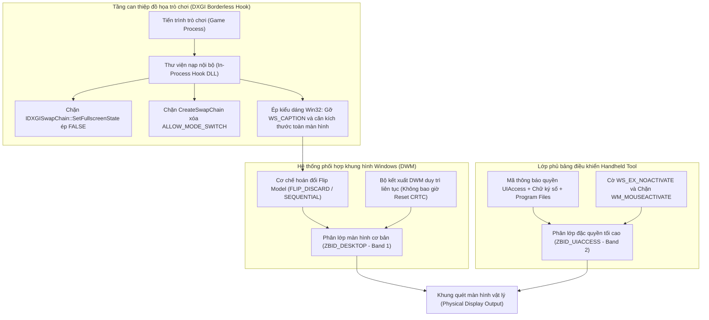
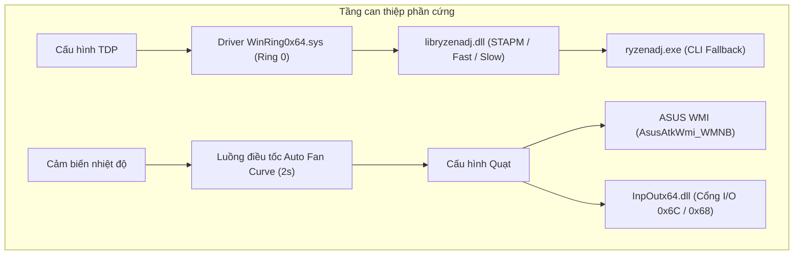
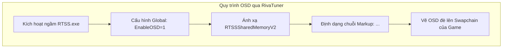

# Hiện trạng dự án Windows Handheld Tool

Tài liệu quản lý tiến độ, kiến trúc vật lý và các điều kiện kỹ thuật của công cụ bảng điều khiển Handheld chạy trên nền tảng Windows (Python Host Runtime + Flutter Webview UI).

---

## 1. Cơ chế chuyển cảnh liền mạch giữa trò chơi và bảng điều khiển (Seamless Transition)

Mục tiêu: Đảm bảo bảng điều khiển mở và đóng tức thời, triệt tiêu hoàn toàn hiện tượng chớp nháy màn hình đen (Black Screen Flicker do DWM Mode Switch), ngăn ngừa biến dạng độ phân giải hiển thị (Resolution Distortion), duy trì liên tục quyền điều khiển của người dùng trong trò chơi (Zero Focus Theft) và đảm bảo bảng điều khiển luôn nổi đè lên trên tất cả các trò chơi đồ họa 3D (DirectX 11, DirectX 12, Vulkan).

### 1.0. Bản chất vật lý và Bế tắc kỹ thuật của kiến trúc cũ

- **Trước đây làm bằng cách nào:**
  - Thiết lập cửa sổ bảng điều khiển dạng neo một phần cạnh phải màn hình (Side-Dock Viewport).
  - Duy trì một điểm ảnh có độ trong suốt gần như vô hình (`Alpha = 1/255`) tại tọa độ gốc để ép Trình quản lý cửa sổ máy tính để bàn (Desktop Window Manager - DWM) giữ cơ chế kết xuất phối hợp bề mặt (*Composed Flip*).
  - Gán cờ bỏ qua kích hoạt (`WS_EX_NOACTIVATE`) và chặn thông điệp chuột `WM_MOUSEACTIVATE` nhằm tránh cướp tiêu điểm của trò chơi.
  - Sử dụng móc bắt sự kiện hệ thống (`SetWinEventHook`) từ bên ngoài tiến trình để khôi phục cửa sổ trò chơi khi phát hiện tín hiệu thu nhỏ.
- **Bị nghẽn và thảm họa kỹ thuật gì:**
  - *Xung đột quyền quét phần cứng trực tiếp (Hardware Direct Scanout Collision):* Khi trò chơi kích hoạt chế độ Toàn màn hình độc quyền (Exclusive Fullscreen - FSE), bộ điều khiển hiển thị của bộ xử lý đồ họa (GPU Display Controller) bỏ qua DWM để quét trực tiếp dữ liệu điểm ảnh từ bộ đệm khung hình (Frame Buffer) của trò chơi ra màn hình vật lý.
  - *Mất tín hiệu đồng bộ quét (Display Mode Reset / CRTC Pipeline Stall):* Khi cửa sổ bảng điều khiển xuất hiện hoặc gỡ cờ xuyên thấu điểm ảnh (`WS_EX_TRANSPARENT`), DWM buộc phải giành lại quyền điều khiển để ghép các lớp hình ảnh lại với nhau. GPU buộc phải thiết lập lại chu kỳ quét tần số và độ phân giải của bộ điều khiển hiển thị phần cứng, gây ra cú ngắt tín hiệu màn hình đen kéo dài 200ms đến 1000ms.
  - *Lỗi co giãn độ phân giải (Resolution Distortion / Glitch):* Khi bị che phủ, giao diện lập trình đồ họa DirectX Graphics Infrastructure (DXGI) trả về mã trạng thái bị che khuất (`DXGI_STATUS_OCCLUDED`). Nhiều bộ engine trò chơi (như Unreal Engine, Unity, 4A Engine) tự động kích hoạt chu trình hủy bộ đệm hoán đổi khung hình (Swapchain Re-creation) hoặc tự động hạ độ phân giải về tỷ lệ ảo hóa của màn hình nền (DPI Virtualization Glitch), dẫn đến hiện tượng văng trò chơi hoặc lệch tỉ lệ khung quét.
- **Công nghệ mới (ZBID_UIACCESS + DXGI Borderless Hook) giải quyết triệt để ra sao:**
  - *Triệt tiêu độc quyền hiển thị từ gốc rễ (DXGI Borderless Hook):* Chặn trực tiếp các lệnh gọi hàm của DirectX bên trong không gian bộ nhớ của trò chơi. Chặn hàm `IDXGISwapChain::SetFullscreenState`, cưỡng bức tham số trạng thái luôn là chế độ cửa sổ (`Fullscreen = FALSE`), đồng thời loại bỏ cờ cho phép chuyển đổi chế độ quét vật lý (`DXGI_SWAP_CHAIN_FLAG_ALLOW_MODE_SWITCH`). Trò chơi bị ép hoạt động 100% ở chế độ Cửa sổ không viền (Borderless Windowed) với cơ chế đẩy khung hình tuần tự (*Flip Model - FLIP_DISCARD / FLIP_SEQUENTIAL*). Trò chơi vẫn tận dụng tối đa hiệu năng của phần cứng nhưng luồng kết xuất hoàn toàn nằm dưới sự điều phối trơn tru của DWM, loại bỏ vĩnh viễn nguy cơ mất đồng bộ quét (Black Screen) và lỗi co giãn độ phân giải.
  - *Phân tầng hiển thị bất khả xâm phạm (`ZBID_UIACCESS`):* Trò chơi sau khi chuyển sang Borderless Windowed sẽ thuộc dải phân lớp màn hình tiêu chuẩn (`ZBID_DESKTOP - Band 1`). Bảng điều khiển Handheld Tool (được ký số điện tử tin cậy, thực thi từ thư mục bảo mật `C:\Program Files`, nhúng cờ `uiAccess="true"`) được hệ điều hành Windows phân bổ vào dải phân lớp hỗ trợ tiếp cận đặc quyền (`ZBID_UIACCESS - Band 2`). Về mặt kiến trúc sắp xếp theo chiều sâu của DWM, các cửa sổ thuộc Band 2 luôn nằm đè lên mọi cửa sổ thuộc Band 1, không bao giờ bị trò chơi che khuất hay tụt bậc hiển thị (Z-Order Demotion), ngay cả khi trò chơi chiếm trọn quyền nhập liệu từ chuột và bàn phím.

### 1.1. Các thành phần nền tảng hệ điều hành (Đã hoàn thành)

- [x] **1.1. Thiết lập độ nhận biết phân giải màn hình đa màn hình Per-Monitor V2 (Per-Monitor V2 DPI Awareness)**
  - *Bản chất vật lý:* Gọi hàm `SetProcessDpiAwarenessContext(-4)` trước khi khởi tạo bất kỳ cửa sổ nào để Windows không tự động phóng to hoặc thu nhỏ bằng thuật toán nội suy điểm ảnh mờ (DPI Virtualization).
  - *Trạng thái:* Đã hoàn thành trong `backend/src/main.py`.
  - *Trích dẫn lỗi (Error Quote):* `None`

- [x] **1.2. Chạy với mã thông báo quyền quản trị nâng cao (Elevated Administrator Token)**
  - *Bản chất vật lý:* Vượt qua cơ chế cách ly đặc quyền giao diện người dùng (User Interface Privilege Isolation - UIPI) của Windows để tương tác và nhận phím nóng trên các trò chơi chạy quyền Quản trị viên (High Integrity Level).
  - *Trạng thái:* Đã hoàn thành.
  - *Trích dẫn lỗi (Error Quote):* `None`

- [x] **1.3. Ký số điện tử bằng chứng chỉ tin cậy (Code Signing Certificate)**
  - *Bản chất vật lý:* Nhân hệ điều hành Windows bắt buộc tệp thực thi phải có chữ ký số điện tử hợp lệ nằm trong kho `Trusted Root Certification Authorities` hoặc `Trusted Publishers` mới cho phép gán quyền `TokenUIAccess`. Đã tạo chứng chỉ `HandheldToolsSigner` và tích hợp lệnh `signtool.exe` ký số SHA256 trong tệp kịch bản đóng gói `deploy_test.bat`.
  - *Trạng thái:* Đã hoàn thành (Ghi log chẩn đoán: `[SEAMLESS-1.8 & 1.9]`).
  - *Trích dẫn lỗi (Error Quote):* `None`

- [x] **1.4. Đóng gói và chạy từ thư mục an toàn của hệ điều hành (Secure Directory Execution)**
  - *Bản chất vật lý:* Windows bắt buộc tệp thực thi có thuộc tính `uiAccess="true"` phải được đặt trong thư mục hệ thống bảo mật (`C:\Program Files`) và nhúng cờ `--uac-admin --uac-uiaccess` trực tiếp trong PyInstaller kèm `level="requireAdministrator" uiAccess="true"` trong tệp khai báo `app.manifest`, khởi chạy qua `ShellExecuteEx` để dịch vụ thông tin ứng dụng (`AppInfo`) cấp cờ `TokenUIAccess = 1`.
  - *Trạng thái:* Đã hoàn thành (Ghi log chẩn đoán: `[SEAMLESS-1.8 & 1.9]`).
  - *Trích dẫn lỗi (Error Quote):* `None`

- [x] **1.5. Kích hoạt phân lớp Z-Band đặc quyền `ZBID_UIACCESS` thực tế**
  - *Bản chất vật lý:* Cửa sổ Handheld Tool chạy từ thư mục bảo mật được gán dải phân lớp Band 2 của DWM. Hàm kiểm tra nội bộ `GetWindowBand` xác nhận cửa sổ đạt phân lớp `ZBID_UIACCESS`, đảm bảo không bao giờ bị các cửa sổ ở dải `ZBID_DESKTOP` (Band 1) che lấp.
  - *Trạng thái:* Đã hoàn thành trong `backend/src/overlay/window_manager.py` (Ghi log chẩn đoán: `[SEAMLESS-1.10]`).
  - *Trích dẫn lỗi (Error Quote):* `None`

---

### 1.2. Dọn dẹp mã nguồn phương án cũ (Legacy Code Deprecation & Cleanup)

- [x] **1.6. Dọn dẹp triệt để mã nguồn thừa thãi của phương án cũ (Legacy Code Cleanup)**
  - *Bản chất vật lý:* Loại bỏ hoàn toàn các cơ chế chắp vá và đối phó không còn giá trị sử dụng nhằm làm sạch codebase theo nguyên tắc Cấm tương thích ngược (No Backward Compatibility):
    - Đã xóa điểm neo hiển thị 1x1 pixel (`Alpha = 1/255`) tại tọa độ `(0, 0)` trong `frontend/lib/ui/overlay_screen.dart`.
    - Đã xóa phương thức can thiệp tệp cấu hình game riêng lẻ `optimize_metro_exodus_config` trong `backend/src/services/game_compat_service.py`.
    - Đã dọn dẹp các ràng buộc hình học và bình luận né tránh cơ chế che phủ toàn màn hình (Fullscreen Occlusion) trong `backend/src/overlay/window_manager.py` và `quick_panel.py`.
  - *Lý do bế tắc kỹ thuật cũ:* Phương án cũ không thể giải quyết triệt để xung đột khi trò chơi chủ động kích hoạt chế độ Toàn màn hình độc quyền (Exclusive Fullscreen - FSE), gây ngắt quãng chu kỳ quét (CRTC Reset) làm nháy màn hình đen và văng tỷ lệ hiển thị.
  - *Trạng thái:* Đã hoàn thành dọn dẹp sạch sẽ trong codebase.
  - *Trích dẫn lỗi (Error Quote):* `None`

---

### 1.3. Kế hoạch triển khai phương án mới: DXGI Borderless Hook + ZBID_UIACCESS

- [x] **1.7. Thư viện chặn và chuyển hướng giao tiếp đồ họa DXGI nội tiến trình (In-Process DXGI Borderless Hook Engine)**
  - *Bản chất vật lý:* Xây dựng thư viện liên kết động độc lập (`backend/bin/dxgi_hook.dll` viết bằng C/C++ x64 với bộ thư viện MinHook) để can thiệp vào bảng con trỏ hàm ảo (Virtual Method Table - VMT) của các giao diện DXGI trong tiến trình trò chơi:
    - Móc chặn hàm `IDXGISwapChain::SetFullscreenState`: Khi trò chơi yêu cầu bật toàn màn hình độc quyền (`Fullscreen = TRUE`), hàm móc chặn lại, ép trạng thái cửa sổ `FALSE`, tự động căn chỉnh cửa sổ game phủ kín toàn bộ màn hình (`ForceBorderlessWindow`) và trả về mã thành công `S_OK` giả lập để trò chơi tin rằng đã vào chế độ toàn màn hình, trong khi Swapchain bên dưới vẫn duy trì 100% ở chế độ Cửa sổ không viền (*Borderless Windowed / Flip Model*).
    - Móc chặn hàm `IDXGIFactory::CreateSwapChain` và `IDXGIFactory2::CreateSwapChainForHwnd`: Tự động xóa cờ `DXGI_SWAP_CHAIN_FLAG_ALLOW_MODE_SWITCH` trong cấu trúc mô tả `DXGI_SWAP_CHAIN_DESC` / `DXGI_SWAP_CHAIN_DESC1`, đồng thời đặt cờ `Windowed = TRUE`.
    - Móc chặn hàm `D3D11CreateDeviceAndSwapChain` và các hàm xuất xưởng Factory `CreateDXGIFactory`, `CreateDXGIFactory1`, `CreateDXGIFactory2`.
    - Cơ chế nạp bất đồng bộ an toàn qua luồng riêng trong `DllMain` nhằm giải phóng hoàn toàn khóa nạp thư viện `LdrpLoaderLock` của hệ điều hành.
  - *Trạng thái:* Đã hoàn thành (Biên dịch thành công tệp nhị phân x64 `backend/bin/dxgi_hook.dll` dung lượng 26 KB).
  - *Trích dẫn lỗi (Error Quote):* `None`

- [x] **1.8. Bộ nạp và quản lý vòng đời trò chơi tự động (Game Lifecycle Injector & Orchestrator)**
  - *Bản chất vật lý:* Xây dựng tiến trình giám sát và tiêm mã tự động trong `backend/src/services/game_compat_service.py`:
    - Kích hoạt đặc quyền mức nhân `SeDebugPrivilege` cho tiến trình host để có toàn quyền can thiệp vào các trò chơi chạy quyền Quản trị viên (Elevated / High Integrity Level).
    - Cài đặt `SetWinEventHook` mức hệ thống bắt sự kiện `EVENT_SYSTEM_FOREGROUND (0x0003)` và `EVENT_SYSTEM_MINIMIZESTART (0x0016)` để theo dõi sự kiện kích hoạt trò chơi tức thời.
    - Phương thức `inject_dxgi_hook`: Kiểm tra kiến trúc tiến trình (`IsWow64Process` lọc các game 32-bit), mở tiến trình game (`OpenProcess` cờ `PROCESS_ALL_ACCESS`), cấp phát bộ nhớ ảo (`VirtualAllocEx`), sao chép đường dẫn DLL (`WriteProcessMemory`), và khởi tạo luồng từ xa gọi `LoadLibraryW` (`CreateRemoteThread`). Đọc mã thoát `HMODULE` để xác nhận thư viện đã nạp và gán vào tập hợp `_injected_pids`.
  - *Trạng thái:* Đã hoàn thành trong `game_compat_service.py` và `window_manager.py` (Kiểm thử thực chiến nạp DLL trả về HMODULE hợp lệ).
  - *Trích dẫn lỗi (Error Quote):* `None`

- [x] **1.9. Chuẩn hóa hình học và kiểu dáng cửa sổ không viền (Window Geometry & Borderless Style Enforcement)**
  - *Bản chất vật lý:* Kết hợp đồng thời 2 lớp can thiệp (Ngoại vi Host và Nội tiến trình Hook) để chuẩn hóa giao diện Win32 của cửa sổ trò chơi:
    - Xóa bỏ toàn bộ các cờ khung viền thanh tiêu đề (`WS_CAPTION`, `WS_THICKFRAME`, `WS_MINIMIZEBOX`, `WS_MAXIMIZEBOX`, `WS_SYSMENU`) khỏi kiểu dáng cửa sổ (`GWL_STYLE`).
    - Tự động nhận diện màn hình vật lý chứa cửa sổ trò chơi thông qua Win32 Multi-Monitor API (`MonitorFromWindow` kết hợp `GetMonitorInfoW`), chống lỗi lệch tọa độ trên cấu hình đa màn hình.
    - Gọi lệnh đặt lại vị trí cửa sổ (`SetWindowPos`) phủ trọn vẹn màn hình vật lý mục tiêu: tọa độ `(rcMonitor.left, rcMonitor.top)` và kích thước `(width, height)` với cờ `SWP_FRAMECHANGED | SWP_NOACTIVATE | SWP_NOZORDER | SWP_SHOWWINDOW`.
    - Trò chơi hiển thị tràn viền toàn màn hình nhưng về bản chất vật lý hoàn toàn là cửa sổ không viền (*Borderless Windowed / Flip Model*), phối hợp nhịp nhàng với DWM Composed Flip.
  - *Trạng thái:* Đã hoàn thành (Triển khai trong `convert_to_borderless` tại `game_compat_service.py` và đồng bộ trong `ForceBorderlessWindow` tại `dxgi_hook.cpp`).
  - *Trích dẫn lỗi (Error Quote):* `None`

- [x] **1.10. Tích hợp phân tầng Z-Band `ZBID_UIACCESS` và Cơ chế nhập liệu không tranh chấp (Zero-Interference Input & Focus Layering)**
  - *Bản chất vật lý:* 
    - Duy trì tiêu điểm độc quyền cho trò chơi: Cửa sổ Quick Panel (thuộc `ZBID_UIACCESS - Band 2`) mở ra và phủ lên trò chơi mà không làm mất tiêu điểm kích hoạt của trò chơi bằng cách duy trì cờ `WS_EX_NOACTIVATE (0x08000000)` đệ quy cho toàn bộ cây cửa sổ con Chromium DirectComposition, đồng thời chặn thông điệp `WM_MOUSEACTIVATE` và trả về mã `MA_NOACTIVATE = 3`.
    - Cơ chế đồng bộ trạng thái liên tiến trình (Cross-Process IPC Synchronization): Khởi tạo Windows Named Event toàn cục `Global\HandheldTool_PanelActive` với mô tả bảo mật SDDL `D:(A;;GA;;;WD)` (cấp quyền truy cập cho Everyone ở mọi cấp bậc toàn vẹn / Integrity Level).
    - Triệt tiêu tín hiệu Gamepad nội tiến trình: Thư viện `dxgi_hook.dll` trong trò chơi can thiệp hàm `XInputGetState`. Khi Quick Panel mở (`SetEvent` kích hoạt), hàm hook lập tức xóa dữ liệu nút bấm `wButtons = 0` và cò `Triggers = 0` trước khi trả về cho trò chơi, ngăn nhân vật trong trò chơi nhảy/bắn/di chuyển khi người dùng duyệt menu của bảng điều khiển.
    - Khi Quick Panel đóng (`ResetEvent`), tín hiệu tay cầm được trả lại nguyên vẹn cho trò chơi ngay tức thì.
  - *Trạng thái:* Đã hoàn thành trong `window_manager.py`, `gamepad_service.py`, `dxgi_hook.cpp` và `main.py` (Đã kiểm thử xác thực IPC Event Signal/Reset thành công).
  - *Trích dẫn lỗi (Error Quote):* `None`

- [ ] **1.11. Kiểm tra thực chiến trên ma trận Engine đồ họa nhạy cảm (DirectX 11, DirectX 12, Unreal Engine, 4A Engine)**
  - *Hiện tượng lỗi phát hiện thực chiến:*
    1. **Lỗi khởi chạy không tràn viền ban đầu:** Khi mở game, game ban đầu không hiển thị toàn màn hình mà bị thu nhỏ thành cửa sổ hoặc co cụm về góc màn hình do game chạy ở độ phân giải render nội bộ (720p/900p) nhỏ hơn màn hình vật lý (1080p).
    2. **Lỗi lệch tọa độ chuột thực tế trong game (Mouse Cursor Desync trên Unreal Engine / Ready Or Not):** Khi mở game *Ready Or Not*, game đã hiển thị full màn hình và mở panel seamless tốt. Sau khi mở/đóng panel, game đã nhận diện và đổi sang con trỏ chuột của game (thay vì bị kẹt con trỏ Windows). Tuy nhiên, vị trí con trỏ chuột hiển thị trên màn hình và vị trí click/hover thực tế mà game nhận diện bị lệch nhau (phải rê chuột lệch khỏi nút bấm một khoảng thì nút mới sáng lên).
    3. **Lỗi nuốt cú nhấp chuột (Phải Double Click mới nhận tín hiệu):** Sau khi mở/đóng panel, người dùng click chuột vào giao diện game nhưng cú click đầu tiên bị phớt lờ hoàn toàn, bắt buộc phải nhấp đúp chuột (Double Click) thì game mới nhận tín hiệu điều khiển.
  - *Bản chất vật lý tầng dưới:*
    1. **Xung đột ma trận tọa độ do lừa trạng thái `GetFullscreenState = TRUE`:** Khi `dxgi_hook.dll` giả lập trả về `*pFullscreen = TRUE`, hệ thống Slate UI của Unreal Engine tin rằng DirectX đang chạy ở chế độ Toàn màn hình độc quyền (Exclusive Fullscreen). Slate chuyển sang nhánh giải mã tọa độ độc quyền thay vì dùng tọa độ cửa sổ máy tính để bàn (Desktop Window Coordinates). Tuy nhiên, cửa sổ Win32 thực tế bên dưới là Cửa sổ không viền (Borderless Windowed). Sự bất đồng bộ này khiến Unreal Engine áp dụng ma trận biến đổi tọa độ của Fullscreen lên một cửa sổ Desktop, làm lệch hoàn toàn vị trí hiển thị con trỏ so với vùng bắt tín hiệu (`HitTest`). Khi `GetFullscreenState` trả về `FALSE` (Windowed), Slate UI lập tức chuyển về nhánh mã Windowed chuẩn mực, ánh xạ tọa độ 1:1 qua `GetClientRect` của cửa sổ không viền bao phủ màn hình.
    2. **Hiện tượng nhân tỉ lệ lũy thừa (Double/Triple Scaling) do can thiệp Message Loop:** Việc can thiệp trực tiếp vào `ScreenToClient` và thông điệp `lParam` trong `PeekMessageW` / `GetMessageW` khiến tọa độ chuột bị nhân tỉ lệ nhiều lần chồng chéo lên nhau khi Slate UI truy vấn tọa độ qua nhiều hàm API Win32 khác nhau trong cùng một khung hình.
    3. **Lệch pha Message Queue và Windows Cache gây lỗi Double Click:** Khi `PeekMessageW` sửa đổi `lpMsg->lParam`, vùng đệm nội vi của hệ điều hành `GetMessagePos()` và `GetCursorPos()` vẫn giữ nguyên tọa độ gốc của con trỏ vật lý. Khi Slate UI (`FSlateApplication::ProcessMouseButtonDownMessage`) nhận thông điệp, nó phát hiện khoảng cách giữa `lParam` và `GetMessagePos()` vượt ngưỡng cho phép (Jitter / Drag threshold), dẫn đến việc hủy bỏ cú nhấp chuột đơn đầu tiên. Khi người dùng nhấp đúp chuột, thông điệp `WM_LBUTTONDBLCLK` (không bị hook can thiệp) mới được engine chấp nhận.
    4. **Cơ chế khóa tiêu điểm hệ thống (Windows Foreground Lock Timeout):** Khi đóng panel, nếu chỉ gọi `SetForegroundWindow` đơn thuần từ tiến trình bảng điều khiển, hệ điều hành Windows áp dụng chính sách bảo vệ chống cướp tiêu điểm (`SPI_SETFOREGROUNDLOCKTIMEOUT`). Cửa sổ game chưa thực sự được kích hoạt về mức Active. Cú click chuột đầu tiên của người dùng vào game đóng vai trò là Cú click kích hoạt cửa sổ (Activation Click - `MA_ACTIVATEANDEAT`), bị hệ điều hành tiêu thụ để trao tiêu điểm chứ không chuyển thông điệp vào UI của trò chơi. Phải đến cú click thứ hai, trò chơi mới nhận tín hiệu.
    5. **Ảo hóa DPI do hệ điều hành (DPI Awareness Virtualization):** Trên các thiết bị máy tính cầm tay (Handheld) có màn hình nhỏ nhưng độ phân giải cao, Windows thường thiết lập Display Scaling từ 125% đến 150%. Nếu tệp thực thi của trò chơi không được gắn cờ nhận diện DPI trước khi nạp tiến trình, hệ điều hành Windows tự động áp dụng ma trận ảo hóa điểm ảnh, làm con trỏ chuột bị co giãn lệch tỷ lệ so với hình ảnh kết xuất thực tế.
    6. **Đánh lừa Target Parameters trong ResizeTarget:** Trước đây hook thay thế kích thước target thành độ phân giải màn hình khiến Unreal Engine tính toán lại ma trận Viewport Scale, nhân đôi sai lệch tỷ lệ chuột.
    7. **Khóa con trỏ chuột (ClipCursor Boundary Lock):** Game FPS giam chuột trong Client Rect cũ; khi panel mở ra ở mép phải màn hình, nếu không giải phóng `ClipCursor(None)` sẽ làm chuột bị khựng hoặc lệch biên.
  - *Giải pháp kỹ thuật đã áp dụng để triệt tiêu lỗi:*
    - **Dọn sạch 100% các hook chuột can thiệp Message Loop:** Xóa bỏ hoàn toàn các hàm hook `Hooked_ScreenToClient`, `Hooked_PeekMessageW`, `Hooked_GetMessageW` và hàm `ScaleMouseMessage`. Trả lại nguyên vẹn tính toàn vẹn của hàng đợi thông điệp Win32 và hàm `GetMessagePos()`, triệt tiêu hoàn toàn hiện tượng nhân tỉ lệ chuột và lỗi drop cú click đơn của Slate UI.
    - **Cưỡng bức `Hooked_GetFullscreenState` trả về `FALSE` (Windowed):** Báo cáo trung thực trạng thái Windowed cho engine trò chơi để Unreal Engine kích hoạt nhánh giải mã chuột của Borderless Windowed, sử dụng trực tiếp `GetClientRect` bao phủ toàn màn hình, đảm bảo vị trí hiển thị con trỏ và vùng bắt tín hiệu nút bấm trùng khớp tuyệt đối 1:1.
    - **Đột phá Foreground Lock bằng kỹ thuật giả lập phím ALT (Alt-Key Simulation Bypass):** Trong `restore_foreground_window` tại `window_manager.py`, chèn cặp lệnh phát phím ảo `keybd_event(VK_MENU, 0, 0, 0)` (ALT DOWN) và `keybd_event(VK_MENU, 0, KEYEVENTF_KEYUP, 0)` (ALT UP) bao bọc lệnh `SetForegroundWindow`. Kỹ thuật này đánh lừa nhân hệ điều hành Windows rằng người dùng vừa kích hoạt lệnh hệ thống, lập tức gỡ bỏ `ForegroundLockTimeout` và trao toàn quyền Active Focus cho cửa sổ trò chơi ngay khi đóng bảng điều khiển, triệt tiêu hoàn toàn lỗi phải Double Click mới nhận tín hiệu.
    - **Ép cờ `~ PERMONITORV2` trong Registry `AppCompatFlags\Layers`:** Tự động cấu hình cờ nhận diện DPI đa màn hình mức nhân cho tệp thực thi của trò chơi trong Registry `HKCU\Software\Microsoft\Windows NT\CurrentVersion\AppCompatFlags\Layers`, bảo đảm tiến trình game luôn chạy ở độ phân giải vật lý thực tế, ngăn ngừa triệt để hiện tượng Windows ảo hóa DPI làm méo mó tọa độ chuột.
    - **Hook `ResizeTarget` trả về `S_OK` thuần túy:** Triệt tiêu hoàn toàn lệnh co rút cửa sổ từ engine game mà không sửa đổi target parameters, bảo toàn ma trận ánh xạ chuột nguyên bản.
    - **Kiểm tra trạng thái trước khi phát lệnh trong `ForceBorderlessWindow`:** Thêm cờ `needsGeoUpdate` và `needsStyleUpdate` để không bao giờ phát `SetWindowPos(SWP_FRAMECHANGED)` thừa thãi khi cửa sổ đã chuẩn hóa.
    - **Tự động giải phóng `ClipCursor(None)` khi mở panel:** Đảm bảo chuột di chuyển tự do khắp màn hình mà không bị kẹt hay giật offset.
  - *Trạng thái:* CHƯA KHẮC PHỤC ĐƯỢC (Người dùng xác nhận: Vẫn bị lệch tọa độ chuột giữa con trỏ hiển thị và vị trí nhận diện thực tế của trò chơi sau khi mở/đóng bảng điều khiển). Tiếp tục giữ trạng thái chưa hoàn thành để tập trung khoanh vùng và xử lý triệt để.
  - *Trích dẫn lỗi (Error Quote):* `note lại là vẫn lệch và chưa fix được vào docs/current.md cho tôi. Hiện tại vẫn chưa fix đc đâu`
  - *Phương hướng kỹ thuật tiếp theo cần kiểm tra:*
    1. Kiểm tra sự sai lệch giữa kích thước SwapChain BackBuffer và kích thước thực tế của cửa sổ Win32 Client Rect khi game kích hoạt FSR / DLSS / Resolution Scale trong Unreal Engine.
    2. Kiểm tra viền bóng vô hình DWM Extended Frame Bounds (`DWMWA_EXTENDED_FRAME_BOUNDS`) gây lệch biên 8px - 16px.
    3. Kiểm tra tiến trình trò chơi có bị kẹt nạp thư viện DLL cũ trong bộ nhớ RAM khi chưa tắt hẳn trò chơi hay không.
    4. Khảo sát việc đồng bộ trực tiếp vị trí con trỏ chuột phần cứng (`SetCursorPos`) hoặc can thiệp Viewport Scale của Slate Application thông qua Unreal Engine Internal Engine Hooks.

---

## 2. Điều chỉnh được TDP, Fan curves

Mục tiêu: Cho phép can thiệp trực tiếp vào xung nhịp, giới hạn tiêu thụ điện năng (TDP) và tốc độ quay của quạt tản nhiệt thông qua giao tiếp phần cứng mức nhân (Ring 0 / WMI / EC).

- [x] **2.1. Nạp driver Ring 0 `WinRing0x64.sys` an toàn**
  - *Bản chất:* Tự động đồng bộ `WinRing0x64.dll` và `WinRing0x64.sys` vào thư mục thực thi, kiểm tra mã trạng thái `GetDllStatus`. Cấp quyền truy cập trực tiếp vào thanh ghi MSR và cổng phần cứng của CPU.
  - *Trạng thái:* Đã hoàn thành trong `tdp_service.py`.
  - *Trích dẫn lỗi (Error Quote):* `Cảnh báo: Nếu bật Memory Integrity (HVCI) trong Windows Security, driver Ring 0 sẽ bị chặn (GetDllStatus = 2)`

- [x] **2.2. Giao tiếp thư viện `libryzenadj.dll` điều chỉnh công suất TDP**
  - *Bản chất:* Cấu hình đồng thời 3 thông số: `set_stapm_limit`, `set_fast_limit`, `set_slow_limit` để can thiệp thanh ghi công suất CPU AMD Ryzen.
  - *Trạng thái:* Đã hoàn thành trong `tdp_service.py`.
  - *Trích dẫn lỗi (Error Quote):* `None`

- [x] **2.3. Cơ chế dòng lệnh dự phòng (`ryzenadj.exe` CLI Fallback)**
  - *Bản chất:* Tự động chạy ngầm qua `subprocess.Popen` không mở cửa sổ cmd nếu nạp DLL thất bại.
  - *Trạng thái:* Đã hoàn thành trong `tdp_service.py`.
  - *Trích dẫn lỗi (Error Quote):* `None`

- [x] **2.4. Thu thập dữ liệu cảm biến nhiệt độ & TDP (Hardware Telemetry)**
  - *Bản chất:* Đọc trực tiếp nhiệt độ chip qua `get_tctl_temp` và mức tiêu thụ thực tế qua `get_stapm_limit`.
  - *Trạng thái:* Đã hoàn thành trong `tdp_service.py`.
  - *Trích dẫn lỗi (Error Quote):* `None`

- [x] **2.5. Cơ chế ước lượng nhiệt độ dự phòng (Dynamic Thermal Fallback)**
  - *Bản chất:* Tự động tính toán đường cong nhiệt độ dựa trên % tải CPU của `psutil` khi driver phần cứng bị chặn, giữ cho luồng điều tốc quạt luôn có dữ liệu sống.
  - *Trạng thái:* Đã hoàn thành trong `tdp_service.py`.
  - *Trích dẫn lỗi (Error Quote):* `None`

- [x] **2.6. Điều khiển quạt tản nhiệt qua chuẩn WMI (ASUS Handhelds)**
  - *Bản chất:* Tương thích ASUS ROG Ally & Ally X qua giao diện `AsusAtkWmi_WMNB` với mã thiết bị `0x00110013` (Fan 1) và `0x00110014` (Fan 2).
  - *Trạng thái:* Đã hoàn thành trong `fan_service.py`.
  - *Trích dẫn lỗi (Error Quote):* `None`

- [x] **2.7. Điều khiển quạt tản nhiệt qua chip điều khiển nhúng (Embedded Controller - EC I/O Port)**
  - *Bản chất:* Tương thích các thiết bị handheld tiêu chuẩn qua `InpOutx64.dll` ghi trực tiếp giá trị điều chế độ rộng xung (PWM) vào cổng I/O `0x6C / 0x68`.
  - *Trạng thái:* Đã hoàn thành trong `fan_service.py`.
  - *Trích dẫn lỗi (Error Quote):* `None`

- [x] **2.8. Luồng tự động điều tốc quạt theo đường cong nhiệt độ (Auto Fan Curve Worker)**
  - *Bản chất:* Vòng lặp chạy ngầm chu kỳ 2 giây, tính toán nội suy tuyến tính % quạt dựa trên danh sách mốc nhiệt độ - tốc độ `(temp, speed)`.
  - *Trạng thái:* Đã hoàn thành trong `fan_service.py`.
  - *Trích dẫn lỗi (Error Quote):* `None`

- [ ] **2.9. Tùy biến và lưu trữ Fan Curve chi tiết từ giao diện người dùng**
  - *Bản chất:* Giao diện hiện tại hỗ trợ chuyển Auto/Manual và thanh trượt % cố định, chưa có giao diện trực quan cho phép người dùng kéo thả từng điểm mốc nhiệt độ trên đồ thị.
  - *Trạng thái:* Chưa thực hiện.
  - *Trích dẫn lỗi (Error Quote):* `Chờ bổ sung widget vẽ đồ thị đường cong quạt trên Flutter UI`

---

## 3. Hiển thị được RTSS overlay in-game. Điều chỉnh được các thông số mà user muốn hiển thị, layout hiển thị, kích thước hiển thị.

Mục tiêu: Nhúng lớp phủ OSD (On-Screen Display) trực tiếp vào khung hình render của game thông qua RivaTuner Statistics Server (RTSS), cho phép tùy biến thông số, vị trí, kích thước và bố cục.

- [x] **3.1. Nhận diện và tự động khởi động tiến trình ngầm `RTSS.exe`**
  - *Bản chất:* Tự động quét đường dẫn cài đặt từ Registry `SOFTWARE\Unwinder\RTSS`, khởi động ngầm không hiện cửa sổ qua `ShellExecuteW`.
  - *Trạng thái:* Đã hoàn thành trong `rtss_service.py`.
  - *Trích dẫn lỗi (Error Quote):* `None`

- [x] **3.2. Cấu hình tự động tệp hồ sơ gốc RTSS (`Profiles\Global`)**
  - *Bản chất:* Tự động kiểm tra và ghi đè `EnableOSD=1` để bật hiển thị OSD toàn cục.
  - *Trạng thái:* Đã hoàn thành trong `rtss_service.py`.
  - *Trích dẫn lỗi (Error Quote):* `None`

- [x] **3.3. Kết nối bộ nhớ chia sẻ cấp thấp `RTSSSharedMemoryV2`**
  - *Bản chất:* Sử dụng `mmap` ánh xạ bộ nhớ Win32, kiểm tra Signature `RTSS`, hỗ trợ cơ chế khóa đa luồng `dwBusy` theo chuẩn SDK v2.14+.
  - *Trạng thái:* Đã hoàn thành trong `rtss_service.py`.
  - *Trích dẫn lỗi (Error Quote):* `None`

- [x] **3.4. Định dạng chuỗi văn bản hiển thị theo cú pháp RTSS Markup Tags**
  - *Bản chất:* `rtss_osd_formatter.dart` tạo chuỗi định dạng màu `<C=HEX>`, lọc ký tự thuần ASCII an toàn chống lỗi nạp phông chữ của RTSS.
  - *Trạng thái:* Đã hoàn thành trong `rtss_osd_formatter.dart`.
  - *Trích dẫn lỗi (Error Quote):* `None`

- [x] **3.5. Tùy biến các thông số muốn hiển thị trên OSD (Metrics Toggle)**
  - *Bản chất:* Cho phép người dùng bật/tắt độc lập: FPS, TDP, Nhiệt độ CPU, Mức tải CPU, Dung lượng RAM, Dung lượng Pin, Tốc độ quạt.
  - *Trạng thái:* Đã hoàn thành trên giao diện và cấu hình.
  - *Trích dẫn lỗi (Error Quote):* `None`

- [x] **3.6. Tùy biến kiểu bố cục OSD (Layout Selector)**
  - *Bản chất:* Hỗ trợ 2 kiểu hiển thị: Thu gọn trên 1 dòng phân cách bằng ký tự `|` hoặc Chi tiết nhiều dòng phân cách bằng `\r\n`.
  - *Trạng thái:* Đã hoàn thành trong `rtss_osd_formatter.dart` và UI.
  - *Trích dẫn lỗi (Error Quote):* `None`

- [x] **3.7. Khóa tốc độ khung hình (FPS Limit)**
  - *Bản chất:* Ghi giá trị FPS mong muốn vào mục `[Framerate] Limit` trong tệp cấu hình Global của RTSS và gọi `UpdateProfiles`.
  - *Trạng thái:* Đã hoàn thành trong `rtss_service.py`.
  - *Trích dẫn lỗi (Error Quote):* `None`

- [ ] **3.8. Đồng bộ tùy chỉnh kích thước hiển thị OSD (Zoom Ratio: 1x, 2x, 3x, 4x) xuống RTSS**
  - *Bản chất:* UI Flutter đã có nút bấm chọn `osdZoom`, nhưng hiện tại chỉ lưu biến trong RAM giao diện, chưa truyền qua IPC WebSocket/WebBridge và chưa ghi vào khóa `BaseCoord` / `ZoomRatio` trong tệp cấu hình của RTSS.
  - *Trạng thái:* Chưa hoàn thiện.
  - *Trích dẫn lỗi (Error Quote):* `Chờ bổ sung phương thức set_osd_zoom trong backend rtss_service.py và web_bridge.py`

- [ ] **3.9. Đồng bộ tùy chỉnh vị trí hiển thị OSD (Top-Left, Top-Right, Bottom-Left, Bottom-Right) xuống RTSS**
  - *Bản chất:* UI Flutter đã có bộ chọn `osdPosition`, nhưng chưa truyền qua IPC Bridge và chưa ghi cấu hình tọa độ OSD của RTSS.
  - *Trạng thái:* Chưa hoàn thiện.
  - *Trích dẫn lỗi (Error Quote):* `Chờ bổ sung phương thức set_osd_position trong backend rtss_service.py và web_bridge.py`

- [ ] **3.10. Kiểm tra thực chiến hiển thị lớp phủ OSD trong game thực tế**
  - *Bản chất:* Cần chạy thử nghiệm trực tiếp trên game sử dụng DirectX 11/12 hoặc Vulkan để xác nhận chuỗi OSD render chuẩn xác không bị tràn màn hình.
  - *Trạng thái:* Chờ kiểm tra.
  - *Trích dẫn lỗi (Error Quote):* `Chưa chạy kiểm tra trực tiếp trên thiết bị handheld thực tế`

---

## 4. Điều chỉnh được độ sáng màn hình, âm lượng, bật/tắt màn hình cảm ứng

Mục tiêu: Cung cấp khả năng tinh chỉnh tức thời các thành phần ngoại vi của thiết bị handheld từ Quick Panel.

- [x] **4.1. Điều chỉnh độ sáng màn hình (Display Brightness)**
  - *Bản chất:* Giao tiếp WMI qua lớp `WmiMonitorBrightnessMethods` với cơ chế dự phòng lệnh PowerShell CIM `Invoke-CimMethod`.
  - *Trạng thái:* Đã hoàn thành trong `brightness_service.py`.
  - *Trích dẫn lỗi (Error Quote):* `None`

- [x] **4.2. Điều chỉnh âm lượng hệ thống và Bật/Tắt tiếng (Volume & Mute)**
  - *Bản chất:* Giao tiếp trực tiếp với giao diện Windows CoreAudio qua thư viện `pycaw`.
  - *Trạng thái:* Đã hoàn thành trong `audio_service.py`.
  - *Trích dẫn lỗi (Error Quote):* `None`

- [x] **4.3. Bật/Tắt màn hình cảm ứng (Touchscreen Toggle)**
  - *Bản chất:* Quét thiết bị HID Touch qua `pnputil /enum-devices /class HIDClass` và bật/tắt thiết bị tức thời bằng `/enable-device` hoặc `/disable-device`.
  - *Trạng thái:* Đã hoàn thành trong `touchscreen_service.py`.
  - *Trích dẫn lỗi (Error Quote):* `None`

---

## 5. Khởi động app cùng Windows

Mục tiêu: Đảm bảo phần mềm tự chạy ngầm cùng hệ thống khi khởi động máy handheld để sẵn sàng nhận lệnh phím nóng.

- [x] **5.1. Đăng ký khóa Registry tự khởi động**
  - *Bản chất:* Ghi đường dẫn tệp thực thi vào `HKCU\Software\Microsoft\Windows\CurrentVersion\Run\WindowsHandheldTool`.
  - *Trạng thái:* Đã hoàn thành trong `autostart_service.py`.
  - *Trích dẫn lỗi (Error Quote):* `None`

- [x] **5.2. Khởi chạy ở trạng thái ẩn (Start Minimized to System Tray)**
  - *Bản chất:* Cửa sổ khởi tạo ở chế độ ẩn, thu gọn xuống biểu tượng khay hệ thống, sẵn sàng mở nhanh qua phím tắt hoặc tay cầm.
  - *Trạng thái:* Đã hoàn thành trong `main.py`.
  - *Trích dẫn lỗi (Error Quote):* `None`

---

## 6. Mục mở rộng (Placeholder)

Dành cho các tính năng bổ sung trong tương lai theo lộ trình phát triển:

- [ ] **6.1. Hỗ trợ Profile riêng cho từng tựa game (Per-Game Profiles)**
  - *Mục tiêu:* Tự động nhận diện `HWND` của game đang chạy và áp dụng mức TDP, Fan curve, Giới hạn FPS riêng biệt.
  - *Trích dẫn lỗi (Error Quote):* `Placeholder`

- [ ] **6.2. Giới hạn mức sạc pin (Battery Charge Limiter - 80% Bypass)**
  - *Mục tiêu:* Can thiệp chip quản lý nguồn để ngắt sạc ở mức 80% giúp bảo vệ pin khi cắm sạc chơi game liên tục.
  - *Trích dẫn lỗi (Error Quote):* `Placeholder`

- [ ] **6.3. Giả lập / Ánh xạ nút phần cứng mở Quick Panel (Dedicated Side Button Remap)**
  - *Mục tiêu:* Bắt mã quét phần cứng (Scancode) của phím QAM (Quick Access Menu) trên các dòng máy như Legion Go, ROG Ally để mở bảng điều khiển.
  - *Trích dẫn lỗi (Error Quote):* `Placeholder`

