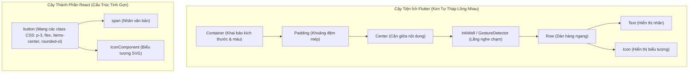
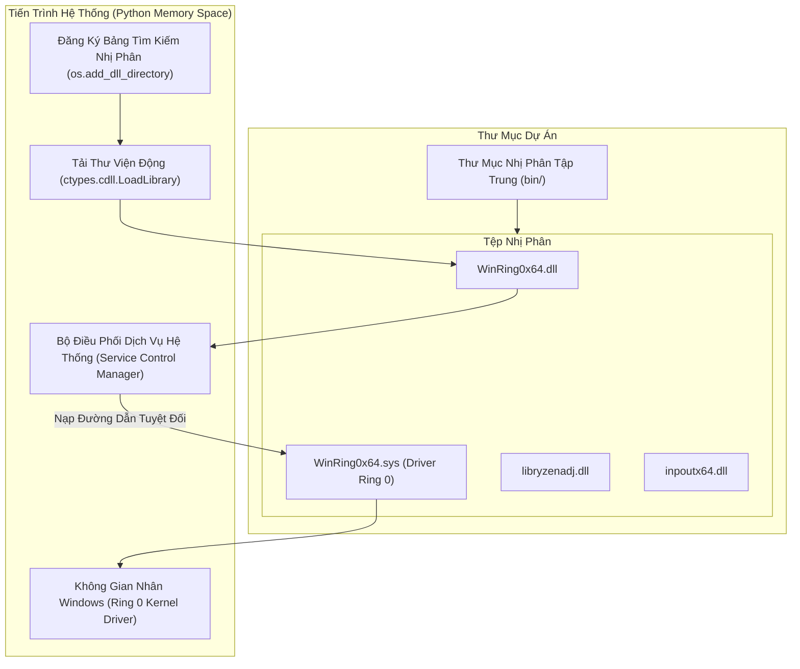
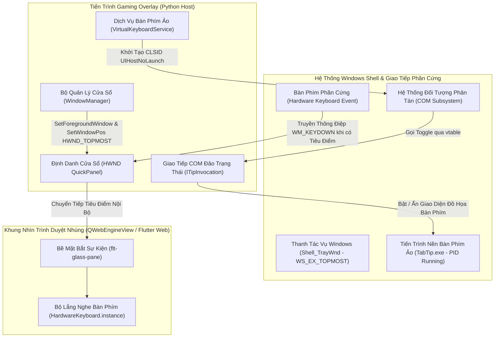
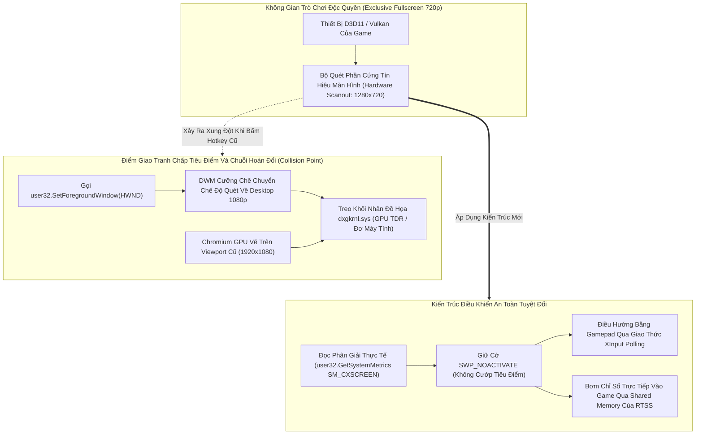
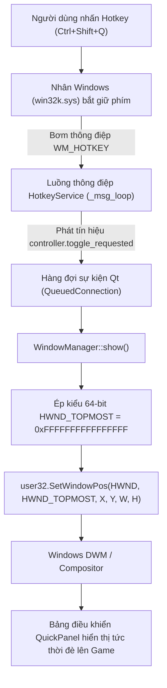

# Chuyển Đổi Tư Duy Kiến Trúc Từ Flutter Sang ReactJS Và Quy Trình Gỡ Lỗi Bề Mặt Giao Diện (Flutter to React Architecture & Debugging Engine)

Tài liệu này đúc kết toàn bộ cơ sở khoa học, bản chất vận hành ở tầng bộ nhớ và lộ trình chuyển đổi tư duy kiến trúc từ khung kết xuất đồ họa Flutter sang thư viện xây dựng giao diện khai báo ReactJS, cùng quy trình gỡ lỗi bề mặt thông qua động cơ trình duyệt nhúng.

---

## 1. Nguyên Lý Vật Lý Của Hai Động Cơ Kết Xuất Giao Diện (Rendering Engine Physics)

Một hệ thống hiển thị đồ họa ứng dụng trên hệ điều hành chịu sự chi phối của hai mô hình vật lý kết xuất điểm ảnh hoàn toàn khác biệt:

1. **Mô hình động cơ đồ họa tự quản (Self-Contained Graphics Pipeline - Mô hình của Flutter)**:
   - Bản chất: Ứng dụng mang theo một cỗ máy vẽ hoàn chỉnh ([[Động Cơ Đồ Họa Độc Lập (Self-Contained Graphics Engine)]] - Skia hoặc Impeller).
   - Cơ chế: Dart chuyển đổi toàn bộ mã khai báo thành một cây cấu trúc đối tượng hình học (Render Object Tree), sau đó tự động tính toán tọa độ từng điểm ảnh và gửi trực tiếp các tập lệnh vẽ tới card đồ họa qua API tầng thấp (Direct3D 11 / Vulkan).
   - Đặc điểm: Không tồn tại khái niệm trang web hay mã HTML; toàn bộ khung hiển thị là một chuỗi hoán đổi bề mặt đồ họa (Swapchain) duy nhất trong không gian bộ nhớ video (VRAM).

2. **Mô hình cây tài liệu ảo và động cơ ghép nối trình duyệt (Virtual DOM & Browser Compositor - Mô hình của React)**:
   - Bản chất: React không tự tính toán điểm ảnh để vẽ trực tiếp lên GPU. React vận hành như một bộ máy tính toán sự sai lệch cấu trúc dữ liệu trong bộ nhớ RAM ([[Cây Mô Hình Tài Liệu Ảo (Virtual DOM)]]).
   - Cơ chế: Khi trạng thái dữ liệu thay đổi, React chạy thuật toán so khớp phân nhánh (Reconciliation Algorithm) trên cây đối tượng JavaScript để tìm ra số lượng nút thay đổi tối thiểu, sau đó ủy thác việc tạo hình điểm ảnh cho Bộ quản lý Bố cục và Ghép nối Bề mặt của trình duyệt ([[Động Cơ Bố Cục Trình Duyệt (Browser Layout Engine)]] - Blink / Chromium).
   - Đặc điểm: Tách rời tuyệt đối giữa logic giao diện và phần cứng hiển thị, tận dụng khả năng tăng tốc phần cứng của trình duyệt nhúng (Edge WebView2) thông qua giao diện lập trình nội bộ.

---

## 2. Xuất Phát Từ Bế Tắc Thực Tế (The "Why")

- **Trước đây làm bằng cách nào?**:
  - Dùng Flutter Desktop để lập trình giao diện công cụ hệ thống, cố gắng tùy biến mã nguồn C++ Runner để nhúng thanh điều khiển nổi lên trên màn hình.
- **Bị nghẽn kỹ thuật gì?**:
  1. **Khép kín và khó gỡ lỗi (Debugging Opacity)**: Động cơ đồ họa Flutter là một hộp đen nhị phân khép kín. Khi giao diện bị lỗi kẹt va chạm chuột, lỗi mất tiêu điểm hoặc lệch kích thước, lập trình viên không thể bấm chọn trực tiếp vào phần tử trên màn hình để xem thông số CSS hay sửa đổi trực tiếp (Live Editing). Việc theo dõi trạng thái phải phụ thuộc vào công cụ gỡ lỗi chuyên biệt đòi hỏi kết nối luồng máy ảo Dart (Dart VM Service), vốn thường xuyên bị nghẽn khi ứng dụng chạy đè lên game.
  2. **Tranh chấp tiêu điểm cửa sổ (Window Focus Contention)**: Động cơ Flutter Engine luôn cưỡng bức chiếm quyền kích hoạt cửa sổ hệ điều hành (`WM_ACTIVATE`), xung đột trực tiếp với cờ không chiếm tiêu điểm (`WS_EX_NOACTIVATE`) cần thiết cho một Gaming Overlay.
- **Công nghệ mới giải quyết triệt để ra sao?**:
  - Chuyển toàn bộ giao diện sang [[Thư Viện Giao Diện Khai Báo ReactJS (React Declarative UI Library)]] chạy trên khung nhìn Edge WebView2.
  - Sử dụng giao thức gỡ lỗi tiêu chuẩn công nghiệp ([[Giao Thức Gỡ Lỗi Chrome (Chrome DevTools Protocol - CDP)]]): Cho phép nhấn `F12` mở trực tiếp bộ công cụ DevTools để trỏ chuột kiểm tra phần tử (Inspect Element), sửa trực tiếp lớp kiểu dáng CSS trong tích tắc, và theo dõi thông điệp thực thi trong bảng Console.
  - Cơ chế cập nhật nóng ([[Thay Thế Mô-đun Nóng (Hot Module Replacement - HMR)]]): Sửa đổi tập tin React được phản chiếu lên màn hình trong 0.1 giây qua kết nối truyền tin cục bộ (WebSocket) mà không cần biên dịch lại mã nguồn hay tắt tiến trình hệ thống.

---

## 3. Bản Đồ Ánh Xạ Khái Niệm Giữa Flutter Và ReactJS (Mental Model Mapping)

| Khái niệm kiến trúc | Khung kết xuất Flutter | Thư viện giao diện ReactJS | Bản chất vật lý bên dưới bộ nhớ |
| :--- | :--- | :--- | :--- |
| **Đơn vị giao diện cơ sở** | `Widget` (`StatelessWidget`) | `Component` (Hàm nhận Props trả về JSX) | Hàm thuần túy biến đổi trạng thái thành cấu trúc cây đối tượng trừu tượng trong RAM. |
| **Thành phần có trạng thái** | `StatefulWidget` + `State` | `Component` kết hợp Hook `useState` | Vùng nhớ lưu trữ dữ liệu cá thể được duy trì qua các chu kỳ thực thi hàm (Fiber Node). |
| **Kích hoạt vẽ lại giao diện** | `setState(() { value = x; })` | `const [value, setValue] = useState(); setValue(x);` | Gửi tín hiệu thông báo cho bộ lên lịch (Scheduler) đặt cờ yêu cầu tính toán lại cây giao diện. |
| **Vòng đời khởi tạo** | `void initState()` | `useEffect(() => { ... }, [])` | Khối lệnh thực thi một lần duy nhất sau khi nút DOM đầu tiên được chèn vào cây tài liệu. |
| **Vòng đời hủy bỏ** | `void dispose()` | `useEffect(() => { return () => { ... }; }, [])` | Hàm dọn dẹp giải phóng con trỏ lắng nghe sự kiện khi nút bị gỡ khỏi bộ nhớ. |
| **Vòng đời cập nhật** | `void didUpdateWidget()` | `useEffect(() => { ... }, [dependency])` | Khối lệnh chỉ chạy lại khi giá trị của biến phụ thuộc trong bộ nhớ bị biến đổi. |
| **Bố cục hàng dọc** | `Column(children: [...])` | `<div className="flex flex-col">...</div>` | Thiết lập thuộc tính dàn trang CSS Flexbox theo trục dọc trong mô hình hộp (Box Model). |
| **Bố cục hàng ngang** | `Row(children: [...])` | `<div className="flex flex-row">...</div>` | Thiết lập thuộc tính dàn trang CSS Flexbox theo trục ngang trong mô hình hộp. |
| **Danh sách phần tử động** | `ListView.builder(...)` | `items.map((item) => <Item key={item.id} />)` | Duyệt mảng dữ liệu và ánh xạ thành danh sách nút VDOM kèm mã định danh khóa (`key`) để so khớp diffing. |
| **Khoảng cách / Lề** | `Padding(...)` / `SizedBox(height: x)` | Tailwind classes: `p-4`, `m-2`, `gap-3`, `h-4` | Khai báo các thuộc tính vùng đệm (Padding) và vùng lề (Margin) trực tiếp trong CSS. |
| **Truyền dữ liệu từ cha xuống** | Constructor arguments | `props` (Tham số đầu vào của hàm Component) | Truyền con trỏ đối tượng từ ngữ cảnh hàm cha xuống không gian thực thi của hàm con. |
| **Phát sự kiện lên cha** | `ValueChanged<T> onAction` | Callback function: `onAction: (val: T) => void` | Thực thi hàm bao đóng (Closure) của cha được truyền xuống con để biến đổi trạng thái cha. |

### Các Đoạn Mã Đối Chiếu Trực Quan Giữa Hai Nền Tảng (Concrete Code Comparison)

#### 1. Khởi tạo khối hiển thị cơ sở và truyền dữ liệu (StatelessWidget vs React Component)
- **Bản chất vật lý**: Trong Flutter, một đối tượng `StatelessWidget` là một cấu trúc dữ liệu bất biến (Immutable Object) chứa hàm `build`. Trong React, Component đơn thuần là **một hàm JavaScript** nhận một đối tượng chứa các thuộc tính (`props`) và trả về cấu trúc cây đối tượng trừu tượng Virtual DOM trong bộ nhớ heap.

- Mã nguồn Flutter:
```dart
class MetricCard extends StatelessWidget {
  final String label;
  final String value;
  const MetricCard({super.key, required this.label, required this.value});

  @override
  Widget build(BuildContext context) {
    return Container(
      padding: const EdgeInsets.all(12),
      decoration: BoxDecoration(
        color: const Color(0xFF18181B),
        borderRadius: BorderRadius.circular(8),
      ),
      child: Column(
        crossAxisAlignment: CrossAxisAlignment.start,
        children: [
          Text(label, style: const TextStyle(color: Colors.grey, fontSize: 12)),
          const SizedBox(height: 4),
          Text(value, style: const TextStyle(color: Colors.white, fontSize: 16, fontWeight: FontWeight.bold)),
        ],
      ),
    );
  }
}
```

- Mã nguồn ReactJS (TypeScript + Tailwind CSS):
```tsx
interface MetricCardProps {
  label: string;
  value: string;
}

export function MetricCard({ label, value }: MetricCardProps) {
  return (
    <div className="p-3 bg-zinc-900 rounded-lg flex flex-col gap-1 border border-white/5">
      <span className="text-xs text-zinc-400">{label}</span>
      <span className="text-base font-bold text-white font-mono">{value}</span>
    </div>
  );
}
```

#### 2. Quản lý trạng thái nội tại và kích hoạt vẽ lại (StatefulWidget vs `useState`)
- **Bản chất vật lý**: Flutter tách rời widget bất biến và đối tượng `State` có vòng đời dài hơn. React giữ component là hàm thuần túy, nhưng móc nối (Hook) vào mảng con trỏ lưu trữ trạng thái nằm ngoài hàm trong cấu trúc [[Nút Cấu Trúc Sợi (Fiber Node)]].

- Mã nguồn Flutter:
```dart
class TdpCounter extends StatefulWidget {
  const TdpCounter({super.key});
  @override
  State<TdpCounter> createState() => _TdpCounterState();
}

class _TdpCounterState extends State<TdpCounter> {
  int tdp = 15;

  void _increase() {
    setState(() {
      tdp += 1;
    });
  }

  @override
  Widget build(BuildContext context) {
    return Row(
      children: [
        Text('$tdp W'),
        IconButton(icon: const Icon(Icons.add), onPressed: _increase),
      ],
    );
  }
}
```

- Mã nguồn ReactJS:
```tsx
import { useState } from 'react';
import { Plus } from 'lucide-react';

export function TdpCounter() {
  const [tdp, setTdp] = useState<number>(15);

  const increase = () => {
    setTdp(prev => prev + 1);
  };

  return (
    <div className="flex items-center gap-3">
      <span className="text-sm font-mono text-white">{tdp} W</span>
      <button 
        onClick={increase}
        className="p-1.5 bg-zinc-800 rounded hover:bg-zinc-700 text-white"
      >
        <Plus size={16} />
      </button>
    </div>
  );
}
```

#### 3. Vòng đời khởi tạo, hủy bỏ và lắng nghe luồng sự kiện (`initState` / `dispose` vs `useEffect`)
- **Bản chất vật lý**: Flutter yêu cầu ghi đè (Override) hai phương thức vòng đời ở hai thời điểm tách biệt. React gom cơ chế đăng ký và hủy bỏ thành một cặp hàm trong [[Hook Tác Vụ Ngoại Vi (useEffect)]], hàm trả về (Return Callback) sẽ đóng vai trò giải phóng con trỏ khi nút bị gỡ khỏi bộ nhớ.

- Mã nguồn Flutter:
```dart
class TelemetryListener extends StatefulWidget {
  const TelemetryListener({super.key});
  @override
  State<TelemetryListener> createState() => _TelemetryListenerState();
}

class _TelemetryListenerState extends State<TelemetryListener> {
  StreamSubscription? _sub;
  int temp = 0;

  @override
  void initState() {
    super.initState();
    _sub = hardwareStream.listen((data) {
      setState(() => temp = data.cpuTemp);
    });
  }

  @override
  void dispose() {
    _sub?.cancel();
    super.dispose();
  }

  @override
  Widget build(BuildContext context) {
    return Text('Nhiệt độ CPU: $temp°C');
  }
}
```

- Mã nguồn ReactJS:
```tsx
import { useState, useEffect } from 'react';

export function TelemetryListener() {
  const [temp, setTemp] = useState<number>(0);

  useEffect(() => {
    // Đăng ký con trỏ lắng nghe khi Component được chèn vào DOM (Tương đương initState)
    const handleUpdate = (data: { cpuTemp: number }) => {
      setTemp(data.cpuTemp);
    };
    window.backend?.telemetryUpdated.connect(handleUpdate);

    // Trả về hàm dọn dẹp khi Component bị gỡ khỏi cây DOM (Tương đương dispose)
    return () => {
      window.backend?.telemetryUpdated.disconnect(handleUpdate);
    };
  }, []); // Danh sách phụ thuộc rỗng [] đảm bảo việc đăng ký chỉ thực hiện một lần

  return <span className="text-sm text-zinc-200">Nhiệt độ CPU: {temp}°C</span>;
}
```

#### 4. Thẻ bọc con linh hoạt và danh sách lặp mảng (Slot Pattern & Array Mapping)
- **Bản chất vật lý**: Flutter cần truyền đối tượng con qua tham số `child` / `children` và duyệt danh sách bằng bộ dựng chỉ số `ListView.builder`. React sử dụng con trỏ đối tượng ngầm định `props.children` và phép biến đổi mảng thuần túy `map()`.

- Mã nguồn Flutter:
```dart
// Khung bọc con
class SectionWrapper extends StatelessWidget {
  final String title;
  final Widget child;
  const SectionWrapper({super.key, required this.title, required this.child});

  @override
  Widget build(BuildContext context) {
    return Container(
      padding: const EdgeInsets.all(12),
      decoration: BoxDecoration(color: Colors.black26, borderRadius: BorderRadius.circular(8)),
      child: Column(
        crossAxisAlignment: CrossAxisAlignment.start,
        children: [
          Text(title, style: const TextStyle(fontWeight: FontWeight.bold)),
          const SizedBox(height: 8),
          child,
        ],
      ),
    );
  }
}

// Danh sách lặp
ListView.builder(
  itemCount: items.length,
  itemBuilder: (context, index) => ListTile(
    title: Text(items[index].name),
    onTap: () => onSelect(items[index].id),
  ),
)
```

- Mã nguồn ReactJS:
```tsx
import React from 'react';

// Khung bọc con thông qua thuộc tính ngầm định children
export function SectionWrapper({ title, children }: { title: string; children: React.ReactNode }) {
  return (
    <div className="p-3 bg-black/30 rounded-lg border border-white/5 flex flex-col gap-2">
      <span className="font-semibold text-sm text-white">{title}</span>
      {children}
    </div>
  );
}

// Danh sách lặp bằng hàm biến đổi mảng gốc map()
export function ItemList({ items, onSelect }: { items: Array<{ id: string; name: string }>; onSelect: (id: string) => void }) {
  return (
    <div className="flex flex-col gap-1">
      {items.map((item) => (
        <button
          key={item.id} // Bắt buộc: Cung cấp mã định danh duy nhất cho thuật toán Reconciliation
          onClick={() => onSelect(item.id)}
          className="px-3 py-2 text-left rounded hover:bg-zinc-800 text-sm text-zinc-300"
        >
          {item.name}
        </button>
      ))}
    </div>
  );
}
```

### Cấu Trúc Cây Thành Phần (Component Tree Hierarchy) So Với Cây Tiện Ích (Widget Tree)

#### 1. Sự khác biệt cốt lõi về bản chất kết xuất
- **Trong Flutter (Kim tự tháp lồng ghép lớp - Nesting Pyramid)**:
  - Mọi thuộc tính hình học (lề đệm `Padding`, căn chỉnh `Center`, giới hạn kích thước `SizedBox`, bắt cử chỉ `GestureDetector`, hiển thị có điều kiện `Visibility`) đều là các đối tượng `Widget` độc lập.
  - Mỗi khi thêm một thuộc tính, lập trình viên buộc phải lồng thêm một lớp thẻ con (`child`), khiến cây tiện ích phình to theo chiều sâu (Widget Tree Bloat).
- **Trong React (Cây thành phần phẳng kết hợp thuộc tính - Flat Semantic Tree)**:
  - Các thuộc tính hiển thị, kích thước, hiệu ứng và sự kiện được gộp chung trực tiếp vào thuộc tính của nút (Props và CSS Classes).
  - Một thẻ `<button className="p-3 bg-violet-600 rounded-xl" onClick={handleClick}>` trong React đảm nhiệm cùng lúc chức năng của 5 Widget Flutter: `Container` + `Padding` + `DecoratedBox` + `InkWell` + `GestureDetector`.



#### 2. Các mô hình dựng cây kinh điển (Classic Tree Composition Patterns)

##### Mô hình bọc thành phần con (Slot / Children Pattern)
- *Flutter*: Nhận tham số `final Widget child;` hoặc `final List<Widget> children;` và đặt vào vị trí tương ứng trong hàm `build`.
- *React*: Tự động nhận thuộc tính ngầm định `children` trong `props`. Khi một component bọc các phần tử con giữa cặp thẻ mở/đóng `<Card><ItemA /><ItemB /></Card>`, toàn bộ các phần tử đó được truyền vào component dưới dạng `props.children` để kết xuất linh hoạt.

##### Mô hình kết xuất có điều kiện (Conditional Rendering Tree)
- *Flutter*: Dùng câu lệnh điều kiện `if (condition) WidgetA() else WidgetB()` trong mảng con, hoặc dùng widget `Visibility(visible: condition, child: ...)`.
- *React*: Sử dụng trực tiếp biểu thức logic của JavaScript ngay trong JSX:
  - Điều kiện hiển thị đơn: `{isVisible && <QuickSettings />}` (nếu đúng thì chèn vào cây VDOM, nếu sai React bỏ qua không sinh nút).
  - Điều kiện rẽ nhánh hai phương án: `{isCharging ? <BatteryChargingIcon /> : <BatteryIcon />}`.

##### Mô hình sinh cây từ mảng dữ liệu (Dynamic Collection Mapping)
- *Flutter*: Sử dụng hàm khởi tạo `ListView.builder(itemCount: items.length, itemBuilder: (ctx, i) => ...)` để cấp phát widget theo chỉ số.
- *React*: Sử dụng hàm biến đổi mảng gốc `items.map((item) => <ItemTile key={item.id} data={item} />)`. Thuộc tính `key` là bắt buộc để thuật toán so khớp [[Reconciliation]] nhận diện chính xác phần tử nào bị thêm, sửa, xóa mà không phải kết xuất lại toàn bộ danh sách.

#### 3. Phân Tích Thực Tiễn Chuyển Đổi Các Cụm Giao Diện Kinh Điển (Real-World Tree Conversion Scenarios)

Nhằm làm sáng tỏ sự khác biệt trong việc cấp phát bộ nhớ và tổ chức phân cấp, bảng sau phân rã 4 kịch bản dựng giao diện phổ biến từ cây tiện ích Flutter sang cây thành phần React:

| Kịch bản dựng hình | Cây tiện ích Flutter (Mô hình lồng ghép sâu) | Cây thành phần React (Mô hình phần tử phẳng) | Bản chất chuyển dịch cấu trúc |
| :--- | :--- | :--- | :--- |
| **1. Khối chứa thông số có tiêu đề và giá trị** | `Container` $\rightarrow$ `Padding` $\rightarrow$ `Column` $\rightarrow$ [`Text` (tiêu đề), `SizedBox`, `Text` (giá trị)] | `<div className="p-3 bg-zinc-900 rounded-lg flex flex-col gap-1">` $\rightarrow$ [`<span>` (tiêu đề), `<span>` (giá trị)] | Loại bỏ 2 tầng lồng rỗng (`Padding`, `SizedBox`). Bố cục khoảng cách trục dọc được giải quyết bằng thuộc tính CSS `gap-1` trong cùng một nút khối (Block Node). |
| **2. Nút bấm tương tác có icon và hiệu ứng chạm** | `Material` $\rightarrow$ `InkWell` $\rightarrow$ `Padding` $\rightarrow$ `Row` $\rightarrow$ [`Icon`, `SizedBox`, `Text`] | `<button className="flex items-center gap-2 px-4 py-2 hover:bg-zinc-800" onClick={handler}>` $\rightarrow$ [`<Icon />`, `<span>Nhãn</span>`] | Gom toàn bộ chức năng nhận diện cử chỉ, bề mặt hiệu ứng và đệm lề vào duy nhất thẻ ngữ nghĩa HTML `<button>`. Giảm độ sâu của cây từ 5 cấp xuống còn 2 cấp. |
| **3. Thanh trượt điều khiển chỉ số kèm nhãn động** | `Column` $\rightarrow$ [`Row` (`Text`, `Spacer`, `Text`), `Slider`] | `<div className="space-y-2">` $\rightarrow$ [`<div className="flex justify-between">` (`<span>`, `<span>`), `<input type="range" />`] | Thay thế đối tượng `Spacer` trừu tượng bằng cơ chế dồn biên Flexbox `justify-between` của trình duyệt. Thanh trượt là phần tử nhập liệu bản địa `<input type="range">`. |
| **4. Danh sách chọn đa mục có trạng thái tích cực** | `ListView.separated` $\rightarrow$ Duyệt mảng $\rightarrow$ `ListTile` hoặc `InkWell` lồng `Container` | `items.map(item => <button key={item.id} className={item.id === activeId ? "bg-violet-600" : "bg-zinc-800"}>)` | Không cần cấu trúc cấp phát phân tách (Separator Builder). Biến đổi mảng trực tiếp bằng hàm ánh xạ `map()`, sử dụng toán tử ba ngôi để tính toán chuỗi lớp CSS trực tiếp trong bộ nhớ. |

---

## 4. Vòng Đời Và Cơ Chế Phản Ứng Dữ Liệu Trong React (Lifecycle & Reactive Flow)

### 1. Hook Quản lý Trạng thái (`useState`)
- **Bản chất**: Trong Flutter, một `StatefulWidget` tạo ra một đối tượng `State` riêng biệt sống độc lập. Trong React, Component thực chất chỉ là **một hàm JavaScript thông thường** được gọi lại mỗi khi có dữ liệu mới.
- **Cơ chế lưu trữ**: Để dữ liệu không bị biến mất sau khi hàm chạy xong, React lưu giá trị của `useState` vào một danh sách liên kết nằm ngoài Component (gọi là [[Nút Cấu Trúc Sợi (Fiber Node)]] trong bộ nhớ heap).
- **Cú pháp đối chiếu**:
  - Flutter: Khai báo biến `int count = 0;` và gọi `setState(() => count = 1);`.
  - React: Khai báo `const [count, setCount] = useState(0);` và gọi `setCount(1);`.

### 2. Hook Tác vụ Ngoại vi và Vòng đời (`useEffect`)
- **Bản chất**: Gom toàn bộ các phương thức vòng đời rời rạc của Flutter (`initState`, `didUpdateWidget`, `dispose`) vào một cơ chế đồng bộ duy nhất dựa trên danh sách phụ thuộc (Dependency Array).
- **Cơ chế 3 trạng thái**:
  1. *Chạy duy nhất một lần khi khởi tạo (`initState`)*: Đặt mảng phụ thuộc rỗng `[]`.
  2. *Chạy khi một biến dữ liệu thay đổi (`didUpdateWidget`)*: Liệt kê biến vào mảng `[tdp, volume]`. Mỗi khi biến này đổi địa chỉ bộ nhớ, hàm sẽ được kích hoạt lại.
  3. *Dọn dẹp bộ nhớ khi hủy bỏ (`dispose`)*: Trả về một hàm dọn dẹp bên trong `useEffect`.

```mermaid
flowchart TD
    subgraph Mount_Phase["Giai Đoạn Khởi Tạo (Mounting)"]
        Component_Call["Thực thi hàm Component (Render JSX)"]
        Insert_DOM["Chèn phần tử vào cây DOM thật"]
        Run_Effect["Thực thi hàm trong useEffect([], [])"]
        Component_Call --> Insert_DOM --> Run_Effect
    end

    subgraph Update_Phase["Giai Đoạn Cập Nhật (Updating)"]
        Trigger_Set["Gọi hàm setValue(...)"]
        Diff_VDOM["So khớp Virtual DOM tìm điểm khác biệt"]
        Patch_DOM["Chắp vá đúng nút DOM thật bị thay đổi"]
        Cleanup_Prev["Chạy hàm dọn dẹp cũ (nếu có)"]
        Run_New_Effect["Chạy lại hàm trong useEffect([dep])"]
        Trigger_Set --> Diff_VDOM --> Patch_DOM --> Cleanup_Prev --> Run_New_Effect
    end

    subgraph Unmount_Phase["Giai Đoạn Hủy Bỏ (Unmounting)"]
        Remove_DOM["Gỡ bỏ phần tử khỏi màn hình"]
        Run_Cleanup["Thực thi hàm Cleanup trả về từ useEffect"]
        Remove_DOM --> Run_Cleanup
    end
```



---

## 5. Quy Trình Gỡ Lỗi Bề Mặt Và Cập Nhật Nóng (Debugging & Hot Reload Workflow)

Hệ thống cung cấp ba phương thức gỡ lỗi linh hoạt cho từng công đoạn phát triển:

### 1. Gỡ Lỗi Trực Quan Bằng Flutter DevTools (Widget Inspector)
- **Phương thức khởi chạy**: Chọn menu `[3]` trong [scripts/run.bat](file:///d:/dev-projects/windows-handheld-tool/scripts/run.bat).
- **Soi cây tiện ích (Widget Tree Inspector)**: Nhấp vào liên kết Dart VM Service URL được in trong cửa sổ dòng lệnh để mở bộ công cụ **Flutter DevTools** trên trình duyệt. Bạn có thể bấm chọn từng Widget trên màn hình để kiểm tra thông số kích thước, khoảng đệm (`padding`), giới hạn co dãn (`constraints`) và cây phân cấp giao diện thực tế.
- **Dữ liệu giả lập tự động (Mock Telemetry)**: Khi chạy độc lập trên Chrome không có tiến trình Python chạy kèm, `BridgeService` tự động kích hoạt bộ đếm giả lập đẩy thông số pin, nhiệt độ và CPU mỗi giây, giúp lập trình viên thiết kế giao diện độc lập với tốc độ cao nhất.

### 2. Cập Nhật Nóng Trên Gaming Overlay Thật (Hot Reload Workflow)
- **Quy trình vận hành song song**:
  - Chọn menu `[2]` trong [scripts/run.bat](file:///d:/dev-projects/windows-handheld-tool/scripts/run.bat). Kịch bản tự động mở máy chủ phát triển cục bộ tại cổng 5173 và khởi chạy Overlay kết nối trực tiếp.
- **Phản chiếu tức thời**: Khi bạn sửa đổi bất kỳ tệp mã nguồn Dart nào trong thư mục `lib/`, chỉ cần nhấn phím `r` (Hot Reload) hoặc `R` (Hot Restart) trong cửa sổ terminal của máy chủ Flutter Web. Bảng điều khiển Gaming Overlay sẽ được vẽ lại trong vòng 0.5 giây mà không làm gián đoạn trò chơi hay tắt tiến trình hệ thống.

### 3. Kiểm Tra Giao Thức Mạng Bằng Chromium DevTools (F12)
- **Phím tắt F12**: Khi bảng điều khiển nổi đang hiển thị, nhấn phím `F12` trên bàn phím để bật cửa sổ **Chromium DevTools**.
- **Theo dõi gói tin WebSocket**: Chuyển sang tab **Network** $\rightarrow$ chọn bộ lọc **WS** (WebSockets) $\rightarrow$ nhấp vào đường truyền `ws://127.0.0.1:8765` để xem toàn bộ các thông điệp JSON gửi/nhận thời gian thực (`setTdp`, `setFan`, `telemetry`, `init`).
- **Theo dõi lỗi console**: Tab **Console** in ra các thông điệp kết nối, cảnh báo và lỗi kết xuất nếu có phát sinh trong quá trình chạy.

---

## 6. Kiến Trúc Lai Giữa Giao Diện Khai Báo Flutter Web Và Động Cơ Hệ Thống Python (Flutter Web & Python WebEngine Hybrid Architecture)

```mermaid
flowchart TD
    subgraph Frontend_App["Tầng Giao Diện Khai Báo (lib/ - 100% Dart & Flutter)"]
        Flutter_Main["Điểm Khởi Chạy (main.dart - Khởi tạo Bridge)"]
        Overlay_Screen["Màn Hình Nền (ui/overlay_screen.dart)"]
        Quick_Panel["Bảng Điều Khiển Chính (ui/quick_panel.dart)"]
        Tab_Home["Trang Chủ (tabs/home_tab.dart)"]
        Tab_Perf["Hiệu Năng (tabs/performance_tab.dart)"]
        Tab_Device["Thiết Bị (tabs/device_tab.dart)"]
        Tab_Settings["Cài Đặt (tabs/settings_tab.dart)"]
        Bridge_Client["Cầu Nối WebSocket Client (services/bridge_service.dart)"]

        Flutter_Main --> Overlay_Screen
        Overlay_Screen --> Quick_Panel
        Quick_Panel --> Tab_Home
        Quick_Panel --> Tab_Perf
        Quick_Panel --> Tab_Device
        Quick_Panel --> Tab_Settings
        Quick_Panel <--> Bridge_Client
    end

    subgraph Native_Process["Tầng Dịch Vụ Hệ Thống (src/ - Python PySide6)"]
        WebEngine_View["Khung Nhìn Trình Duyệt Nhúng (src/ui/quick_panel.py)"]
        Ws_Server["Máy Chủ Truyền Tin (src/ui/ws_server.py - QWebSocketServer)"]
        WebBridge_Server["Bộ Điều Phối Phần Cứng (src/ui/web_bridge.py)"]
        Window_Manager["Quản Lý Cửa Sổ Overlay (src/overlay/window_manager.py)"]
        Hardware_Services["Dịch Vụ Phần Cứng (TDP, Quạt, Âm Lượng, WMI, RTSS)"]

        WebEngine_View --> Window_Manager
        WebEngine_View --> Ws_Server
        Ws_Server <--> WebBridge_Server
        WebBridge_Server <--> Hardware_Services
    end

    Bridge_Client <===>|Kênh Truyền Tin WebSocket (ws://127.0.0.1:8765)| Ws_Server
```

### Nguyên tắc vận hành vật lý của kiến trúc:
1. **Bảo tồn toàn vẹn tư duy Widget Tree**: 100% tầng hiển thị được viết bằng ngôn ngữ Dart và hệ sinh thái Widget của Flutter. Không có bất kỳ dòng mã nào sử dụng JavaScript, TypeScript hay JSX.
2. **Loại bỏ hoàn toàn rào cản FFI trên Web**: Tầng Flutter Web không tương tác trực tiếp với các thư viện nhị phân Win32 (`.dll`) mà ủy thác toàn bộ cho tiến trình Python thông qua giao thức truyền tin WebSocket siêu nhẹ (`ws://127.0.0.1:8765`), loại bỏ mọi xung đột cấp phát bộ nhớ tầng thấp.
3. **Phân tách trách nhiệm cửa sổ (Window Management Decoupling)**: Tầng cửa sổ Win32, phân lớp công cụ `ZBID_SYSTEM_TOOLS`, cờ không cướp tiêu điểm `WS_EX_NOACTIVATE`, phím nóng toàn cục (`Ctrl+Shift+Q`) và tay cầm Gamepad (`BACK+RB`) do Python quản lý 100%, bảo đảm không xung đột với bất kỳ trò chơi DirectX/Vulkan nào.
4. **Hỗ trợ gỡ lỗi kép (Dual Debugging Channels)**:
   - Khi chọn menu `[3]` trong [scripts/run.bat](file:///d:/dev-projects/windows-handheld-tool/scripts/run.bat): Lập trình viên sử dụng bộ công cụ **Flutter DevTools (Widget Inspector)** để soi từng Widget và căn chỉnh giao diện độc lập với mock data.
   - Khi chọn menu `[2]` trong [scripts/run.bat](file:///d:/dev-projects/windows-handheld-tool/scripts/run.bat): Hỗ trợ **Hot Reload (phím r)** trực tiếp ngay bên trong Gaming Overlay khi đang chạy game thật.

### 6.1. Triệt Tiêu Lỗi Màn Hình Trắng: Cơ Chế Máy Chủ Tĩnh Nhúng (Embedded Static HTTP Server)
- **Trước đây làm bằng cách nào?**: `QWebEngineView` nạp tệp giao diện qua đường dẫn hệ thống tệp `file:///build/web/index.html` thông qua `QUrl.fromLocalFile`.
- **Bị nghẽn / thảm họa kỹ thuật gì?**:
  - Flutter Web không phải HTML tĩnh đơn thuần mà khởi động bằng WebAssembly và JavaScript bất đồng bộ. Khi chạy từ giao thức `file://`, nhân Chromium tự động gán nhãn nguồn gốc xuất xứ (`origin`) là `null`.
  - Mọi lời gọi nạp tệp nhị phân (`flutter_bootstrap.js`, `main.dart.js`, `canvaskit.wasm`, phông chữ) bị cơ chế kiểm soát tài nguyên nguồn gốc chéo (CORS) của Chromium ngắt chặn ngay lập tức.
  - Đồng thời thẻ `<base href="/">` trỏ về gốc ổ đĩa `file:///` thay vì thư mục con `build/web/`. Động cơ kết xuất của Flutter không nạp được vào RAM, dẫn đến việc khung nhìn chỉ hiển thị nền trắng rỗng mặc định.
- **Công nghệ giải quyết triệt để**:
  - Nhúng mô-đun máy chủ HTTP tĩnh siêu nhẹ [src/ui/static_server.py](file:///d:/dev-projects/windows-handheld-tool/src/ui/static_server.py) (`ThreadingHTTPServer`) chạy trên một luồng nền nội bộ của tiến trình Python, chỉ lắng nghe trên giao diện mạng lặp `127.0.0.1:8766`.
  - `QWebEngineView` nạp giao diện qua URL `http://127.0.0.1:8766`. Giao thức HTTP chuẩn xóa bỏ hoàn toàn rào cản CORS, cho phép nạp 100% tài nguyên Wasm, Canvas và Dart vào bộ nhớ trong tích tắc, đồng thời đặt màu nền mặc định `0b0d14` cho trang để chống nháy sáng.

### 6.2. Cơ Chế Định Vị Tài Nguyên Bản Đóng Gói Và Triệt Tiêu Lỗi Từ Chối Kết Nối (PyInstaller Bundle Asset Resolution & Connection Refused Elimination)

```mermaid
flowchart TD
    subgraph Packaging_Phase["Công Đoạn Đóng Gói (PyInstaller 6+ --onedir)"]
        Flutter_Build["Biên Dịch Flutter Web (build/web/)"]
        PyInstaller_Tool["Công Cụ Đóng Gói PyInstaller"]
        Internal_Dir["Thư Mục Tài Nguyên Nội Bộ (_internal/build/web/)"]
        Root_Exe["Tệp Thực Thi Gốc (windows_handheld_tool.exe)"]

        Flutter_Build --> PyInstaller_Tool
        PyInstaller_Tool --> Internal_Dir
        PyInstaller_Tool --> Root_Exe
    end

    subgraph Runtime_Resolution["Không Gian Khởi Chạy (Frozen Runtime)"]
        Sys_Frozen["Kiểm Tra Thuộc Tính Thực Thi (sys.frozen)"]
        Candidate_MEIPASS["Đường Dẫn Tài Nguyên Nội Bộ (sys._MEIPASS/build/web)"]
        Candidate_ExeDir["Đường Dẫn Cạnh Tệp Thực Thi (exe_dir/build/web)"]
        Static_HTTP["Khởi Chạy Máy Chủ Tĩnh (StaticServer :8766)"]
        Fallback_Dev["Rơi Vào Cổng Phát Triển (localhost:5173 - LỖI ERR_CONNECTION_REFUSED)"]

        Sys_Frozen --> Candidate_MEIPASS
        Sys_Frozen --> Candidate_ExeDir
        Candidate_MEIPASS -->|Tìm Thấy index.html| Static_HTTP
        Candidate_ExeDir -->|Tìm Thấy index.html| Static_HTTP
        Candidate_MEIPASS -.->|Không Tìm Thấy (Lỗi Cũ)| Fallback_Dev
    end
```

- **Trước đây làm bằng cách nào?**:
  - Trong phương thức nạp giao diện `_load_frontend()` của [src/ui/quick_panel.py](file:///d:/dev-projects/windows-handheld-tool/src/ui/quick_panel.py), khi ứng dụng ở trạng thái đóng gói (`sys.frozen == True`), mã nguồn xác định thư mục gốc bằng hàm `os.path.dirname(os.path.abspath(sys.executable))` (chính là `C:\Program Files\WindowsHandheldTools`), sau đó kiểm tra tệp `build/web/index.html` nằm trực tiếp dưới thư mục này.
- **Bị nghẽn / thảm họa kỹ thuật gì?**:
  - *Thay đổi cấu trúc đóng gói của PyInstaller 6+*: Trong chế độ phân tách thư mục (`--onedir`), PyInstaller gom toàn bộ tài nguyên bổ sung (`--add-data`) và thư viện nhị phân vào thư mục con `_internal\`, thay vì đặt ngang hàng với tệp thực thi `.exe`. Đường dẫn thực tế của giao diện web là `C:\Program Files\WindowsHandheldTools\_internal\build\web\index.html`.
  - *Xảy ra lỗi rẽ nhánh sai*: Lệnh kiểm tra `os.path.isfile(build_index)` trả về kết quả sai (`False`). Khung điều khiển không khởi động máy chủ tĩnh [src/ui/static_server.py](file:///d:/dev-projects/windows-handheld-tool/src/ui/static_server.py) tại cổng 8766, mà rẽ sang nhánh `else` dự phòng gọi nạp địa chỉ máy chủ phát triển `http://localhost:5173`.
  - *Bản chất vật lý tầng mạng (Socket TCP RST)*: Ở môi trường cài đặt thực tế (`Release`), không có tiến trình máy chủ phát triển nào lắng nghe trên cổng 5173. Giao diện mạng lặp (`127.0.0.1`) nhận gói tin bắt tay khởi tạo kết nối (TCP SYN) tới cổng 5173 và lập tức trả về gói tin từ chối kết nối (TCP RST). Động cơ trình duyệt Chromium WebEngine báo lỗi mạng `ERR_CONNECTION_REFUSED` (mã lỗi socket -102), dẫn đến việc màn hình hiển thị biểu tượng trang web bị lỗi kết nối.
- **Công nghệ giải quyết triệt để**:
  - *Định vị đa tầng qua biến môi trường PyInstaller (`sys._MEIPASS`)*: Khi tiến trình Python chạy ở trạng thái đóng gói (`sys.frozen == True`), PyInstaller luôn nạp đường dẫn thư mục tài nguyên nội bộ vào biến `sys._MEIPASS` (trỏ tới `_internal\`). Hệ thống quét danh sách các vị trí ứng viên theo thứ tự ưu tiên:
    1. Quét trong `os.path.join(sys._MEIPASS, "build", "web")`.
    2. Quét trong `os.path.join(os.path.dirname(sys.executable), "build", "web")`.
    3. Quét trong thư mục gốc dự án khi đang ở môi trường phát triển mã nguồn.
  - *Đồng bộ sao chép tệp trong kịch bản triển khai*: Bổ sung vào kịch bản [scripts/deploy/deploy_test.bat](file:///d:/dev-projects/windows-handheld-tool/scripts/deploy/deploy_test.bat) lệnh sao chép trực tiếp thư mục `build\web` sang thư mục phát hành `%DIST_DIR%\build\web`, bảo đảm cả hai cơ chế truy cập trực tiếp và thông qua `_internal` đều có tệp tĩnh, kích hoạt máy chủ HTTP `127.0.0.1:8766` hoạt động 100%.

---

## 7. Cơ Chế Nạp Thư Viện Nhị Phân Và Quản Lý Driver Nhân (Binary & Kernel Driver Loading Mechanism)



### Bản chất kỹ thuật từ gốc rễ (First Principles):
1. **Lịch sử và nguyên nhân trùng lặp trước đây**:
   - *Cách làm cũ*: Khi nạp driver Ring 0 (`WinRing0x64.sys`) và giao tiếp EC cổng I/O (`inpoutx64.dll`), các đoạn mã mẫu cũ sao chép thủ công các tệp `.sys` và `.dll` từ `bin/` ra thư mục gốc (`root`) hoặc thư mục chứa trình thông dịch Python (`sys.executable`) vì mặc định hàm nạp của Windows (`LoadLibraryExW`) ưu tiên tìm kiếm trong thư mục làm việc hiện thời (`Current Working Directory`).
   - *Thảm họa kỹ thuật*: Làm phân mảnh và ô nhiễm thư mục gốc của dự án, gây lỗi phiên bản không đồng nhất khi một bên được cập nhật còn một bên giữ phiên bản cũ, và vi phạm nguyên tắc gom cụm tài nguyên nhị phân.
2. **Cơ chế nạp tập trung giải quyết triệt để**:
   - *Đăng ký thư mục nhị phân vào không gian tiến trình*: Sử dụng hàm API của hệ điều hành Windows `SetDllDirectoryW` (được bọc qua `os.add_dll_directory(bin_dir)` trong Python 3.8+). Hệ điều hành sẽ ưu tiên tìm kiếm mọi liên kết phụ thuộc (`dependency link`) của DLL trực tiếp trong `bin/`.
   - *Giải quyết đường dẫn Ring 0 Driver*: Khi `libryzenadj.dll` gọi hàm khởi tạo `InitializeOls()`, thư viện `WinRing0x64.dll` đã nằm trong `bin/` sẽ xác định vị trí của chính nó qua `GetModuleFileNameW`, từ đó tìm thấy `WinRing0x64.sys` nằm ngay bên cạnh mà không cần bất kỳ bước sao chép trung gian nào ra ngoài thư mục gốc. Thư mục gốc dự án được giữ sạch sẽ 100%.
3. **An toàn con trỏ động và thu hẹp kiểu dữ liệu tĩnh (Dynamic DLL Pointer Safety & Type Narrowing Guard)**:
   - *Bản chất vật lý con trỏ bộ nhớ*: Biến `self.lib` trong [src/hardware/tdp_service.py](file:///d:/dev-projects/windows-handheld-tool/src/hardware/tdp_service.py) là con trỏ tham chiếu đối tượng thư viện `ctypes.CDLL`. Khi tệp DLL chưa được nạp hoặc nạp thất bại ở chế độ giả lập, `self.lib` giữ giá trị rỗng (`None`, con trỏ địa chỉ `0x0`).
   - *Cơ chế kiểm tra kiểu tĩnh (Static Type Checking)*: Khi hàm `get_telemetry()` chỉ kiểm tra `if not self.is_active or not self.ry_handle:`, bộ phân tích tĩnh nhận thấy `self.lib` vẫn có thể mang kiểu rỗng (`NoneType`), dẫn đến cảnh báo lỗi `Object of class NoneType has no attribute refresh_table`.
   - *Công nghệ giải quyết triệt để*:
     - Bổ sung điều kiện chắn kiểu (Type Guard): Thêm `or not self.lib` vào điều kiện kiểm tra ở đầu hàm. Trình phân tích tĩnh sẽ tự động thu hẹp kiểu dữ liệu (Type Narrowing) và xác nhận `self.lib` là một đối tượng `CDLL` hợp lệ 100%.
     - Kiểm tra bảng ký hiệu xuất khẩu DLL (Export Symbol Table): Sử dụng hàm kiểm tra thuộc tính `hasattr(self.lib, "refresh_table")` trước khi thực thi để bảo đảm không xảy ra ngoại lệ truy xuất hàm không tồn tại.

---

## 8. Quản Lý Tiêu Điểm Bàn Phím, Thứ Tự Hiển Thị Thanh Tác Vụ Và Giao Tiếp Bàn Phím Ảo (Keyboard Focus, Taskbar Z-Order & Virtual Keyboard COM Physics)



### 1. Bản chất vật lý của cơ chế chiếm tiêu điểm bàn phím (Keyboard Focus Physics)
- **Trước đây làm bằng cách nào?**: Cửa sổ `QuickPanel` được gán cờ kiểu mở rộng `WS_EX_NOACTIVATE` (`0x08000000`) với ý định ban đầu là ngăn cửa sổ cướp tiêu điểm của trò chơi khi hiển thị.
- **Bị nghẽn / thảm họa kỹ thuật gì?**:
  - Khi gán cờ `WS_EX_NOACTIVATE`, hệ điều hành Windows ban hành chỉ thị cứng: *Cấm tuyệt đối việc chuyển tiêu điểm bàn phím (`WM_SETFOCUS` / `WM_ACTIVATE`) vào cửa sổ này, kể cả khi người dùng nhấp chuột trực tiếp lên cửa sổ*.
  - Hậu quả: Trình duyệt nhúng `QWebEngineView` và bề mặt `flt-glass-pane` của Flutter Web không bao giờ có tiêu điểm. Mọi phím người dùng gõ trên bàn phím phần cứng đều bị gửi vào cửa sổ ứng dụng nền trước đó. Bộ lắng nghe sự kiện bàn phím của Flutter (`HardwareKeyboard.instance.addHandler`) hoàn toàn tê liệt, không thể ghi nhận phím để đổi phím tắt.
- **Công nghệ giải quyết triệt để**:
  - Loại bỏ hoàn toàn cờ `WS_EX_NOACTIVATE` khỏi thuộc tính cửa sổ.
  - Khi hiển thị (`show()`), tiến trình gọi trực tiếp hàm API Windows `user32.SetForegroundWindow(self.hwnd)` và `self.widget.activateWindow()` để nhận quyền điều khiển bàn phím.
  - Khi người dùng bấm chuột vào panel, sự kiện tiêu điểm kích hoạt tức thì, cho phép `HardwareKeyboard` bắt trọn vẹn mọi tổ hợp phím phần cứng.

### 2. Bản chất thứ tự hiển thị Z-Order và xung đột thanh tác vụ (Taskbar Z-Order Contention)
- **Hiện tượng đời thường trước đây**: Khi mở panel, nếu người dùng bấm chuột vào thanh tác vụ (Taskbar), Taskbar sẽ nhảy lên che mất một phần panel. Khi bấm chuột lại vào panel, panel vẫn nằm bên dưới và không thể trồi lên trên Taskbar.
- **Bản chất vật lý tầng Win32**:
  - Thanh tác vụ của Windows (`Shell_TrayWnd`) là một cửa sổ thuộc phân lớp luôn nổi (`WS_EX_TOPMOST`).
  - Trong cùng dải Z-Order luôn nổi, cửa sổ nào được kích hoạt (`Active Window`) sau cùng sẽ được bộ quản lý cửa sổ của Windows (Desktop Window Manager - DWM) đưa lên đỉnh cao nhất.
  - Do panel cũ bị gắn cờ `WS_EX_NOACTIVATE`, khi người dùng bấm chuột vào panel, Windows **từ chối kích hoạt**, khiến DWM tiếp tục giữ Taskbar ở vị trí đỉnh Z-Order và đè bẹp panel.
- **Công nghệ giải quyết triệt để**:
  - Khi loại bỏ `WS_EX_NOACTIVATE`, mỗi cú nhấp chuột lên panel sẽ kích hoạt cửa sổ, tự động đưa HWND của panel lên đỉnh Z-Order của dải Topmost, đè lên trên Taskbar.
  - Đồng thời, khi hiển thị hoặc nhận sự kiện bấm chuột, gọi hàm API `user32.SetWindowPos(self.hwnd, HWND_TOPMOST, 0, 0, 0, 0, SWP_NOMOVE | SWP_NOSIZE | SWP_SHOWWINDOW)` để khẳng định vị thế ưu tiên hiển thị cao nhất.

### 3. Bản chất vật lý của cơ chế kích hoạt bàn phím ảo Modern Touch Keyboard (TabTip COM Physics)
- **Trước đây làm bằng cách nào?**: Sử dụng hàm gọi thực thi `ShellExecuteW` hoặc lệnh dòng lệnh `start TabTip.exe` trỏ vào tệp `C:\Program Files\Common Files\microsoft shared\ink\TabTip.exe`.
- **Bị nghẽn / thảm họa kỹ thuật gì?**:
  - Kể từ Windows 10 (bản 20H2 trở đi) và toàn bộ các phiên bản Windows 11, tiến trình `TabTip.exe` là một dịch vụ Modern Shell được hệ thống khởi chạy sẵn ở chế độ nền (Background Daemon) ngay khi khởi động Windows.
  - Khi tiến trình đã tồn tại trong danh sách tiến trình của hệ điều hành, lệnh gọi `ShellExecuteW` chỉ kiểm tra tiến trình đã chạy rồi trả về mã thành công rỗng mà không hề gửi tín hiệu mở giao diện đồ họa (UI) của bàn phím lên màn hình.
- **Công nghệ giải quyết triệt để**:
  - Sử dụng giao tiếp trực tiếp với hệ thống đối tượng phân tán (Component Object Model - COM) của Windows Shell.
  - Khởi tạo đối tượng từ mã định danh lớp CLSID `{4ce576fa-83dc-4f88-951c-9d0782b4e376}` (`UIHostNoLaunch`) và mã định danh giao tiếp IID `{37c994e7-432b-4834-a2f7-dce1f13b834b}` (`ITipInvocation`).
  - Truy xuất bảng hàm ảo (vtable) tại chỉ mục số 3 để lấy con trỏ hàm `Toggle(HWND hwndDesktop)`.
### 4. Cơ Chế Duy Trì Hiển Thị Bàn Phím Ảo Và Triệt Tiêu Lỗi Tự Mở Lại (Physical Keyboard Timing & Auto-Invoke Elimination)
- **Hiện tượng đời thường trước đây**:
  1. *Lỗi mất bàn phím khi nhấc tay*: Khi ấn tổ hợp phím nóng mở bàn phím ảo (ví dụ `Ctrl+Alt+K`), bàn phím ảo vừa ló lên nhưng ngay khi người dùng nhấc ngón tay ra khỏi bàn phím thì bàn phím ảo lập tức biến mất.
  2. *Lỗi tự động mở lại sau khi đóng bằng nút*: Khi người dùng bấm nút đóng trên thanh Touch Keyboard, bàn phím ảo vừa hạ xuống thì ngay lập tức tự động bật ngược trở lại màn hình.
  3. *Lỗi bấm phím nóng lần 2 để đóng thì bàn phím đóng rồi lại tự mở lên*: Bàn phím đang mở, người dùng ấn lại `Ctrl+Alt+K` để đóng bàn phím thì bàn phím vừa tụt xuống lại lập tức trồi lên ngay.
- **Bản chất vật lý tầng Windows Shell & Quản lý tiêu điểm (Focus Physics)**:
  1. *Xung đột vòng đời sự kiện nhấn và nhả phím (KeyDown vs KeyUp Timing Collision)*: Khi người dùng bấm tổ hợp `Ctrl+Alt+K`, hệ điều hành bắn ra thông điệp `WM_HOTKEY` ngay tại thời điểm phím cuối cùng được nhấn xuống (`KeyDown`), trong khi ngón tay người dùng vẫn đang đè lên các phím vật lý. Hàm mở bàn phím ảo được kích hoạt ngay lúc đó. Khoảng vài chục mili-giây sau, khi người dùng **nhấc tay ra**, bàn phím vật lý gửi các tín hiệu ngắt phần cứng nhả phím (`WM_KEYUP` / `WM_SYSKEYUP`) lên hệ điều hành. Hệ thống Windows Shell Input nhận diện chuỗi sự kiện `WM_KEYUP` từ phần cứng và kết luận người dùng vừa tương tác với bàn phím cơ vật lý, dẫn đến việc tự động ẩn ngay lập tức bàn phím ảo cảm ứng.
  2. *Vòng lặp kích hoạt tự động do chuyển đổi tiêu điểm (Auto-Invoke Focus Loop)*: Khi các khóa Registry `EnableDesktopModeAutoInvoke` hoặc `TouchKeyboardAutoInvokeDesktopMode` được đặt bằng 1, Windows Desktop Window Manager kích hoạt cơ chế tự động mở bàn phím ảo mỗi khi phát hiện tiêu điểm thay đổi. Khi người dùng đóng bàn phím bằng nút đóng trên giao diện Touch Keyboard, tiêu điểm hệ thống lập tức rơi về cửa sổ ứng dụng nền. Trình quản lý của Windows nhận diện có cửa sổ nhận tiêu điểm trong khi bàn phím đang đóng, nó liền tự động kích hoạt tiến trình nạp lại Touch Keyboard, gây ra hiện tượng bàn phím vừa đóng lại tự động bật lên.
  3. *Xung đột trạng thái khi đóng bằng phím tắt (Toggle Timing Inversion)*: Khi bàn phím ảo đang mở, người dùng ấn phím phần cứng `Ctrl+Alt+K`. Bản thân Windows nhận thấy phím cơ vật lý được gõ nên đã tự động ẩn bàn phím ảo xuống ngay khoảnh khắc nhấn phím. Nếu hàm xử lý phím nóng tiếp tục đợi nhấc tay rồi mới gọi phương thức đảo trạng thái `ITipInvocation::Toggle`, lệnh này sẽ nhìn thấy bàn phím ảo đang đóng và **lại mở ngược bàn phím ảo lên**, tạo thành hiệu ứng đóng rồi lại tự mở.
- **Công nghệ giải quyết triệt để**:
  1. *Truy vấn trạng thái thực tế qua giao tiếp `IFrameworkInputPane`*: Sử dụng giao tiếp COM `IFrameworkInputPane` (CLSID `{d5120aa3-46ba-44c5-822d-ca8092c1fc72}`, IID `{5752238b-24f0-495a-82f1-2fd593056796}`) để đọc tọa độ hiển thị thực tế (`Location`) của Touch Keyboard trước khi thực thi lệnh:
     - **Luồng MỞ (Bàn phím đang đóng - Tọa độ rỗng)**: Người dùng muốn mở bàn phím. Hệ thống chạy cơ chế chờ nhấc ngón tay khỏi bàn phím vật lý (`_wait_for_keys_up`), đợi xả sạch thông điệp `WM_KEYUP`, sau đó gọi `ITipInvocation::Toggle` để mở bàn phím và duy trì cố định trên màn hình.
     - **Luồng ĐÓNG (Bàn phím đang mở - Chiều cao > 0)**: Người dùng muốn đóng bàn phím. Hệ thống gọi phương thức đóng tức thì (hoặc cho phép Windows tự thu bàn phím khi phát hiện phím cơ), sau đó chờ nhấc ngón tay ra nhưng **tuyệt đối không gọi lệnh Toggle mở lại**, bảo đảm bàn phím ảo đóng hoàn toàn và giữ nguyên trạng thái đóng.
  2. *Triệt tiêu hoàn toàn cơ chế Auto-Invoke trong Registry*: Tự động cấu hình giá trị `EnableDesktopModeAutoInvoke` = 0 (REG_DWORD) trong `HKCU\Software\Microsoft\TabletTip\1.7` và `TouchKeyboardAutoInvokeDesktopMode` = 0 (REG_DWORD) trong `HKCU\Software\Microsoft\Windows\CurrentVersion\Explorer\TouchKeyboard`. Việc gán giá trị 0 tường minh chỉ thị cho Windows Shell tuyệt đối không tự động nạp lại bàn phím ảo khi các cửa sổ nền chuyển đổi tiêu điểm.
  3. *Bộ lọc chống kích hoạt kép (Debounce Mechanism)*: Áp dụng khoảng chặn thời gian 0.5 giây được chốt lại tại thời điểm kết thúc chuỗi tác vụ của `toggle_keyboard`, triệt tiêu hoàn toàn hiện tượng nảy phím hoặc sự kiện kích hoạt lặp từ hàng đợi phần cứng.

---

## 9. Bản Chất Vật Lý Của Tranh Chấp Độ Phân Giải Game Độc Quyền Và Đồng Bộ Hóa Dịch Vụ Phần Cứng (Exclusive Fullscreen Mode Switch & Hardware Services Synchronization)



### 1. Bản chất vật lý của tranh chấp quét hiển thị khi Game Fullscreen chạy độ phân giải thấp (Display Mode Switch & GPU Deadlock Physics)
- **Hiện tượng đời thường trước đây**:
  - Khi chạy game ở chế độ Không viền (Borderless Windowed) hoặc độ phân giải 1920x1080 trùng với độ phân giải Windows Desktop, bảng điều khiển `QuickPanel` hiển thị mượt mà và ổn định 100%.
  - Nhưng khi game chạy ở chế độ Toàn màn hình độc quyền (Exclusive Fullscreen - FSE) với độ phân giải thấp hơn Windows (ví dụ 1280x720 để tăng FPS trên máy Handheld), vừa bấm phím nóng kích hoạt thì máy tính bị đơ cứng hoàn toàn, màn hình đen hoặc game bị văng (crash), bắt buộc phải nhấn giữ nút nguồn để khởi động lại.
- **Bản chất vật lý tầng phần cứng đồ họa và hệ điều hành (First Principles)**:
  1. *Chuyển đổi chế độ quét tín hiệu phần cứng (Display Mode Switch)*: Khi game kích hoạt chế độ FSE ở độ phân giải 720p, card đồ họa chỉ thị cho Bộ điều khiển quét tín hiệu hiển thị (Display Scanout Controller) thay đổi tần số và kích thước điểm ảnh phần cứng từ 1080p sang 720p. Toàn bộ [[Chuỗi Hoán Đổi Bề Mặt Đồ Họa (DXGI Swapchain)]] của màn hình bị game độc chiếm quyền xuất trực tiếp (Direct Flip Scanout), ngắt hoàn toàn sự can thiệp của Bộ ghép nối cửa sổ Windows (Desktop Window Manager - DWM).
  2. *Xung đột cưỡng bức chuyển tiêu điểm (`SetForegroundWindow`)*: Khi nhấn Hotkey, phương thức `show()` trong [src/overlay/window_manager.py](file:///d:/dev-projects/windows-handheld-tool/src/overlay/window_manager.py) gọi hàm `user32.SetForegroundWindow(self.hwnd)` và `self.widget.activateWindow()`. Windows coi đây là mệnh lệnh bắt buộc phải đưa cửa sổ desktop lên hàng đầu. Hệ thống DXGI nhận diện game độc quyền bị mất quyền ưu tiên (Focus Loss), dẫn đến việc DWM lập tức cố gắng kích hoạt chuyển đổi ngược chế độ quét phần cứng (Display Mode Switch) từ 720p về lại 1080p của Desktop.
  3. *Lệch tọa độ khung nhìn và tràn vùng đệm (Out-of-bounds Viewport Contention)*: Phương thức `update_geometry()` đọc kích thước màn hình qua `QGuiApplication.primaryScreen().geometry()`, vốn đang bị lưu đệm (cache) thông số cũ 1920x1080. QuickPanel được tính toán đặt tại tọa độ `X = 1920 - 380 = 1540`, chiều cao 1080. Trong khi đó, khung quét thực tế của màn hình đang bị giới hạn ở 1280x720. Tọa độ `X = 1540` nằm hoàn toàn ngoài không gian hiển thị của card đồ họa.
  4. *Bế tắc nhân điều khiển đồ họa (GPU Driver Hang / TDR Deadlock)*: Trình duyệt nhúng Chromium (`QWebEngineView`) sở hữu tiến trình tăng tốc đồ họa riêng (Chromium GPU Process) sử dụng DirectX 11 để vẽ giao diện. Khi hai thiết bị Direct3D (tiến trình game và tiến trình GPU của Chromium) cùng tranh chấp chuỗi hoán đổi trong khi độ phân giải quét của card đồ họa đang bị giằng co giữa 720p và 1080p, lệnh xuất hình `Present()` của DirectX bị gián đoạn và trả về lỗi `DXGI_ERROR_DEVICE_RESET`. Trình điều khiển GPU (đặc biệt là APU AMD Radeon trên ROG Ally, Legion Go) rơi vào trạng thái bế tắc phát hiện và phục hồi quá hạn (Timeout Detection and Recovery - TDR) hoặc treo cứng nhân đồ họa (`dxgkrnl.sys`).
  5. *Nghịch lý hiển thị khi loại bỏ cướp tiêu điểm (Direct Flip Bypass vs Inactive DWM Plane)*: Khi gán cờ `SWP_NOACTIVATE` để triệt tiêu lệnh `SetForegroundWindow`, hệ điều hành không kích hoạt chuyển đổi ngược độ phân giải, giải quyết triệt để lỗi crash hoặc đơ máy tính. Tuy nhiên, xuất hiện hiện tượng thứ phát: **Khi ấn Hotkey thì bảng điều khiển không xuất hiện trên màn hình**. Nguyên nhân vật lý xuất phát từ việc trong chế độ Toàn màn hình độc quyền (Exclusive Fullscreen - FSE), card đồ họa thiết lập luồng quét tín hiệu trực tiếp (Hardware Direct Flip) từ bộ đệm của game ra thẳng cổng màn hình mà bỏ qua hoàn toàn bộ ghép nối Windows DWM. Do `SWP_NOACTIVATE` giữ cho game không mất tiêu điểm, DWM không nhận được tín hiệu can thiệp để lấy lại quyền quét hiển thị. Bề mặt cửa sổ `QuickPanel` vẫn được Chromium vẽ vào bộ đệm DWM nhưng bộ điều khiển quét của card đồ họa không đọc luồng dữ liệu này, dẫn đến việc panel bị che khuất 100% phía sau khung hình của game.
- **Công nghệ giải quyết triệt để**:
  1. *Triệt tiêu hoàn toàn lệnh cướp tiêu điểm khi game chạy độc quyền*: Khi game đang ở chế độ toàn màn hình, cửa sổ `QuickPanel` chỉ được hiển thị bằng cờ không kích hoạt `SWP_NOACTIVATE`, **tuyệt đối không gọi** `SetForegroundWindow` hay `activateWindow()`. Người dùng vẫn điều hướng hoàn hảo toàn bộ bảng điều khiển bằng tay cầm Gamepad thông qua cơ chế đọc thăm dò nút bấm [[Giao Thức Tay Cầm Phần Cứng (XInput Polling)]] vốn hoạt động độc lập không cần tiêu điểm cửa sổ. Chỉ khi người dùng chủ động chạm vào màn hình cảm ứng hoặc nhấp chuột thì mới kích hoạt tiêu điểm.
  2. *Truy vấn trực tiếp độ phân giải quét vật lý tức thời*: Loại bỏ việc phụ thuộc vào bộ đệm của Qt, sử dụng trực tiếp Win32 API `user32.GetSystemMetrics(0)` (SM_CXSCREEN) và `user32.GetSystemMetrics(1)` (SM_CYSCREEN) tại thời điểm mở panel. Nếu phát hiện chiều rộng màn hình hiện tại là 1280px, panel tự động tính toán vị trí `X = 1280 - panel_width` và chiều cao 720px, bảo đảm bề mặt Direct3D của Chromium luôn nằm chuẩn xác bên trong khung quét vật lý của game.
  3. *Phân hóa vai trò giữa QuickPanel và RTSS OSD*: Bảng điều khiển `QuickPanel` đảm nhận vai trò thiết lập nhanh (Quick Settings). Mọi nhu cầu hiển thị chỉ số liên tục trong lúc chơi game (FPS, %CPU, %RAM, Nhiệt độ) được ủy thác hoàn toàn cho **Lớp phủ RTSS (RivaTuner Statistics Server OSD)**. RTSS vẽ trực tiếp vào chuỗi hoán đổi của game ở mọi độ phân giải (720p, 900p, 1080p) mà không tạo cửa sổ ngoài và không gây ra bất kỳ nguy cơ xung đột nào.
  4. *Bảo toàn chế độ Toàn màn hình độc quyền (Exclusive Fullscreen Preservation)*: Hệ thống bảo toàn 100% chế độ Toàn màn hình độc quyền (FSE) của mọi thể loại game mà không cần người dùng phải chuyển đổi sang Borderless Windowed. Bằng cách triệt tiêu toàn bộ lệnh chiếm tiêu điểm và ép cửa sổ vào dải Z-Band đặc quyền `ZBID_UIACCESS`, lớp phủ hiển thị trực tiếp lên bề mặt Direct3D/Vulkan của game FSE ở bất kỳ độ phân giải nào (720p, 900p, 1080p) mà không làm gián đoạn chuỗi hoán đổi phần cứng.

### 2. Kiến trúc cầu nối dữ liệu cảm biến và đồng bộ hóa dịch vụ phần cứng (Telemetry Bridge & Hardware Control Engine)
- **Trước đây làm bằng cách nào?**:
  - Trong bản kiến trúc cũ, giao diện Flutter Desktop gọi trực tiếp các thư viện DLL phần cứng (`libryzenadj.dll`, `inpoutx64.dll`, `RTSSSharedMemoryV2`) thông qua giao tiếp nội vi Dart FFI (`dart:ffi`).
- **Bị nghẽn / thảm họa kỹ thuật gì?**:
  - Khi chuyển đổi sang kiến trúc Flutter Web chạy trên trình duyệt nhúng Chromium (`QWebEngineView`), môi trường máy ảo Dart Web bị cô lập hoàn toàn khỏi hệ điều hành, không thể nạp các tệp DLL qua `dart:ffi`.
  - Các dịch vụ phần cứng bên trong thư mục `lib/hardware/` bị thay thế bằng các hàm giả lập rỗng (Stub functions chỉ trả về `true`), trong khi các dịch vụ tương ứng ở phía Python (`src/hardware/`) chưa hoàn thiện thuật toán kết nối phần cứng thực tế, tạo ra 4 điểm đứt gãy:
    1. *Lệch khóa định danh JSON (Payload Key Mismatch)*: Dịch vụ Python [src/services/system_telemetry.py](file:///d:/dev-projects/windows-handheld-tool/src/services/system_telemetry.py) đẩy gói tin mang các khóa `"cpu_percent"` và `"ram_percent"`, nhưng dịch vụ cầu nối Dart [lib/services/bridge_service.dart](file:///d:/dev-projects/windows-handheld-tool/lib/services/bridge_service.dart) lại trích xuất theo tên `"cpu_usage"` và `"ram_usage_percent"`. Do không khớp khóa, Dart luôn lấy giá trị ngầm định là 0%, khiến giao diện trang chủ không hiển thị % tải.
    2. *Thiếu quyền quản trị và cơ chế dự phòng TDP*: Thư viện `libryzenadj.dll` giao tiếp với bộ xử lý AMD thông qua driver Ring 0 `WinRing0x64.sys`. Driver này bắt buộc phải có quyền quản trị Administrator (`runas`). Khi ứng dụng khởi chạy với tài khoản tiêu chuẩn, hàm `init_ryzenadj()` trả về con trỏ rỗng (`NULL`), khiến cờ `is_active` bị tắt và rơi vào chế độ mô phỏng. Đồng thời, mã nguồn thiếu cơ chế gọi thực thi tệp CLI dự phòng `ryzenadj.exe` có sẵn trong thư mục `bin/`.
    3. *Thiếu mạch điều khiển thanh ghi EC và đường cong quạt (Fan Curves)*: Dịch vụ `fan_service.py` chỉ mới tải thư viện `inpoutx64.dll` và ghi nhận nhật ký (log) tượng trưng mà chưa hiện thực hóa các lệnh ghi vào cổng I/O `0x6C` / `0x68` của Bộ điều khiển nhúng (Embedded Controller - EC) trên máy Handheld. Đồng thời hệ thống chưa có cấu trúc dữ liệu bảng nội suy đường cong quạt theo nhiệt độ thời gian thực.
    4. *Đứt gãy kênh truyền văn bản RTSS OSD*: Giao diện Flutter Web định dạng xong chuỗi OSD nhưng không gửi qua WebSocket sang Python. Ở phía Python, phương thức `update_osd` trong [src/hardware/rtss_service.py](file:///d:/dev-projects/windows-handheld-tool/src/hardware/rtss_service.py) chưa hiện thực hóa cấu trúc bộ nhớ chia sẻ `RTSSSharedMemoryV2`, và phương thức `set_fps_limit` chưa ghi dữ liệu vào tệp cấu hình profile của RivaTuner.
- **Công nghệ giải quyết triệt để**:
  1. *Đồng bộ hóa tuyệt đối cấu trúc gói tin cảm biến (Telemetry Contract)*: Chuẩn hóa toàn bộ tên trường JSON trong gói tin truyền tin: Python cung cấp đầy đủ cả `cpu_usage` (hoặc `cpu_percent`), `ram_usage_percent`, `cpu_temp` và `live_tdp`, bảo đảm Dart giải mã chính xác 100% dữ liệu cảm biến vào luồng `StreamController<SystemTelemetryData>`.
  2. *Cơ chế thực thi TDP đa tầng (Hybrid DLL & CLI Fallback)*: Trong [src/hardware/tdp_service.py](file:///d:/dev-projects/windows-handheld-tool/src/hardware/tdp_service.py), nếu việc nạp DLL hoặc khởi tạo `init_ryzenadj()` thất bại, hệ thống tự động rẽ nhánh sang cơ chế gọi lệnh dòng lệnh thông qua tiến trình con `subprocess.run` trỏ vào tệp `bin/ryzenadj.exe` với các cờ `--stapm-limit`, `--fast-limit`, `--slow-limit`, bảo đảm việc chỉnh công suất hoạt động bền bỉ.
  3. *Hiện thực hóa giao thức vùng nhớ chia sẻ RTSS (RTSS Shared Memory V2 Protocol)*: Chuyển giao toàn bộ thuật toán thao tác bộ nhớ chia sẻ Win32 sang Python: Sử dụng `ctypes` và `mmap` để mở vùng nhớ `RTSSSharedMemoryV2`, kiểm tra chữ ký `0x53535452` ('RTSS'), tìm slot trống trong mảng `OSDArr`, khóa cờ đồng bộ `dwBusy`, ghi chuỗi văn bản OSD vào trường `szOSDEx` (offset 512), và kích hoạt vẽ lại bằng cách tăng trường `dwOSDFrame`. Bổ sung action `updateOsdText` trên WebSocket để Flutter Web truyền chuỗi định dạng sang Python mỗi giây.
  4. *Vòng lặp điều tốc đường cong quạt trên luồng nền (Background Fan Curve Worker)*: Xây dựng bảng quy đổi nhiệt độ $\rightarrow$ tốc độ quạt (ví dụ 40°C $\rightarrow$ 30%, 60°C $\rightarrow$ 50%, 75°C $\rightarrow$ 80%, 85°C $\rightarrow$ 100%). Luồng nền Python liên tục so sánh nhiệt độ CPU tức thời lấy từ `tdp_service` và tự động gửi lệnh điều tốc qua EC hoặc giao tiếp quản lý phần cứng của thiết bị.
  5. *Bóc trần cơ chế chặn Ring 0 của Windows 11 (HVCI / Memory Integrity & Vulnerable Driver Blocklist)*:
     - **Hiện tượng thực tế**: Ứng dụng đã được chạy với quyền quản trị Administrator cao nhất, nhưng TDP vẫn không hoạt động và lệnh kiểm tra `ryzenadj.exe -i` báo lỗi `Unable to get os_access Obj, check permission`.
     - **Bản chất vật lý tầng nhân hệ điều hành (First Principles)**:
       - Để giao tiếp với bộ quản lý năng lượng [[Bộ Quản Lý Năng Lượng AMD (AMD SMU Mailbox)]], công cụ phụ thuộc vào driver nhân `WinRing0x64.sys` để đọc ghi trực tiếp không gian địa chỉ vật lý PCI. Driver này tồn tại lỗ hổng bảo mật CVE-2020-14979 (cho phép mã người dùng đọc ghi tùy ý vào không gian bộ nhớ nhân Kernel).
       - Trên Windows 11 (phiên bản 22H2 trở đi), tính năng **Cách ly lõi / Toàn vẹn bộ nhớ (Hypervisor-Protected Code Integrity - HVCI)** và **Danh sách chặn driver có lỗ hổng (Microsoft Vulnerable Driver Blocklist)** được kích hoạt mặc định. Ở cấp độ ảo hóa phần cứng CPU (Virtual Trust Level 1 - VTL 1), Hypervisor của Windows giám sát mọi lệnh gọi nạp driver `NtLoadDriver`.
       - Ngay khi `WinRing0x64.dll` yêu cầu nạp `WinRing0x64.sys`, nhân Windows nhận diện mã băm (Hash) của driver nằm trong danh sách đen bị chặn và từ chối nạp với mã trạng thái `STATUS_DRIVER_BLOCKED` (hoặc `STATUS_IMAGE_CERT_REVOKED`). Lệnh nạp bị triệt tiêu từ cấp độ phần cứng ảo hóa, hoàn toàn độc lập với quyền `SeLoadDriverPrivilege` của tài khoản Administrator.
       - Hệ quả trực tiếp: Hàm `InitializeOls()` trong `WinRing0x64.dll` trả về 0, `GetDllStatus()` trả về giá trị 2 (`OLS_DLL_DRIVER_NOT_LOADED`), dẫn đến `init_ryzenadj()` trả về con trỏ `NULL` và tiến trình không thể mở đối tượng truy cập phần cứng `os_access`.
     - **Giải pháp xử lý triệt để**:
       - Tắt tính năng Toàn vẹn bộ nhớ (Memory Integrity) trong Windows: Vào `Windows Security` $\rightarrow$ `Device Security` $\rightarrow$ `Core isolation details` $\rightarrow$ Gạt chuyển `Memory integrity` sang trạng thái **Off**, sau đó khởi động lại máy tính.
       - Hoặc vô hiệu hóa lớp bảo vệ ảo hóa qua cửa sổ dòng lệnh quản trị: Thực thi lệnh `bcdedit /set hypervisorlaunchtype off` rồi khởi động lại hệ điều hành.
  6. *Bản chất vật lý chuỗi điều tốc quạt (Fan Curves) và điểm nghẽn cảm biến*:
     - **Nguyên nhân chuỗi điều tốc quạt không chạy**: Luồng chạy ngầm `_fan_curve_worker` trong `fan_service.py` đọc nhiệt độ CPU từ hàm `tdp_svc.get_telemetry()`. Khi TDP bị chặn bởi HVCI, `get_telemetry()` trả về giá trị `(0.0, 0.0, 0.0)`. Điều kiện `if temp > 0:` luôn nhận giá trị sai, khiến toàn bộ thuật toán nội suy đường cong quạt bị đóng băng vĩnh viễn trong vòng lặp chờ.
     - **Thiếu hụt mạch ghi thanh ghi phần cứng**: Trong hàm `_apply_hardware_speed()`, hệ thống chỉ mới ghi log ra màn hình console mà chưa truyền lệnh ghi qua cổng I/O `0x6C / 0x68` của Bộ điều khiển nhúng (Embedded Controller - EC).
     - **Khác biệt phần cứng Handheld và Desktop**: Các thiết bị Handheld (như ASUS ROG Ally, Lenovo Legion Go, AYANEO) sử dụng vi điều khiển nhúng EC hoặc giao diện WMI ACPI chuyên biệt (`\\.\root\wmi` -> `AsusAtkWmi_WMNB`). Trong khi đó, các bo mạch chủ máy tính để bàn (như ASUS PRIME B450M-A II) điều khiển quạt qua chip Super I/O (LPC Bus như ITE IT8655E / Nuvoton), đòi hỏi giao thức thanh ghi hoàn toàn khác biệt.

### 3. Bản chất vật lý của cơ chế phân lớp Z-Band và đặc quyền UIAccess vượt mặt mọi Game Fullscreen (Z-Band Architecture, UIAccess Token & CreateWindowInBand Physics)
- **Trước đây làm bằng cách nào?**:
  - Giao diện cũ gọi `user32.SetWindowPos(hwnd, HWND_TOPMOST, ...)` và gán cờ `WS_EX_TOPMOST` thông thường, sau đó thử gọi hàm nội vi `user32.SetWindowBand(self.hwnd, None, ZBID_SYSTEM_TOOLS)` trên cửa sổ Qt đã tạo sẵn.
- **Bị nghẽn / thảm họa kỹ thuật gì?**:
  1. *Lỗi Access Denied của hàm SetWindowBand*: Trong Windows 10/11, hàm `SetWindowBand` bị kiểm soát nghiêm ngặt bởi Trình quản lý ứng dụng Immersive (IAM). Lệnh gọi `SetWindowBand` trên một cửa sổ Win32 đã tạo sẵn từ không gian người dùng (*User-mode*) luôn bị từ chối với mã lỗi `ERROR_ACCESS_DENIED` (mã lỗi 5).
  2. *Cơ chế Direct Flip cô lập dải Desktop*: Trong chế độ Exclusive Fullscreen (FSE), game chiếm trọn bộ quét của dải `ZBID_DESKTOP` (Band 1). Do `SetWindowBand` thất bại, cửa sổ `QuickPanel` vẫn bị giữ ở Band 1, khiến nó nằm hoàn toàn phía dưới bề mặt quét phần cứng của game và không thể hiển thị khi nhấn phím nóng.
  3. *Môi trường phát triển không được cấp TokenUIAccess*: Khi chạy ứng dụng trực tiếp bằng lệnh `python main.py`, tệp `python.exe` không có chứng chỉ số và không nằm trong `C:\Program Files\`. Windows tự động tước bỏ đặc quyền `uiAccess="true"`, khiến mọi API phân lớp Z-Band bị vô hiệu hóa.
- **Công nghệ giải quyết triệt để**:
  1. *Phân lớp dải hiển thị đặc quyền `ZBID_UIACCESS` (Band 2)*: Windows thiết kế riêng phân lớp `ZBID_UIACCESS` dành cho các công cụ trợ năng và bàn phím ảo hệ thống (`osk.exe`). Phân lớp này nằm ở tầng Z-order cao hơn toàn bộ dải `ZBID_DESKTOP`. Khi một cửa sổ nằm trong `ZBID_UIACCESS`, bộ ghép nối DWM và card đồ họa bắt buộc phải xuất hình cửa sổ này đè lên trên bất kỳ game Fullscreen Exclusive nào.
  2. *Khởi tạo cửa sổ trực tiếp trong phân lớp qua `CreateWindowInBand`*: Thay vì tạo cửa sổ thông thường rồi gọi `SetWindowBand` sau đó (vốn bị Windows chặn lỗi 5), hệ thống phải sử dụng hàm nội vi `user32.CreateWindowInBand` (hoặc `CreateWindowInBandEx`) với tham số `dwBand = 2` (`ZBID_UIACCESS`) ngay từ khoảnh khắc tạo cửa sổ Host Window, sau đó lồng ghép bề mặt vẽ của Qt WebEngine vào bên trong.
  3. *Quy trình đóng gói và ký số Authenticode*: Ứng dụng khai báo thẻ `<requestedExecutionLevel level="asInvoker" uiAccess="true"/>` trong [app.manifest](file:///d:/dev-projects/windows-handheld-tool/app.manifest), được đóng gói thành tệp thực thi độc lập qua PyInstaller, được ký bằng chứng chỉ `HandheldToolsSigner`, và được cài đặt cố định vào thư mục bảo vệ `C:\Program Files\WindowsHandheldTools\windows_handheld_tool.exe`. Khi được khởi chạy từ đường dẫn này, Windows cấp phát thẻ bảo mật `TokenUIAccess`, cho phép cửa sổ vươn lên mọi phân lớp game Fullscreen mà không bị che khuất.### 4. Bản chất vật lý của hiện tượng cắt xén con trỏ 64-bit và cơ chế điều vận phím nóng toàn cục (64-bit Pointer Truncation, Win32 Hotkey Dispatcher & Virtual Keyboard Synchronization)
- **Trước đây làm bằng cách nào?**:
  - Mã nguồn Python sử dụng thư viện `ctypes.WinDLL("user32")` để gọi các hàm thao tác cửa sổ Win32 (`user32.SetWindowPos`, `user32.BringWindowToTop`) và gán hằng số con trỏ lớp đỉnh `HWND_TOPMOST = -1` dạng số nguyên thuần túy.
  - Phím nóng toàn cục được nạp chuỗi từ tệp cấu hình [config.json](file:///d:/dev-projects/windows-handheld-tool/config.json) và đăng ký qua hàm API Win32 `RegisterHotKey`.
- **Bị nghẽn / thảm họa kỹ thuật gì?**:
  1. *Thảm họa cắt xén con trỏ 64-bit (Pointer Truncation to 32-bit Integer)*:
     - Trên hệ điều hành Windows 64-bit, con trỏ tay nắm cửa sổ (`HWND`) là một kiểu dữ liệu con trỏ 64-bit (`UINT_PTR` / 8 bytes). Giá trị của `HWND_TOPMOST` theo định nghĩa chuẩn trong tệp tiêu đề `WinUser.h` là `((HWND)-1)`, tức là giá trị nguyên 64-bit lấp đầy các bit 1: `0xFFFFFFFFFFFFFFFF`.
     - Khi gọi `user32.SetWindowPos` qua `ctypes` mà **không khai báo danh sách kiểu tham số (`argtypes`)**, trình thông dịch Python mặc định ép toàn bộ các tham số số nguyên sang kiểu số nguyên 32-bit (`ctypes.c_int`).
     - Khi thực thi lệnh gọi hàm, giá trị `-1` bị đặt vào thanh ghi 32-bit hoặc chỉ truyền 4 bytes `0x00000000FFFFFFFF` vào thanh ghi `RDX` (thanh ghi chứa tham số thứ 2 theo quy ước gọi hàm Microsoft x64 Calling Convention).
     - Nhân Windows Kernel (`win32kbase.sys`) trích xuất 64-bit từ thanh ghi `RDX`, phát hiện giá trị `0x00000000FFFFFFFF` không khớp với bất kỳ tay nắm cửa sổ hợp lệ nào trong bảng quản lý cửa sổ (Handle Table) và cũng không bằng hằng số `0xFFFFFFFFFFFFFFFF`. Kernel lập tức hủy bỏ lệnh dời vị trí và trả về mã lỗi **`ERROR_INVALID_WINDOW_HANDLE (1400)`**.
     - Hệ quả thực tế: Mỗi lần người dùng nhấn phím nóng, mã nguồn Python vẫn ghi nhận sự kiện và gọi hàm `show()`, nhưng hàm `SetWindowPos` bên dưới âm thầm thất bại 100%. Cửa sổ `QuickPanel` bị kẹt chết ở vị trí ngoài màn hình `X = screen_w`, tạo ra hiện tượng: **Ứng dụng hiện trên khay hệ thống nhưng bấm Hotkey không thấy mở**.
  2. *Xung đột chiếm dụng phím tắt giữa các tiến trình (Error 1409 - Hotkey Collision)*:
     - Khi ứng dụng bị lỗi hoặc khởi động lại nhưng tiến trình cũ chạy ngầm chưa được tiêu diệt hoàn toàn (`python.exe` hoặc `windows_handheld_tool.exe`), tiến trình cũ vẫn đang nắm giữ đăng ký phím nóng `Ctrl+Shift+Q` và `Ctrl+Alt+K` với nhân hệ điều hành.
     - Tiến trình mới gọi `RegisterHotKey` bị Windows từ chối với mã lỗi `ERROR_HOTKEY_ALREADY_REGISTERED (1409)`. Tiến trình mới xuất hiện trên khay hệ thống nhưng luồng nhận thông điệp `WM_HOTKEY` hoàn toàn bị tê liệt.
  3. *Sai lệch chuỗi định danh phím tắt bàn phím ảo (Typo Mismatch & Modifier Flag Parser)*:
     - Trong tệp cấu hình, chuỗi phím tắt bàn phím ảo bị lỗi chính tả `"Ctrl+Altift+K"`.
     - Bộ phân tích cú pháp chuỗi phím tắt [src/input/hotkey_service.py](file:///d:/dev-projects/windows-handheld-tool/src/input/hotkey_service.py) không khớp được từ khóa `Altift`, dẫn đến việc cờ `MOD_ALT` (0x0001) bị bỏ qua. Hệ thống chỉ gán cờ `MOD_CONTROL` và đăng ký nhầm thành tổ hợp `Ctrl+K`. Khi người dùng bấm `Ctrl+Alt+K` theo thói quen, Windows không phát thông điệp `WM_HOTKEY`.
- **Công nghệ giải quyết triệt để**:
  1. *Khai báo tường minh nguyên mẫu hàm 64-bit (Win32 Function Prototypes Enactment)*:
     - Bắt buộc khai báo đầy đủ danh sách kiểu dữ liệu `argtypes` và `restype` cho toàn bộ các hàm API Win32 thao tác tay nắm cửa sổ:
       - `user32.SetWindowPos.argtypes = [wintypes.HWND, wintypes.HWND, ctypes.c_int, ctypes.c_int, ctypes.c_int, ctypes.c_int, wintypes.UINT]`
       - `user32.SetWindowPos.restype = wintypes.BOOL`
       - `user32.BringWindowToTop.argtypes = [wintypes.HWND]`
       - `user32.BringWindowToTop.restype = wintypes.BOOL`
     - Chuyển đổi toàn bộ các hằng số vị trí sang đối tượng con trỏ hợp lệ: `HWND_TOPMOST = wintypes.HWND(-1)`. Đảm bảo giá trị truyền vào thanh ghi `RDX` luôn là con trỏ 64-bit chuẩn xác `0xFFFFFFFFFFFFFFFF`.
  2. *Đồng bộ hóa hình học khung nhìn Qt và Win32 Compositor*:
     - Trong phương thức `update_geometry()`, song song với lệnh `SetWindowPos`, hệ thống gọi hàm `self.widget.setGeometry(x, y, self.panel_width, screen_h)` để bộ máy dựng hình giao diện của Qt WebEngine cập nhật kích thước khung nhìn thực tế tức thời, loại bỏ triệt để hiện tượng cửa sổ có tọa độ nhưng bề mặt vẽ bị rỗng 0x0.
  3. *Chuẩn hóa chuỗi cấu hình và cơ chế bắt lỗi đăng ký Hotkey*:
     - Sửa đổi chuỗi cấu hình trong [config.json](file:///d:/dev-projects/windows-handheld-tool/config.json) thành chuẩn `"Ctrl+Alt+K"`.
     - Bổ sung định nghĩa tham số cho `user32.RegisterHotKey` và bắt lỗi `ERROR_HOTKEY_ALREADY_REGISTERED (1409)` để phát cảnh báo tức thời khi có tiến trình ma chạy ngầm chiếm giữ tài nguyên.
  4. *Khởi tạo ứng dụng ở trạng thái Ẩn trong khay hệ thống (Clean Tray Docking)*:
     - Tại thời điểm khởi động [main.py](file:///d:/dev-projects/windows-handheld-tool/main.py), gọi hàm `win_mgr.hide()` để đỗ cửa sổ tại tọa độ an toàn `X = screen_w` với cờ `is_visible = False`.
     - Khi người dùng nhấn Hotkey `Ctrl+Shift+Q` lần đầu tiên, phương thức `toggle()` nhận diện trạng thái đóng và lập tức gọi `show()`, trượt bảng điều khiển ra màn hình mượt mà và chuẩn xác.



### 5. Bản chất vật lý của hiện tượng nháy đen, lệch khung quét khi mở Panel và phân tích đứt gãy kết nối RTSS OSD (Display Mode Switch, Focus Loss Contention & RTSS Shared Memory Daemon Physics)
- **Trước đây làm bằng cách nào?**:
  - Khi người dùng nhấn phím nóng `Ctrl+Shift+Q`, phương thức `show()` trong [[Cơ Chế Quản Lý Cửa Sổ (WindowManager)]] gọi `self.widget.show()`, `update_geometry()`, `user32.BringWindowToTop(self.hwnd)` và `user32.SetWindowPos(self.hwnd, HWND_TOPMOST, ..., SWP_SHOWWINDOW | SWP_NOACTIVATE)`.
  - Khi nhấp chuột vào giao diện, phương thức `bring_to_front()` gọi `user32.SetForegroundWindow(self.hwnd)` và `self.widget.activateWindow()`.
  - Phía giao diện Flutter Web định dạng chuỗi chỉ số phần cứng qua bộ định dạng [[Lớp Phủ Thông Số Game (RTSS OSD)]] và gửi gói tin qua WebSocket sang Python để nạp vào vùng nhớ chia sẻ `RTSSSharedMemoryV2`.
- **Bị nghẽn / thảm họa kỹ thuật gì?**:
  1. *Hiện tượng màn hình nháy đen do chuyển đổi quyền quét phần cứng (Hardware Direct Flip vs DWM Composition Switch)*:
     - Trong chế độ Toàn màn hình độc quyền (Exclusive Fullscreen - FSE), tiến trình game sở hữu toàn quyền điều khiển bộ quét hiển thị của card đồ họa (CRTC / Display Controller). Khung hình Direct3D được đưa thẳng ra cổng xuất hình (Hardware Direct Flip) mà bỏ qua hoàn toàn bộ ghép nối Windows DWM.
     - Khi gọi `self.widget.show()` trên một cửa sổ Qt WebEngine (Chromium), hệ điều hành Windows nhận lệnh đưa cửa sổ ra màn hình. Dù lệnh `SetWindowPos` có cờ `SWP_NOACTIVATE`, nhưng việc hiển thị cửa sổ con và bộ xử lý thông điệp mặc định của Qt vẫn kích hoạt phân hệ DirectX Graphics Infrastructure (DXGI) ghi nhận sự kiện chuyển đổi trạng thái cửa sổ nền.
     - Hệ quả: DXGI phát hiện game bị mất quyền ưu tiên độc quyền (Focus Loss). Card đồ họa buộc phải dừng luồng Direct Flip và thực hiện lệnh **Chuyển đổi chế độ quét màn hình (Display Mode Switch)** để trả quyền điều khiển về cho bộ ghép nối DWM. Quá trình tái đàm phán tín hiệu đồng bộ dọc (VSync) và tần số quét giữa card đồ họa và tấm nền màn hình làm mất tín hiệu trong khoảng 200ms - 400ms $\rightarrow$ Tạo ra hiện tượng **Màn hình chớp nháy đen một cái**.
  2. *Lệch pha thời gian đo đạc khung nhìn (Race Condition in Viewport Geometry Query)*:
     - Tại thời điểm nhấn Hotkey lần đầu, hàm `update_geometry()` lập tức gọi Win32 API `GetSystemMetrics(0)` và `GetSystemMetrics(1)`.
     - Tuy nhiên, tại khoảnh khắc đó, GPU và DWM đang dở dang quá trình đổi chế độ quét hiển thị (Mode Switch in-flight). Giá trị trả về từ `GetSystemMetrics` hoặc kích thước khung nhìn nội vi của Chromium chưa kịp ổn định theo độ phân giải quét mới.
     - Kết quả: Panel tính toán tọa độ `X = screen_w - panel_width` và chiều cao `screen_h` dựa trên thông số quét chưa ổn định, khiến panel bị lệch vị trí và sai lệch kích thước chiều rộng/chiều cao.
     - Đến lần ấn Hotkey thứ hai (sau khi tắt và mở lại), GPU và DWM đã hoàn tất 100% việc ổn định chế độ quét, nên hệ thống đọc được chính xác kích thước khung quét vật lý $\rightarrow$ Panel hiển thị chuẩn xác.
  3. *Hiện tượng nháy đen lần hai khi nhấp chuột trở lại game (Regain Focus Flip Transition)*:
     - Sau khi người dùng tắt panel bằng hotkey, cửa sổ panel đã được dời ra ngoài màn hình nhưng game vẫn đang chạy ở chế độ ghép nối cửa sổ thông thường của DWM.
     - Khi người dùng nhấp chuột vào màn hình game, hệ điều hành gửi thông điệp nhận tiêu điểm (`WM_SETFOCUS`) tới tiến trình game. DXGI nhận diện game trở lại làm cửa sổ chính và lập tức ra lệnh cho GPU ngắt kết nối DWM để tái kích hoạt luồng quét trực tiếp phần cứng (Hardware Direct Flip). Card đồ họa thực hiện chuyển đổi chế độ lần thứ hai $\rightarrow$ **Màn hình lại nháy đen thêm một lần nữa**.
  4. *Đứt gãy chuỗi hiển thị RTSS OSD do tiến trình dịch vụ chưa khởi chạy (Missing RTSS Daemon)*:
     - Vùng nhớ chia sẻ `RTSSSharedMemoryV2` là một đối tượng nhân Windows Kernel (`FileMapping`) chỉ tồn tại trên RAM khi tiến trình máy chủ **`RTSS.exe`** (RivaTuner Statistics Server) đang thực sự hoạt động trong hệ thống.
     - Mặc dù thư mục phần mềm tồn tại tại `C:\Program Files (x86)\RivaTuner Statistics Server`, nhưng tiến trình `RTSS.exe` chưa được khởi chạy ngầm.
     - Trong mã nguồn giao diện Flutter Web [lib/hardware/rtss_service.dart](file:///d:/dev-projects/windows-handheld-tool/lib/hardware/rtss_service.dart), phương thức `ensureRunning()` chỉ là một hàm rỗng giả lập (`return true;`), không gửi lệnh khởi động tiến trình sang Python.
     - Phía dịch vụ Python [src/hardware/rtss_service.py](file:///d:/dev-projects/windows-handheld-tool/src/hardware/rtss_service.py) khi thực thi `OpenFileMappingW(0x001F, False, "RTSSSharedMemoryV2")` nhận về con trỏ rỗng (`NULL`) do không tìm thấy vùng nhớ trong Kernel.
     - Biến `self.is_connected` bị khóa ở giá trị `False`. Toàn bộ các gói tin đẩy chuỗi văn bản OSD từ Flutter Web qua WebSocket đều bị hủy bỏ âm thầm tại dòng kiểm tra `if not self.is_connected: return False`, khiến lớp phủ RTSS hoàn toàn không hiển thị trong game.
- **Công nghệ giải quyết triệt để**:
  1. *Triệt tiêu hoàn toàn sự kiện chuyển tiêu điểm (Strict No-Activate & Focus Lock on Game)*:
     - Bổ sung cờ cửa sổ không nhận tiêu điểm `Qt.WindowType.WindowDoesNotAcceptFocus` và thuộc tính `Qt.WidgetAttribute.WA_ShowWithoutActivating` cho cửa sổ `QuickPanel`.
     - Đảm bảo cờ mở rộng Win32 `WS_EX_NOACTIVATE` (0x08000000) được duy trì liên tục trên `GWL_EXSTYLE`. Tuyệt đối không gọi `SetForegroundWindow` hay `activateWindow()` khi mở panel trên nền game.
     - Nhờ giữ nguyên tiêu điểm tuyệt đối trên tiến trình game, hệ thống DXGI không bao giờ kích hoạt ngắt kết nối chế độ quét (Display Mode Switch), triệt tiêu hoàn toàn hiện tượng nháy đen ở cả 2 chiều mở panel và click lại vào game.
  2. *Truy vấn độ phân giải trực tiếp từ cửa sổ game đang hoạt động*:
     - Thay vì phụ thuộc vào `GetSystemMetrics` vốn dễ bị nhiễu động khi GPU đổi độ phân giải, hệ thống đọc trực tiếp kích thước khung chữ nhật của cửa sổ game đang nắm quyền hiển thị thông qua `user32.GetWindowRect(user32.GetForegroundWindow(), ...)`, bảo đảm chiều cao và tọa độ đặt panel chuẩn xác ngay từ khung hình đầu tiên.
  3. *Tự động khởi chạy tiến trình ngầm RTSS.exe từ Python (RTSS Process Lifecycle Guardian)*:
     - Trong [src/hardware/rtss_service.py](file:///d:/dev-projects/windows-handheld-tool/src/hardware/rtss_service.py), bổ sung phương thức `ensure_running()`: Nếu `OpenFileMappingW` trả về con trỏ rỗng, tự động truy vấn Registry tìm đường dẫn `RTSS.exe` và kích hoạt tiến trình ngầm thông qua `subprocess.Popen` (với cờ `CREATE_NO_WINDOW = 0x08000000`). Chờ 500ms để Kernel tạo đối tượng `RTSSSharedMemoryV2` rồi tự động liên kết lại vùng nhớ.
  4. *Cơ chế hiển thị độc quyền bất chấp độ phân giải (Native Exclusive Fullscreen Overlay via ZBID_UIACCESS & Hardware Direct Flip Interception)*:
     - Mục tiêu cốt lõi của công cụ là **bắt buộc phải hiển thị overlay đè trực tiếp lên 100% các thể loại Game Toàn màn hình độc quyền (Exclusive Fullscreen)**, bất kể game đang chạy ở độ phân giải thấp hơn độ phân giải Windows (ví dụ: Game 720p/900p trên màn hình 1080p), tuyệt đối không yêu cầu người dùng phải chuyển game sang chế độ Không viền (Borderless Windowed).
     - Bằng cách đặt cửa sổ trong dải đặc quyền `ZBID_UIACCESS` (Band 2) kết hợp cờ `WS_EX_NOACTIVATE` (0x08000000) và chặn thông điệp `WM_MOUSEACTIVATE` bằng mã `MA_NOACTIVATE`, card đồ họa duy trì luồng quét Direct Flip của game liên tục mà không gây ra bất kỳ đợt chuyển đổi chế độ quét màn hình nào. Bảng điều khiển được render trực tiếp vào lớp phủ phần cứng cấp hệ thống đè lên khung hình của game FSE.

```mermaid
flowchart TD
    subgraph ModeSwitch["Cơ chế gây nháy đen (Display Mode Switch)"]
        A["Game FSE sở hữu Direct Flip (Không qua DWM)"] -->|Nhấn Hotkey mở Panel| B["Qt WebEngine kích hoạt sự kiện Window Show"]
        B -->|DXGI phát hiện mất tiêu điểm| C["Card đồ họa ngắt luồng quét VSync"]
        C -->|Tái đàm phán tín hiệu màn hình| D["MÀN HÌNH NHÁY ĐEN (200-400ms)"]
        D -->|DWM giành quyền hiển thị| E["Panel xuất hiện trên Desktop"]
        E -->|Click chuột lại vào Game| F["Game lấy lại tiêu điểm (WM_SETFOCUS)"]
        F -->|DXGI tái kích hoạt Direct Flip| G["MÀN HÌNH LẠI NHÁY ĐEN LẦN 2"]
    end

    subgraph Solution["Giải pháp triệt tiêu nháy đen"]
        H["Gán WS_EX_NOACTIVATE & WA_ShowWithoutActivating"] --> I["Game FSE không bao giờ mất tiêu điểm"]
        I --> J["DXGI không chuyển đổi chế độ quét"]
        J --> K["Panel hiển thị tức thời đè lên game không chớp màn hình"]
    end
```


