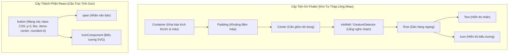
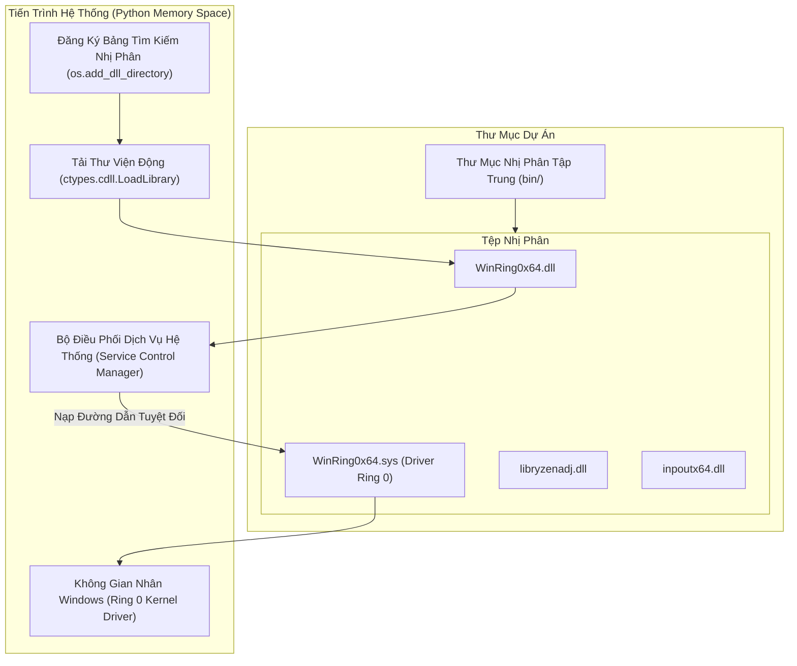

# Chuyển Đổi Tư Duy Kiến Trúc Từ Flutter Sang ReactJS Và Quy Trình Gỡ Lỗi Bề Mặt Giao Diện (Flutter to React Architecture & Debugging Engine)

Tài liệu này đúc kết toàn bộ cơ sở khoa học, bản chất vận hành ở tầng bộ nhớ và lộ trình chuyển đổi tư duy kiến trúc từ khung kết xuất đồ họa Flutter sang thư viện xây dựng giao diện khai báo ReactJS, cùng quy trình gỡ lỗi bề mặt thông qua động cơ trình duyệt nhúng.

---

## 1. Nguyên Lý Vật Lý Của Hai Động Cơ Kết Xuất Giao Diện (Rendering Engine Physics)

Một hệ thống hiển thị đồ họa ứng dụng trên hệ điều hành chịu sự chi phối của hai mô hình vật lý kết xuất điểm ảnh hoàn toàn khác biệt:

1. **Mô hình động cơ đồ họa tự quản (Self-Contained Graphics Pipeline - Mô hình của Flutter)**:
   - Bản chất: Ứng dụng mang theo một cỗ máy vẽ hoàn chỉnh ([[Động Cơ Đồ Họa Độc Lập (Self-Contained Graphics Engine)]] - Skia hoặc Impeller).
   - Cơ chế: Dart chuyển đổi toàn bộ mã khai báo thành một cây cấu trúc đối tượng hình học (Render Object Tree), sau đó tự động tính toán tọa độ từng điểm ảnh và gửi trực tiếp các tập lệnh vẽ tới card đồ họa qua API tầng thấp (Direct3D 11 / Vulkan).
   - Đặc điểm: Không tồn tại khái niệm trang web hay mã HTML; toàn bộ khung hiển thị là một chuỗi hoán đổi bề mặt đồ họa (Swapchain) duy nhất trong không gian bộ nhớ video (VRAM).

2. **Mô hình cây tài liệu ảo và động cơ ghép nối trình duyệt (Virtual DOM & Browser Compositor - Mô hình của React)**:
   - Bản chất: React không tự tính toán điểm ảnh để vẽ trực tiếp lên GPU. React vận hành như một bộ máy tính toán sự sai lệch cấu trúc dữ liệu trong bộ nhớ RAM ([[Cây Mô Hình Tài Liệu Ảo (Virtual DOM)]]).
   - Cơ chế: Khi trạng thái dữ liệu thay đổi, React chạy thuật toán so khớp phân nhánh (Reconciliation Algorithm) trên cây đối tượng JavaScript để tìm ra số lượng nút thay đổi tối thiểu, sau đó ủy thác việc tạo hình điểm ảnh cho Bộ quản lý Bố cục và Ghép nối Bề mặt của trình duyệt ([[Động Cơ Bố Cục Trình Duyệt (Browser Layout Engine)]] - Blink / Chromium).
   - Đặc điểm: Tách rời tuyệt đối giữa logic giao diện và phần cứng hiển thị, tận dụng khả năng tăng tốc phần cứng của trình duyệt nhúng (Edge WebView2) thông qua giao diện lập trình nội bộ.

---

## 2. Xuất Phát Từ Bế Tắc Thực Tế (The "Why")

- **Trước đây làm bằng cách nào?**:
  - Dùng Flutter Desktop để lập trình giao diện công cụ hệ thống, cố gắng tùy biến mã nguồn C++ Runner để nhúng thanh điều khiển nổi lên trên màn hình.
- **Bị nghẽn kỹ thuật gì?**:
  1. **Khép kín và khó gỡ lỗi (Debugging Opacity)**: Động cơ đồ họa Flutter là một hộp đen nhị phân khép kín. Khi giao diện bị lỗi kẹt va chạm chuột, lỗi mất tiêu điểm hoặc lệch kích thước, lập trình viên không thể bấm chọn trực tiếp vào phần tử trên màn hình để xem thông số CSS hay sửa đổi trực tiếp (Live Editing). Việc theo dõi trạng thái phải phụ thuộc vào công cụ gỡ lỗi chuyên biệt đòi hỏi kết nối luồng máy ảo Dart (Dart VM Service), vốn thường xuyên bị nghẽn khi ứng dụng chạy đè lên game.
  2. **Tranh chấp tiêu điểm cửa sổ (Window Focus Contention)**: Động cơ Flutter Engine luôn cưỡng bức chiếm quyền kích hoạt cửa sổ hệ điều hành (`WM_ACTIVATE`), xung đột trực tiếp với cờ không chiếm tiêu điểm (`WS_EX_NOACTIVATE`) cần thiết cho một Gaming Overlay.
- **Công nghệ mới giải quyết triệt để ra sao?**:
  - Chuyển toàn bộ giao diện sang [[Thư Viện Giao Diện Khai Báo ReactJS (React Declarative UI Library)]] chạy trên khung nhìn Edge WebView2.
  - Sử dụng giao thức gỡ lỗi tiêu chuẩn công nghiệp ([[Giao Thức Gỡ Lỗi Chrome (Chrome DevTools Protocol - CDP)]]): Cho phép nhấn `F12` mở trực tiếp bộ công cụ DevTools để trỏ chuột kiểm tra phần tử (Inspect Element), sửa trực tiếp lớp kiểu dáng CSS trong tích tắc, và theo dõi thông điệp thực thi trong bảng Console.
  - Cơ chế cập nhật nóng ([[Thay Thế Mô-đun Nóng (Hot Module Replacement - HMR)]]): Sửa đổi tập tin React được phản chiếu lên màn hình trong 0.1 giây qua kết nối truyền tin cục bộ (WebSocket) mà không cần biên dịch lại mã nguồn hay tắt tiến trình hệ thống.

---

## 3. Bản Đồ Ánh Xạ Khái Niệm Giữa Flutter Và ReactJS (Mental Model Mapping)

| Khái niệm kiến trúc | Khung kết xuất Flutter | Thư viện giao diện ReactJS | Bản chất vật lý bên dưới bộ nhớ |
| :--- | :--- | :--- | :--- |
| **Đơn vị giao diện cơ sở** | `Widget` (`StatelessWidget`) | `Component` (Hàm nhận Props trả về JSX) | Hàm thuần túy biến đổi trạng thái thành cấu trúc cây đối tượng trừu tượng trong RAM. |
| **Thành phần có trạng thái** | `StatefulWidget` + `State` | `Component` kết hợp Hook `useState` | Vùng nhớ lưu trữ dữ liệu cá thể được duy trì qua các chu kỳ thực thi hàm (Fiber Node). |
| **Kích hoạt vẽ lại giao diện** | `setState(() { value = x; })` | `const [value, setValue] = useState(); setValue(x);` | Gửi tín hiệu thông báo cho bộ lên lịch (Scheduler) đặt cờ yêu cầu tính toán lại cây giao diện. |
| **Vòng đời khởi tạo** | `void initState()` | `useEffect(() => { ... }, [])` | Khối lệnh thực thi một lần duy nhất sau khi nút DOM đầu tiên được chèn vào cây tài liệu. |
| **Vòng đời hủy bỏ** | `void dispose()` | `useEffect(() => { return () => { ... }; }, [])` | Hàm dọn dẹp giải phóng con trỏ lắng nghe sự kiện khi nút bị gỡ khỏi bộ nhớ. |
| **Vòng đời cập nhật** | `void didUpdateWidget()` | `useEffect(() => { ... }, [dependency])` | Khối lệnh chỉ chạy lại khi giá trị của biến phụ thuộc trong bộ nhớ bị biến đổi. |
| **Bố cục hàng dọc** | `Column(children: [...])` | `<div className="flex flex-col">...</div>` | Thiết lập thuộc tính dàn trang CSS Flexbox theo trục dọc trong mô hình hộp (Box Model). |
| **Bố cục hàng ngang** | `Row(children: [...])` | `<div className="flex flex-row">...</div>` | Thiết lập thuộc tính dàn trang CSS Flexbox theo trục ngang trong mô hình hộp. |
| **Danh sách phần tử động** | `ListView.builder(...)` | `items.map((item) => <Item key={item.id} />)` | Duyệt mảng dữ liệu và ánh xạ thành danh sách nút VDOM kèm mã định danh khóa (`key`) để so khớp diffing. |
| **Khoảng cách / Lề** | `Padding(...)` / `SizedBox(height: x)` | Tailwind classes: `p-4`, `m-2`, `gap-3`, `h-4` | Khai báo các thuộc tính vùng đệm (Padding) và vùng lề (Margin) trực tiếp trong CSS. |
| **Truyền dữ liệu từ cha xuống** | Constructor arguments | `props` (Tham số đầu vào của hàm Component) | Truyền con trỏ đối tượng từ ngữ cảnh hàm cha xuống không gian thực thi của hàm con. |
| **Phát sự kiện lên cha** | `ValueChanged<T> onAction` | Callback function: `onAction: (val: T) => void` | Thực thi hàm bao đóng (Closure) của cha được truyền xuống con để biến đổi trạng thái cha. |

### Các Đoạn Mã Đối Chiếu Trực Quan Giữa Hai Nền Tảng (Concrete Code Comparison)

#### 1. Khởi tạo khối hiển thị cơ sở và truyền dữ liệu (StatelessWidget vs React Component)
- **Bản chất vật lý**: Trong Flutter, một đối tượng `StatelessWidget` là một cấu trúc dữ liệu bất biến (Immutable Object) chứa hàm `build`. Trong React, Component đơn thuần là **một hàm JavaScript** nhận một đối tượng chứa các thuộc tính (`props`) và trả về cấu trúc cây đối tượng trừu tượng Virtual DOM trong bộ nhớ heap.

- Mã nguồn Flutter:
```dart
class MetricCard extends StatelessWidget {
  final String label;
  final String value;
  const MetricCard({super.key, required this.label, required this.value});

  @override
  Widget build(BuildContext context) {
    return Container(
      padding: const EdgeInsets.all(12),
      decoration: BoxDecoration(
        color: const Color(0xFF18181B),
        borderRadius: BorderRadius.circular(8),
      ),
      child: Column(
        crossAxisAlignment: CrossAxisAlignment.start,
        children: [
          Text(label, style: const TextStyle(color: Colors.grey, fontSize: 12)),
          const SizedBox(height: 4),
          Text(value, style: const TextStyle(color: Colors.white, fontSize: 16, fontWeight: FontWeight.bold)),
        ],
      ),
    );
  }
}
```

- Mã nguồn ReactJS (TypeScript + Tailwind CSS):
```tsx
interface MetricCardProps {
  label: string;
  value: string;
}

export function MetricCard({ label, value }: MetricCardProps) {
  return (
    <div className="p-3 bg-zinc-900 rounded-lg flex flex-col gap-1 border border-white/5">
      <span className="text-xs text-zinc-400">{label}</span>
      <span className="text-base font-bold text-white font-mono">{value}</span>
    </div>
  );
}
```

#### 2. Quản lý trạng thái nội tại và kích hoạt vẽ lại (StatefulWidget vs `useState`)
- **Bản chất vật lý**: Flutter tách rời widget bất biến và đối tượng `State` có vòng đời dài hơn. React giữ component là hàm thuần túy, nhưng móc nối (Hook) vào mảng con trỏ lưu trữ trạng thái nằm ngoài hàm trong cấu trúc [[Nút Cấu Trúc Sợi (Fiber Node)]].

- Mã nguồn Flutter:
```dart
class TdpCounter extends StatefulWidget {
  const TdpCounter({super.key});
  @override
  State<TdpCounter> createState() => _TdpCounterState();
}

class _TdpCounterState extends State<TdpCounter> {
  int tdp = 15;

  void _increase() {
    setState(() {
      tdp += 1;
    });
  }

  @override
  Widget build(BuildContext context) {
    return Row(
      children: [
        Text('$tdp W'),
        IconButton(icon: const Icon(Icons.add), onPressed: _increase),
      ],
    );
  }
}
```

- Mã nguồn ReactJS:
```tsx
import { useState } from 'react';
import { Plus } from 'lucide-react';

export function TdpCounter() {
  const [tdp, setTdp] = useState<number>(15);

  const increase = () => {
    setTdp(prev => prev + 1);
  };

  return (
    <div className="flex items-center gap-3">
      <span className="text-sm font-mono text-white">{tdp} W</span>
      <button 
        onClick={increase}
        className="p-1.5 bg-zinc-800 rounded hover:bg-zinc-700 text-white"
      >
        <Plus size={16} />
      </button>
    </div>
  );
}
```

#### 3. Vòng đời khởi tạo, hủy bỏ và lắng nghe luồng sự kiện (`initState` / `dispose` vs `useEffect`)
- **Bản chất vật lý**: Flutter yêu cầu ghi đè (Override) hai phương thức vòng đời ở hai thời điểm tách biệt. React gom cơ chế đăng ký và hủy bỏ thành một cặp hàm trong [[Hook Tác Vụ Ngoại Vi (useEffect)]], hàm trả về (Return Callback) sẽ đóng vai trò giải phóng con trỏ khi nút bị gỡ khỏi bộ nhớ.

- Mã nguồn Flutter:
```dart
class TelemetryListener extends StatefulWidget {
  const TelemetryListener({super.key});
  @override
  State<TelemetryListener> createState() => _TelemetryListenerState();
}

class _TelemetryListenerState extends State<TelemetryListener> {
  StreamSubscription? _sub;
  int temp = 0;

  @override
  void initState() {
    super.initState();
    _sub = hardwareStream.listen((data) {
      setState(() => temp = data.cpuTemp);
    });
  }

  @override
  void dispose() {
    _sub?.cancel();
    super.dispose();
  }

  @override
  Widget build(BuildContext context) {
    return Text('Nhiệt độ CPU: $temp°C');
  }
}
```

- Mã nguồn ReactJS:
```tsx
import { useState, useEffect } from 'react';

export function TelemetryListener() {
  const [temp, setTemp] = useState<number>(0);

  useEffect(() => {
    // Đăng ký con trỏ lắng nghe khi Component được chèn vào DOM (Tương đương initState)
    const handleUpdate = (data: { cpuTemp: number }) => {
      setTemp(data.cpuTemp);
    };
    window.backend?.telemetryUpdated.connect(handleUpdate);

    // Trả về hàm dọn dẹp khi Component bị gỡ khỏi cây DOM (Tương đương dispose)
    return () => {
      window.backend?.telemetryUpdated.disconnect(handleUpdate);
    };
  }, []); // Danh sách phụ thuộc rỗng [] đảm bảo việc đăng ký chỉ thực hiện một lần

  return <span className="text-sm text-zinc-200">Nhiệt độ CPU: {temp}°C</span>;
}
```

#### 4. Thẻ bọc con linh hoạt và danh sách lặp mảng (Slot Pattern & Array Mapping)
- **Bản chất vật lý**: Flutter cần truyền đối tượng con qua tham số `child` / `children` và duyệt danh sách bằng bộ dựng chỉ số `ListView.builder`. React sử dụng con trỏ đối tượng ngầm định `props.children` và phép biến đổi mảng thuần túy `map()`.

- Mã nguồn Flutter:
```dart
// Khung bọc con
class SectionWrapper extends StatelessWidget {
  final String title;
  final Widget child;
  const SectionWrapper({super.key, required this.title, required this.child});

  @override
  Widget build(BuildContext context) {
    return Container(
      padding: const EdgeInsets.all(12),
      decoration: BoxDecoration(color: Colors.black26, borderRadius: BorderRadius.circular(8)),
      child: Column(
        crossAxisAlignment: CrossAxisAlignment.start,
        children: [
          Text(title, style: const TextStyle(fontWeight: FontWeight.bold)),
          const SizedBox(height: 8),
          child,
        ],
      ),
    );
  }
}

// Danh sách lặp
ListView.builder(
  itemCount: items.length,
  itemBuilder: (context, index) => ListTile(
    title: Text(items[index].name),
    onTap: () => onSelect(items[index].id),
  ),
)
```

- Mã nguồn ReactJS:
```tsx
import React from 'react';

// Khung bọc con thông qua thuộc tính ngầm định children
export function SectionWrapper({ title, children }: { title: string; children: React.ReactNode }) {
  return (
    <div className="p-3 bg-black/30 rounded-lg border border-white/5 flex flex-col gap-2">
      <span className="font-semibold text-sm text-white">{title}</span>
      {children}
    </div>
  );
}

// Danh sách lặp bằng hàm biến đổi mảng gốc map()
export function ItemList({ items, onSelect }: { items: Array<{ id: string; name: string }>; onSelect: (id: string) => void }) {
  return (
    <div className="flex flex-col gap-1">
      {items.map((item) => (
        <button
          key={item.id} // Bắt buộc: Cung cấp mã định danh duy nhất cho thuật toán Reconciliation
          onClick={() => onSelect(item.id)}
          className="px-3 py-2 text-left rounded hover:bg-zinc-800 text-sm text-zinc-300"
        >
          {item.name}
        </button>
      ))}
    </div>
  );
}
```

### Cấu Trúc Cây Thành Phần (Component Tree Hierarchy) So Với Cây Tiện Ích (Widget Tree)

#### 1. Sự khác biệt cốt lõi về bản chất kết xuất
- **Trong Flutter (Kim tự tháp lồng ghép lớp - Nesting Pyramid)**:
  - Mọi thuộc tính hình học (lề đệm `Padding`, căn chỉnh `Center`, giới hạn kích thước `SizedBox`, bắt cử chỉ `GestureDetector`, hiển thị có điều kiện `Visibility`) đều là các đối tượng `Widget` độc lập.
  - Mỗi khi thêm một thuộc tính, lập trình viên buộc phải lồng thêm một lớp thẻ con (`child`), khiến cây tiện ích phình to theo chiều sâu (Widget Tree Bloat).
- **Trong React (Cây thành phần phẳng kết hợp thuộc tính - Flat Semantic Tree)**:
  - Các thuộc tính hiển thị, kích thước, hiệu ứng và sự kiện được gộp chung trực tiếp vào thuộc tính của nút (Props và CSS Classes).
  - Một thẻ `<button className="p-3 bg-violet-600 rounded-xl" onClick={handleClick}>` trong React đảm nhiệm cùng lúc chức năng của 5 Widget Flutter: `Container` + `Padding` + `DecoratedBox` + `InkWell` + `GestureDetector`.



#### 2. Các mô hình dựng cây kinh điển (Classic Tree Composition Patterns)

##### Mô hình bọc thành phần con (Slot / Children Pattern)
- *Flutter*: Nhận tham số `final Widget child;` hoặc `final List<Widget> children;` và đặt vào vị trí tương ứng trong hàm `build`.
- *React*: Tự động nhận thuộc tính ngầm định `children` trong `props`. Khi một component bọc các phần tử con giữa cặp thẻ mở/đóng `<Card><ItemA /><ItemB /></Card>`, toàn bộ các phần tử đó được truyền vào component dưới dạng `props.children` để kết xuất linh hoạt.

##### Mô hình kết xuất có điều kiện (Conditional Rendering Tree)
- *Flutter*: Dùng câu lệnh điều kiện `if (condition) WidgetA() else WidgetB()` trong mảng con, hoặc dùng widget `Visibility(visible: condition, child: ...)`.
- *React*: Sử dụng trực tiếp biểu thức logic của JavaScript ngay trong JSX:
  - Điều kiện hiển thị đơn: `{isVisible && <QuickSettings />}` (nếu đúng thì chèn vào cây VDOM, nếu sai React bỏ qua không sinh nút).
  - Điều kiện rẽ nhánh hai phương án: `{isCharging ? <BatteryChargingIcon /> : <BatteryIcon />}`.

##### Mô hình sinh cây từ mảng dữ liệu (Dynamic Collection Mapping)
- *Flutter*: Sử dụng hàm khởi tạo `ListView.builder(itemCount: items.length, itemBuilder: (ctx, i) => ...)` để cấp phát widget theo chỉ số.
- *React*: Sử dụng hàm biến đổi mảng gốc `items.map((item) => <ItemTile key={item.id} data={item} />)`. Thuộc tính `key` là bắt buộc để thuật toán so khớp [[Reconciliation]] nhận diện chính xác phần tử nào bị thêm, sửa, xóa mà không phải kết xuất lại toàn bộ danh sách.

#### 3. Phân Tích Thực Tiễn Chuyển Đổi Các Cụm Giao Diện Kinh Điển (Real-World Tree Conversion Scenarios)

Nhằm làm sáng tỏ sự khác biệt trong việc cấp phát bộ nhớ và tổ chức phân cấp, bảng sau phân rã 4 kịch bản dựng giao diện phổ biến từ cây tiện ích Flutter sang cây thành phần React:

| Kịch bản dựng hình | Cây tiện ích Flutter (Mô hình lồng ghép sâu) | Cây thành phần React (Mô hình phần tử phẳng) | Bản chất chuyển dịch cấu trúc |
| :--- | :--- | :--- | :--- |
| **1. Khối chứa thông số có tiêu đề và giá trị** | `Container` $\rightarrow$ `Padding` $\rightarrow$ `Column` $\rightarrow$ [`Text` (tiêu đề), `SizedBox`, `Text` (giá trị)] | `<div className="p-3 bg-zinc-900 rounded-lg flex flex-col gap-1">` $\rightarrow$ [`<span>` (tiêu đề), `<span>` (giá trị)] | Loại bỏ 2 tầng lồng rỗng (`Padding`, `SizedBox`). Bố cục khoảng cách trục dọc được giải quyết bằng thuộc tính CSS `gap-1` trong cùng một nút khối (Block Node). |
| **2. Nút bấm tương tác có icon và hiệu ứng chạm** | `Material` $\rightarrow$ `InkWell` $\rightarrow$ `Padding` $\rightarrow$ `Row` $\rightarrow$ [`Icon`, `SizedBox`, `Text`] | `<button className="flex items-center gap-2 px-4 py-2 hover:bg-zinc-800" onClick={handler}>` $\rightarrow$ [`<Icon />`, `<span>Nhãn</span>`] | Gom toàn bộ chức năng nhận diện cử chỉ, bề mặt hiệu ứng và đệm lề vào duy nhất thẻ ngữ nghĩa HTML `<button>`. Giảm độ sâu của cây từ 5 cấp xuống còn 2 cấp. |
| **3. Thanh trượt điều khiển chỉ số kèm nhãn động** | `Column` $\rightarrow$ [`Row` (`Text`, `Spacer`, `Text`), `Slider`] | `<div className="space-y-2">` $\rightarrow$ [`<div className="flex justify-between">` (`<span>`, `<span>`), `<input type="range" />`] | Thay thế đối tượng `Spacer` trừu tượng bằng cơ chế dồn biên Flexbox `justify-between` của trình duyệt. Thanh trượt là phần tử nhập liệu bản địa `<input type="range">`. |
| **4. Danh sách chọn đa mục có trạng thái tích cực** | `ListView.separated` $\rightarrow$ Duyệt mảng $\rightarrow$ `ListTile` hoặc `InkWell` lồng `Container` | `items.map(item => <button key={item.id} className={item.id === activeId ? "bg-violet-600" : "bg-zinc-800"}>)` | Không cần cấu trúc cấp phát phân tách (Separator Builder). Biến đổi mảng trực tiếp bằng hàm ánh xạ `map()`, sử dụng toán tử ba ngôi để tính toán chuỗi lớp CSS trực tiếp trong bộ nhớ. |

---

## 4. Vòng Đời Và Cơ Chế Phản Ứng Dữ Liệu Trong React (Lifecycle & Reactive Flow)

### 1. Hook Quản lý Trạng thái (`useState`)
- **Bản chất**: Trong Flutter, một `StatefulWidget` tạo ra một đối tượng `State` riêng biệt sống độc lập. Trong React, Component thực chất chỉ là **một hàm JavaScript thông thường** được gọi lại mỗi khi có dữ liệu mới.
- **Cơ chế lưu trữ**: Để dữ liệu không bị biến mất sau khi hàm chạy xong, React lưu giá trị của `useState` vào một danh sách liên kết nằm ngoài Component (gọi là [[Nút Cấu Trúc Sợi (Fiber Node)]] trong bộ nhớ heap).
- **Cú pháp đối chiếu**:
  - Flutter: Khai báo biến `int count = 0;` và gọi `setState(() => count = 1);`.
  - React: Khai báo `const [count, setCount] = useState(0);` và gọi `setCount(1);`.

### 2. Hook Tác vụ Ngoại vi và Vòng đời (`useEffect`)
- **Bản chất**: Gom toàn bộ các phương thức vòng đời rời rạc của Flutter (`initState`, `didUpdateWidget`, `dispose`) vào một cơ chế đồng bộ duy nhất dựa trên danh sách phụ thuộc (Dependency Array).
- **Cơ chế 3 trạng thái**:
  1. *Chạy duy nhất một lần khi khởi tạo (`initState`)*: Đặt mảng phụ thuộc rỗng `[]`.
  2. *Chạy khi một biến dữ liệu thay đổi (`didUpdateWidget`)*: Liệt kê biến vào mảng `[tdp, volume]`. Mỗi khi biến này đổi địa chỉ bộ nhớ, hàm sẽ được kích hoạt lại.
  3. *Dọn dẹp bộ nhớ khi hủy bỏ (`dispose`)*: Trả về một hàm dọn dẹp bên trong `useEffect`.

```mermaid
flowchart TD
    subgraph Mount_Phase["Giai Đoạn Khởi Tạo (Mounting)"]
        Component_Call["Thực thi hàm Component (Render JSX)"]
        Insert_DOM["Chèn phần tử vào cây DOM thật"]
        Run_Effect["Thực thi hàm trong useEffect([], [])"]
        Component_Call --> Insert_DOM --> Run_Effect
    end

    subgraph Update_Phase["Giai Đoạn Cập Nhật (Updating)"]
        Trigger_Set["Gọi hàm setValue(...)"]
        Diff_VDOM["So khớp Virtual DOM tìm điểm khác biệt"]
        Patch_DOM["Chắp vá đúng nút DOM thật bị thay đổi"]
        Cleanup_Prev["Chạy hàm dọn dẹp cũ (nếu có)"]
        Run_New_Effect["Chạy lại hàm trong useEffect([dep])"]
        Trigger_Set --> Diff_VDOM --> Patch_DOM --> Cleanup_Prev --> Run_New_Effect
    end

    subgraph Unmount_Phase["Giai Đoạn Hủy Bỏ (Unmounting)"]
        Remove_DOM["Gỡ bỏ phần tử khỏi màn hình"]
        Run_Cleanup["Thực thi hàm Cleanup trả về từ useEffect"]
        Remove_DOM --> Run_Cleanup
    end
```



---

## 5. Quy Trình Gỡ Lỗi Bề Mặt Và Cập Nhật Nóng (Debugging & Hot Reload Workflow)

Hệ thống cung cấp ba phương thức gỡ lỗi linh hoạt cho từng công đoạn phát triển:

### 1. Gỡ Lỗi Trực Quan Bằng Flutter DevTools (Widget Inspector)
- **Phương thức khởi chạy**: Chọn menu `[3]` trong [scripts/run.bat](file:///d:/dev-projects/windows-handheld-tool/scripts/run.bat).
- **Soi cây tiện ích (Widget Tree Inspector)**: Nhấp vào liên kết Dart VM Service URL được in trong cửa sổ dòng lệnh để mở bộ công cụ **Flutter DevTools** trên trình duyệt. Bạn có thể bấm chọn từng Widget trên màn hình để kiểm tra thông số kích thước, khoảng đệm (`padding`), giới hạn co dãn (`constraints`) và cây phân cấp giao diện thực tế.
- **Dữ liệu giả lập tự động (Mock Telemetry)**: Khi chạy độc lập trên Chrome không có tiến trình Python chạy kèm, `BridgeService` tự động kích hoạt bộ đếm giả lập đẩy thông số pin, nhiệt độ và CPU mỗi giây, giúp lập trình viên thiết kế giao diện độc lập với tốc độ cao nhất.

### 2. Cập Nhật Nóng Trên Gaming Overlay Thật (Hot Reload Workflow)
- **Quy trình vận hành song song**:
  - Chọn menu `[2]` trong [scripts/run.bat](file:///d:/dev-projects/windows-handheld-tool/scripts/run.bat). Kịch bản tự động mở máy chủ phát triển cục bộ tại cổng 5173 và khởi chạy Overlay kết nối trực tiếp.
- **Phản chiếu tức thời**: Khi bạn sửa đổi bất kỳ tệp mã nguồn Dart nào trong thư mục `lib/`, chỉ cần nhấn phím `r` (Hot Reload) hoặc `R` (Hot Restart) trong cửa sổ terminal của máy chủ Flutter Web. Bảng điều khiển Gaming Overlay sẽ được vẽ lại trong vòng 0.5 giây mà không làm gián đoạn trò chơi hay tắt tiến trình hệ thống.

### 3. Kiểm Tra Giao Thức Mạng Bằng Chromium DevTools (F12)
- **Phím tắt F12**: Khi bảng điều khiển nổi đang hiển thị, nhấn phím `F12` trên bàn phím để bật cửa sổ **Chromium DevTools**.
- **Theo dõi gói tin WebSocket**: Chuyển sang tab **Network** $\rightarrow$ chọn bộ lọc **WS** (WebSockets) $\rightarrow$ nhấp vào đường truyền `ws://127.0.0.1:8765` để xem toàn bộ các thông điệp JSON gửi/nhận thời gian thực (`setTdp`, `setFan`, `telemetry`, `init`).
- **Theo dõi lỗi console**: Tab **Console** in ra các thông điệp kết nối, cảnh báo và lỗi kết xuất nếu có phát sinh trong quá trình chạy.

---

## 6. Kiến Trúc Lai Giữa Giao Diện Khai Báo Flutter Web Và Động Cơ Hệ Thống Python (Flutter Web & Python WebEngine Hybrid Architecture)

```mermaid
flowchart TD
    subgraph Frontend_App["Tầng Giao Diện Khai Báo (lib/ - 100% Dart & Flutter)"]
        Flutter_Main["Điểm Khởi Chạy (main.dart - Khởi tạo Bridge)"]
        Overlay_Screen["Màn Hình Nền (ui/overlay_screen.dart)"]
        Quick_Panel["Bảng Điều Khiển Chính (ui/quick_panel.dart)"]
        Tab_Home["Trang Chủ (tabs/home_tab.dart)"]
        Tab_Perf["Hiệu Năng (tabs/performance_tab.dart)"]
        Tab_Device["Thiết Bị (tabs/device_tab.dart)"]
        Tab_Settings["Cài Đặt (tabs/settings_tab.dart)"]
        Bridge_Client["Cầu Nối WebSocket Client (services/bridge_service.dart)"]

        Flutter_Main --> Overlay_Screen
        Overlay_Screen --> Quick_Panel
        Quick_Panel --> Tab_Home
        Quick_Panel --> Tab_Perf
        Quick_Panel --> Tab_Device
        Quick_Panel --> Tab_Settings
        Quick_Panel <--> Bridge_Client
    end

    subgraph Native_Process["Tầng Dịch Vụ Hệ Thống (src/ - Python PySide6)"]
        WebEngine_View["Khung Nhìn Trình Duyệt Nhúng (src/ui/quick_panel.py)"]
        Ws_Server["Máy Chủ Truyền Tin (src/ui/ws_server.py - QWebSocketServer)"]
        WebBridge_Server["Bộ Điều Phối Phần Cứng (src/ui/web_bridge.py)"]
        Window_Manager["Quản Lý Cửa Sổ Overlay (src/overlay/window_manager.py)"]
        Hardware_Services["Dịch Vụ Phần Cứng (TDP, Quạt, Âm Lượng, WMI, RTSS)"]

        WebEngine_View --> Window_Manager
        WebEngine_View --> Ws_Server
        Ws_Server <--> WebBridge_Server
        WebBridge_Server <--> Hardware_Services
    end

    Bridge_Client <===>|Kênh Truyền Tin WebSocket (ws://127.0.0.1:8765)| Ws_Server
```

### Nguyên tắc vận hành vật lý của kiến trúc:
1. **Bảo tồn toàn vẹn tư duy Widget Tree**: 100% tầng hiển thị được viết bằng ngôn ngữ Dart và hệ sinh thái Widget của Flutter. Không có bất kỳ dòng mã nào sử dụng JavaScript, TypeScript hay JSX.
2. **Loại bỏ hoàn toàn rào cản FFI trên Web**: Tầng Flutter Web không tương tác trực tiếp với các thư viện nhị phân Win32 (`.dll`) mà ủy thác toàn bộ cho tiến trình Python thông qua giao thức truyền tin WebSocket siêu nhẹ (`ws://127.0.0.1:8765`), loại bỏ mọi xung đột cấp phát bộ nhớ tầng thấp.
3. **Phân tách trách nhiệm cửa sổ (Window Management Decoupling)**: Tầng cửa sổ Win32, phân lớp công cụ `ZBID_SYSTEM_TOOLS`, cờ không cướp tiêu điểm `WS_EX_NOACTIVATE`, phím nóng toàn cục (`Ctrl+Shift+Q`) và tay cầm Gamepad (`BACK+RB`) do Python quản lý 100%, bảo đảm không xung đột với bất kỳ trò chơi DirectX/Vulkan nào.
4. **Hỗ trợ gỡ lỗi kép (Dual Debugging Channels)**:
   - Khi chọn menu `[3]` trong [scripts/run.bat](file:///d:/dev-projects/windows-handheld-tool/scripts/run.bat): Lập trình viên sử dụng bộ công cụ **Flutter DevTools (Widget Inspector)** để soi từng Widget và căn chỉnh giao diện độc lập với mock data.
   - Khi chọn menu `[2]` trong [scripts/run.bat](file:///d:/dev-projects/windows-handheld-tool/scripts/run.bat): Hỗ trợ **Hot Reload (phím r)** trực tiếp ngay bên trong Gaming Overlay khi đang chạy game thật.

### 6.1. Triệt Tiêu Lỗi Màn Hình Trắng: Cơ Chế Máy Chủ Tĩnh Nhúng (Embedded Static HTTP Server)
- **Trước đây làm bằng cách nào?**: `QWebEngineView` nạp tệp giao diện qua đường dẫn hệ thống tệp `file:///build/web/index.html` thông qua `QUrl.fromLocalFile`.
- **Bị nghẽn / thảm họa kỹ thuật gì?**:
  - Flutter Web không phải HTML tĩnh đơn thuần mà khởi động bằng WebAssembly và JavaScript bất đồng bộ. Khi chạy từ giao thức `file://`, nhân Chromium tự động gán nhãn nguồn gốc xuất xứ (`origin`) là `null`.
  - Mọi lời gọi nạp tệp nhị phân (`flutter_bootstrap.js`, `main.dart.js`, `canvaskit.wasm`, phông chữ) bị cơ chế kiểm soát tài nguyên nguồn gốc chéo (CORS) của Chromium ngắt chặn ngay lập tức.
  - Đồng thời thẻ `<base href="/">` trỏ về gốc ổ đĩa `file:///` thay vì thư mục con `build/web/`. Động cơ kết xuất của Flutter không nạp được vào RAM, dẫn đến việc khung nhìn chỉ hiển thị nền trắng rỗng mặc định.
- **Công nghệ giải quyết triệt để**:
  - Nhúng mô-đun máy chủ HTTP tĩnh siêu nhẹ [src/ui/static_server.py](file:///d:/dev-projects/windows-handheld-tool/src/ui/static_server.py) (`ThreadingHTTPServer`) chạy trên một luồng nền nội bộ của tiến trình Python, chỉ lắng nghe trên giao diện mạng lặp `127.0.0.1:8766`.
  - `QWebEngineView` nạp giao diện qua URL `http://127.0.0.1:8766`. Giao thức HTTP chuẩn xóa bỏ hoàn toàn rào cản CORS, cho phép nạp 100% tài nguyên Wasm, Canvas và Dart vào bộ nhớ trong tích tắc, đồng thời đặt màu nền mặc định `0b0d14` cho trang để chống nháy sáng.

---

## 7. Cơ Chế Nạp Thư Viện Nhị Phân Và Quản Lý Driver Nhân (Binary & Kernel Driver Loading Mechanism)



### Bản chất kỹ thuật từ gốc rễ (First Principles):
1. **Lịch sử và nguyên nhân trùng lặp trước đây**:
   - *Cách làm cũ*: Khi nạp driver Ring 0 (`WinRing0x64.sys`) và giao tiếp EC cổng I/O (`inpoutx64.dll`), các đoạn mã mẫu cũ sao chép thủ công các tệp `.sys` và `.dll` từ `bin/` ra thư mục gốc (`root`) hoặc thư mục chứa trình thông dịch Python (`sys.executable`) vì mặc định hàm nạp của Windows (`LoadLibraryExW`) ưu tiên tìm kiếm trong thư mục làm việc hiện thời (`Current Working Directory`).
   - *Thảm họa kỹ thuật*: Làm phân mảnh và ô nhiễm thư mục gốc của dự án, gây lỗi phiên bản không đồng nhất khi một bên được cập nhật còn một bên giữ phiên bản cũ, và vi phạm nguyên tắc gom cụm tài nguyên nhị phân.
2. **Cơ chế nạp tập trung giải quyết triệt để**:
   - *Đăng ký thư mục nhị phân vào không gian tiến trình*: Sử dụng hàm API của hệ điều hành Windows `SetDllDirectoryW` (được bọc qua `os.add_dll_directory(bin_dir)` trong Python 3.8+). Hệ điều hành sẽ ưu tiên tìm kiếm mọi liên kết phụ thuộc (`dependency link`) của DLL trực tiếp trong `bin/`.
   - *Giải quyết đường dẫn Ring 0 Driver*: Khi `libryzenadj.dll` gọi hàm khởi tạo `InitializeOls()`, thư viện `WinRing0x64.dll` đã nằm trong `bin/` sẽ xác định vị trí của chính nó qua `GetModuleFileNameW`, từ đó tìm thấy `WinRing0x64.sys` nằm ngay bên cạnh mà không cần bất kỳ bước sao chép trung gian nào ra ngoài thư mục gốc. Thư mục gốc dự án được giữ sạch sẽ 100%.
