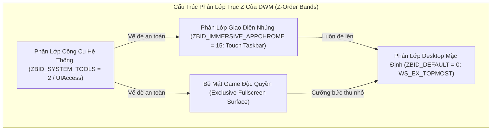

# Yêu Cầu Kỹ Thuật Vận Hành Lớp Phủ Cho Far Cry 5, Metro Exodus và Dead Island 2

Tài liệu này đúc kết toàn bộ các điều kiện kỹ thuật và nguyên lý vật lý bắt buộc của hệ thống móc DirectX (`dxgi_hook.dll`) cùng tầng điều khiển cửa sổ (`NativeWindowService`) nhằm đảm bảo vận hành ổn định cho 3 trò chơi đại diện cho 3 cơ chế dựng hình đặc thù.

---

## 1. Far Cry 5 (Dunia Engine - Direct3D 11)

### Vấn đề vật lý
- **Hiện tượng**: Trò chơi bị văng (Crash to Desktop) khi người dùng thay đổi độ phân giải màn hình từ lần thứ 2 trở đi.
- **Bản chất dưới tầng hệ điều hành**:
  - Khi thay đổi độ phân giải, Dunia Engine giải phóng toàn bộ Render Target View và phát lệnh tái cấp phát vùng nhớ VRAM thông qua hàm `IDXGISwapChain::ResizeBuffers`.
  - Nếu tầng hook can thiệp thay đổi kích thước cửa sổ (`SetWindowPos` kèm cờ `SWP_FRAMECHANGED`) hoặc để hàm `IDXGISwapChain::ResizeTarget` lọt xuống hệ thống, Windows sẽ phát đồng bộ thông điệp `WM_SIZE` vào hàng đợi thông điệp của cửa sổ trò chơi.
  - Việc tiếp nhận thông điệp kích thước trong lúc chuỗi hoán đổi khung hình (SwapChain) đang ở trạng thái chuyển giao dở dang làm engine kích hoạt chu kỳ tính toán Viewport thứ hai, gây xung đột tuần tự Direct3D dẫn tới sập tiến trình.

### Yêu cầu kỹ thuật bắt buộc
- **Triệt tiêu bão thông điệp kích thước tại `ResizeTarget`**:
  - Đánh chặn hàm `IDXGISwapChain::ResizeTarget` và lập tức trả về `S_OK`, không chuyển tiếp lệnh xuống runtime DirectX gốc khi đang chạy chế độ không viền.
- **Bảo toàn chu trình `ResizeBuffers` nguyên bản**:
  - Trong hàm `Hooked_ResizeBuffers`, tuyệt đối không gọi `SetWindowPos` hay bất kỳ hàm can thiệp hình học cửa sổ nào.
  - Cho phép các tham số `BufferCount`, `Width`, `Height`, `NewFormat`, `SwapChainFlags` đi thẳng xuống hàm gốc để Driver GPU tái cấp phát bộ đệm tự nhiên.
- **Thiết lập không viền một lần duy nhất**:
  - Định dạng phong cách cửa sổ không viền (`WS_POPUP`, kích thước màn hình vật lý) chỉ thực thi một lần duy nhất tại thời điểm khởi tạo chuỗi khung hình (`CreateSwapChain` / `CreateSwapChainForHwnd`).

---

## 2. Metro Exodus (4A Engine - Direct3D 11 / Direct3D 12)

### Vấn đề vật lý
- **Hiện tượng**: Tốc độ khung hình sụt giảm nghiêm trọng (từ 60 FPS xuống còn 15–20 FPS) khi mở và đóng bảng điều khiển Quick Panel.
- **Bản chất dưới tầng hệ điều hành**:
  - 4A Engine tích hợp cơ chế tự động tiết kiệm tài nguyên vi xử lý (Background Throttling). Khi cửa sổ game mất trạng thái cửa sổ tiền cảnh (`GetForegroundWindow() != hGameWnd`), engine chủ động hạ xung nhịp vòng lặp dựng hình và nhường chu kỳ CPU cho các tiến trình khác.
  - Khi bảng điều khiển Quick Panel đóng lại, nếu tiêu điểm hệ thống bị kẹt lại ở Desktop hoặc một cửa sổ trung gian, Metro Exodus vẫn nhận diện mình đang chạy ẩn dưới nền và tiếp tục bóp nghẹt FPS.

### Yêu cầu kỹ thuật bắt buộc
- **Cơ chế khôi phục tiêu điểm tiền cảnh hai tầng (Two-Layer Focus Restoration)**:
  - **Tầng ứng dụng (Dart/Flutter)**: Khi đóng giao diện lớp phủ, gọi Win32 API thông qua FFI để đưa cửa sổ trò chơi trở lại đỉnh với quyền tương tác:
    - `SetForegroundWindow(hGameWnd)`
    - `SetFocus(hGameWnd)`
  - **Tầng nhị phân chèn mã (C++ DLL Hook)**: Khi nhận tín hiệu tắt lớp phủ (`SetOverlayActive(FALSE)`), tiến trình trong không gian nhớ của trò chơi tự động khẳng định lại quyền tiền cảnh một lần nữa nhằm vượt qua các rào cản ngăn cướp tiêu điểm của Windows giữa các tiến trình khác nhau.
- **Đính kèm luồng nhập liệu khi bị chặn quyền**:
  - Trong trường hợp Windows từ chối lệnh chuyển tiền cảnh do hạn chế bảo mật Win32 (`LockSetForegroundWindow`), sử dụng `AttachThreadInput` kết nối luồng giao diện của công cụ với luồng trò chơi trước khi gọi `SetForegroundWindow`, sau đó tháo gỡ kết nối (`AttachThreadInput(..., FALSE)`).
- **Không chiếm quyền điều khiển khi mở Panel**:
  - Cửa sổ lớp phủ phải duy trì cờ `SWP_NOACTIVATE` khi xuất hiện để giảm thiểu tối đa việc ngắt quãng dòng thông điệp chuột/phím của trò chơi.

---

## 3. Dead Island 2 (Unreal Engine 4 - Direct3D 12)

### Vấn đề vật lý
- **Hiện tượng**: Trò chơi khởi động nhưng chỉ hiển thị một khung hình trong suốt hoàn toàn (nhìn xuyên thấu xuống màn hình nền Desktop), không xuất hiện hình ảnh đồ họa.
- **Bản chất dưới tầng hệ điều hành**:
  - Dead Island 2 vận hành trên Unreal Engine 4 sử dụng Direct3D 12. Trong mô hình đồ họa D3D12 của Unreal Engine (`D3D12Viewport.cpp`), khi khởi tạo thiết bị đồ họa, engine gọi hàm `IDXGISwapChain::GetFullscreenState` để kiểm tra cấu hình xuất hình.
  - Nếu hàm hook giả lập trả về cờ toàn màn hình `*pFullscreen = TRUE` nhưng lại gán con trỏ cổng xuất hình phần cứng là rỗng (`*ppTarget = nullptr`), Unreal Engine sẽ gặp lỗi truy cập con trỏ rỗng và lập tức hủy bỏ luồng khởi tạo RHI Viewport.
  - Hệ quả là không có bất kỳ lệnh hoán đổi khung hình nào (`Present` / `Present1`) được gửi tới bộ điều hợp DWM. Trên Windows 10/11 với mô hình lật khung hình (Flip Model), một cửa sổ kiểu `WS_POPUP` không có dữ liệu kết xuất sẽ trở thành một bề mặt trong suốt hoàn toàn.
  - Đồng thời, Unreal Engine phân tách giữa cửa sổ khung chứa cấp cao nhất (Top-Level Container) và cửa sổ con vẽ đồ họa (Child Viewport Window). Can thiệp kiểu dáng sai cửa sổ con sẽ làm đứt gãy ma trận tọa độ kết xuất.

### Yêu cầu kỹ thuật bắt buộc
- **Khởi tạo trạng thái toàn màn hình giả lập chính xác**:
  - Biến cờ toàn màn hình giả lập `g_fakeFullscreenState` bắt buộc phải mang giá trị ban đầu là `FALSE` khi ứng dụng khởi động ở chế độ cửa sổ, tránh đánh lừa engine trước khi hoàn tất khởi tạo.
- **Cung cấp con trỏ đầu ra phần cứng hợp lệ (`IDXGIOutput`)**:
  - Trong hàm `Hooked_GetFullscreenState`:
    - Khi `g_fakeFullscreenState == TRUE`, bắt buộc phải gọi phương thức phần cứng của chuỗi khung hình: `pThis->GetContainingOutput(ppTarget)` để bàn giao một con trỏ `IDXGIOutput` thực tế cho engine.
    - Khi `g_fakeFullscreenState == FALSE`, gán an toàn `*ppTarget = nullptr` và trả về `S_OK`.
- **Nhận diện và chuẩn hóa cửa sổ gốc (Root Window Resolution)**:
  - Khi áp dụng kiểu dáng không viền (`MakeWindowBorderless`), bắt buộc phải truy vết cửa sổ cha cao nhất bằng hàm:
    `HWND hRoot = GetAncestor(hWnd, GA_ROOT); if (hRoot && IsWindow(hRoot)) hWnd = hRoot;`
  - Đảm bảo toàn bộ các thuộc tính loại bỏ viền và đặt vị trí toàn màn hình (`WS_POPUP`, loại bỏ `WS_THICKFRAME`, `WS_CAPTION`) được áp vào khung chứa gốc, bảo toàn cấu trúc phân cấp cửa sổ của Unreal Engine.

---

## 4. Bảng Tổng Hợp Thông Số Kỹ Thuật

| Hạng mục can thiệp | Far Cry 5 (Dunia / DX11) | Metro Exodus (4A Engine / DX11-DX12) | Dead Island 2 (UE4 / DX12) |
| :--- | :--- | :--- | :--- |
| **`CreateSwapChain`** | Ép `Windowed = TRUE` | Ép `Windowed = TRUE` | Ép `Windowed = TRUE` |
| **`ResizeBuffers`** | Không gọi `SetWindowPos` | Không gọi `SetWindowPos` | Không gọi `SetWindowPos` |
| **`ResizeTarget`** | Chặn đứng, trả về `S_OK` | Cho phép hoặc chặn an toàn | Chặn đứng, trả về `S_OK` |
| **`GetFullscreenState`** | Trả về `TRUE` | Trả về `TRUE` | Trả về `TRUE` + Trả về `IDXGIOutput*` hợp lệ qua `GetContainingOutput` |
| **Quản lý Tiêu điểm (Focus)** | Tiêu chuẩn | Bắt buộc phục hồi 2 lớp (`SetForegroundWindow` + C++ Hook) | Tiêu chuẩn |
| **Xác định HWND** | Cửa sổ trực tiếp | Cửa sổ trực tiếp | Truy vết cửa sổ gốc (`GA_ROOT`) |

---

## 5. Kiến Trúc Phân Lớp Hệ Thống (Windows System Z-Band) & Quy Trình Ký Số UIAccess

### Xuất phát từ bế tắc thực tế (The "Why")
- **Trước đây làm bằng cách nào?**: Ứng dụng tạo một cửa sổ Win32 nổi trên cùng (`WS_EX_TOPMOST`) hoặc tiêm DLL (`dxgi_hook.dll`) vào tiến trình trò chơi để can thiệp chuỗi dựng hình.
- **Bị nghẽn kỹ thuật gì?**:
  1. Khi gặp các trò chơi chạy đồ họa Vulkan / OpenGL hoặc có phần mềm chống gian lận cấp nhân (Kernel Anti-Cheat như Easy Anti-Cheat, Vanguard), việc tiêm DLL bị chặn đứng hoàn toàn.
  2. Khi trò chơi chiếm quyền hiển thị toàn màn hình độc quyền (Exclusive Fullscreen), bộ quản lý cửa sổ DWM ngắt kết nối toàn bộ phân lớp Desktop thông thường (`ZBID_DEFAULT = 0`). Bất kỳ cửa sổ `WS_EX_TOPMOST` nào đòi quyền hiển thị đều bị Windows cưỡng bức thu nhỏ game (Minimize to Taskbar).
  3. Thanh tác vụ cảm ứng chế độ máy tính bảng của Windows 11 (`Shell_TrayWnd`) cư ngụ ở phân lớp hệ thống cao (`ZBID_IMMERSIVE_APPCHROME = 15`), luôn kết xuất đè lên các cửa sổ ở phân lớp 0 ngoài Desktop.
- **Công nghệ này giải quyết triệt để ra sao?**:
  - Đưa cửa sổ bảng điều khiển vào thẳng **Phân lớp Công cụ Hệ thống (`ZBID_SYSTEM_TOOLS = 2`)** thông qua hàm nội bộ `CreateWindowInBand` / `SetWindowBand` của `user32.dll`.
  - Ở phân lớp này, DWM cho phép cửa sổ vẽ đè trực tiếp lên cả màn hình game độc quyền lẫn thanh tác vụ cảm ứng mà không cần tiêm bất kỳ dòng mã nào vào không gian nhớ của trò chơi, tương thích 100% mọi API đồ họa và không có rủi ro bị Anti-Cheat xử lý.

---

### Bản chất vật lý của cơ chế bảo vệ UIAccess
Để ngăn chặn mã độc lợi dụng việc vẽ đè lên các màn hình đăng nhập bảo mật (như UAC Prompt), nhân hệ điều hành Windows (`ntoskrnl.exe`) chỉ cấp cờ đặc quyền `TokenUIAccess` vào thẻ định danh tiến trình khi thỏa mãn đồng thời **3 điều kiện vật lý**:
1. Tập tin nhị phân khai báo thuộc tính `uiAccess="true"` trong tài nguyên Manifest.
2. Tập tin nhị phân được gắn chữ ký số Authenticode bắt nguồn từ một Nhà cấp chứng chỉ tin cậy nằm trong kho máy tính cục bộ (`LocalMachine\Root` và `LocalMachine\TrustedPublisher`).
3. Tập tin nhị phân nằm trong thư mục được bảo vệ của hệ điều hành (`C:\Program Files` hoặc `C:\Windows\System32`).

---

### Quy trình kỹ thuật thực hiện chi tiết

#### Bước 1: Khai báo đặc quyền trong Manifest ứng dụng
- Mở tập tin cấu hình manifest: `windows/runner/runner.exe.manifest`.
- Tìm thẻ `requestedExecutionLevel` trong nhánh `trustInfo` -> `security` -> `requestedPrivileges`.
- Thiết lập cú pháp: `<requestedExecutionLevel level="asInvoker" uiAccess="true"/>`.

#### Bước 2: Tạo chứng chỉ số ký mã nội bộ (Self-Signed Code Signing Certificate)
- Khởi chạy PowerShell với quyền Quản trị viên (Run as Administrator).
- Tạo chứng chỉ ký mã thời hạn 10 năm lưu vào kho cá nhân của máy cục bộ bằng lệnh:
  `New-SelfSignedCertificate -Type CodeSigningCert -Subject "CN=HandheldToolsSigner" -CertStoreLocation "Cert:\LocalMachine\My" -KeySpec Signature -NotAfter (Get-Date).AddYears(10)`
- Trích xuất con trỏ chứng chỉ vừa tạo:
  `$cert = (Get-ChildItem Cert:\LocalMachine\My -CodeSigningCert | Where-Object Subject -match "HandheldToolsSigner")[0]`
- Nạp chứng chỉ vào kho Chứng chỉ Gốc Tin cậy (Trusted Root Certification Authorities):
  `$rootStore = Get-Item Cert:\LocalMachine\Root`
  `$rootStore.Open("ReadWrite")`
  `$rootStore.Add($cert)`
  `$rootStore.Close()`
- Nạp chứng chỉ vào kho Nhà phát hành Tin cậy (Trusted Publishers):
  `$pubStore = Get-Item Cert:\LocalMachine\TrustedPublisher`
  `$pubStore.Open("ReadWrite")`
  `$pubStore.Add($cert)`
  `$pubStore.Close()`

#### Bước 3: Đưa cửa sổ vào Z-Band trong mã nguồn C++ Runner
- Trong tập tin điều khiển cửa sổ Win32 (`windows/runner/win32_window.cpp`), nạp con trỏ hàm không công khai từ `user32.dll`:
  - Kiểu con trỏ hàm: `typedef HWND (WINAPI *pfnCreateWindowInBand)(DWORD, LPCWSTR, LPCWSTR, DWORD, int, int, int, int, HWND, HMENU, HINSTANCE, LPVOID, DWORD);`
  - Kiểu con trỏ hàm: `typedef BOOL (WINAPI *pfnSetWindowBand)(HWND, HWND, DWORD);`
  - Chỉ số phân lớp: `#define ZBID_SYSTEM_TOOLS 2`
- Khởi tạo hoặc gán phân lớp cho cửa sổ Flutter:
  `pfnSetWindowBand SetWindowBand = (pfnSetWindowBand)GetProcAddress(GetModuleHandleW(L"user32.dll"), "SetWindowBand");`
  `if (SetWindowBand) SetWindowBand(m_hwnd, NULL, ZBID_SYSTEM_TOOLS);`

#### Bước 4: Ký số tập tin thực thi sau khi biên dịch
- Sau khi đóng gói ứng dụng bản Release (`flutter build windows --release`), định vị công cụ `signtool.exe` trong Windows SDK (thường tại `C:\Program Files (x86)\Windows Kits\10\bin\<version>\x64\signtool.exe`).
- Thực thi lệnh ký số nhị phân:
  `signtool.exe sign /sm /s My /n "HandheldToolsSigner" /fd SHA256 /tr http://timestamp.digicert.com /td SHA256 "build\windows\x64\runner\Release\windows_handheld_tools.exe"`

#### Bước 5: Cài đặt vào thư mục an toàn (Secure Location)
- Sau khi ký số, thư mục ứng dụng bắt buộc phải được đặt trong thư mục hệ thống để nhân Windows chấp thuận cờ `TokenUIAccess`:
  - Đường dẫn chuẩn: `C:\Program Files\WindowsHandheldTools\`
- Nếu khởi chạy từ thư mục người dùng (`Desktop`, `Downloads`), hệ thống sẽ trả về mã lỗi `0x800702e4` (Elevation Required) và từ chối cấp phân lớp hệ thống.

