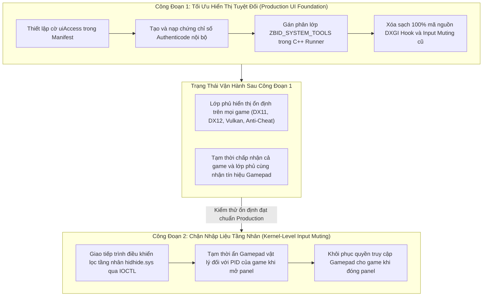
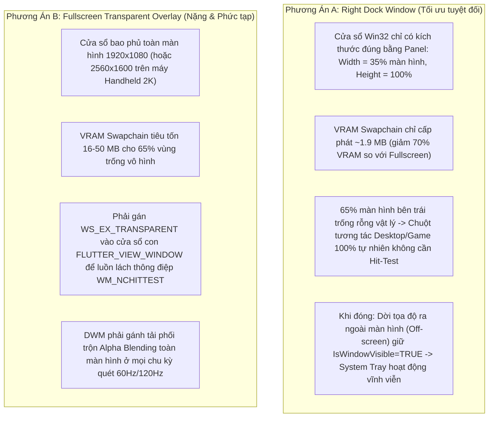
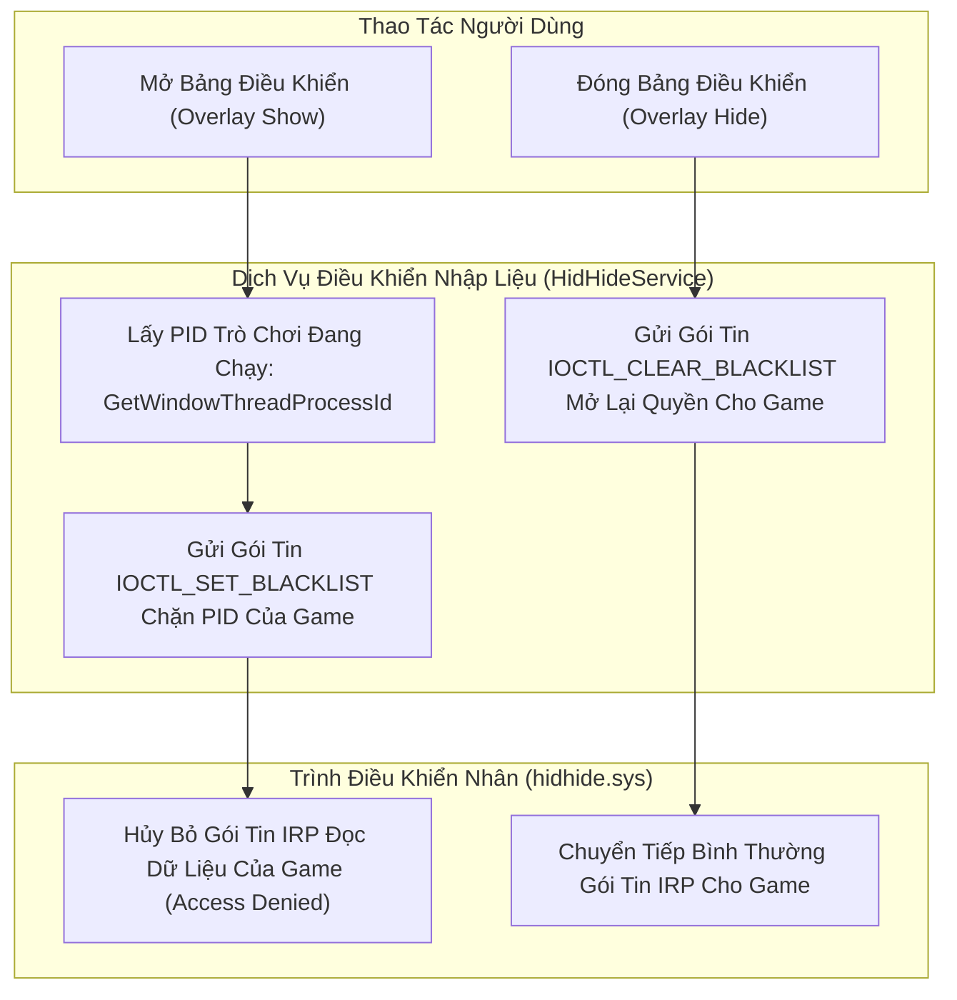

# Kiến Trúc Lớp Phủ Hệ Thống (Windows System Z-Band) Và Lọc Nhập Liệu Cấp Nhân (Kernel Input Filter)

Tài liệu này đúc kết toàn bộ cơ sở khoa học, bản chất vật lý của hệ điều hành Windows và lộ trình kỹ thuật triển khai hệ thống lớp phủ bảng điều khiển (Gaming Overlay) cho thiết bị máy tính cầm tay, phân tách triệt để thành 2 công đoạn độc lập theo nguyên lý phân ly bài toán (Separation of Concerns).

---

## 1. Nguyên Lý Phân Tách Hai Trục Vật Lý Trong Hệ Điều Hành

Một hệ thống lớp phủ chơi game (Gaming Overlay) trên Windows chịu sự chi phối của hai trục vật lý hoàn toàn độc lập:

1. **Trục hiển thị bề mặt và thứ tự lớp cửa sổ (Surface Composition & Window Z-Order)**:
   - Do Bộ quản lý Cửa sổ Máy tính (Desktop Window Manager - DWM) và chuỗi xuất hình của card đồ họa (GPU Scanout Pipeline) điều phối.
   - Bản chất: Đảm bảo điểm ảnh của bảng điều khiển vẽ đè lên điểm ảnh của trò chơi mà không làm gián đoạn chu kỳ xuất hình của trò chơi ra màn hình vật lý.
2. **Trục thu thập và phân phối tín hiệu điều khiển (Peripheral Input Polling & Dispatching)**:
   - Do hệ thống con nhập liệu (XInput / Raw Input Subsystem) và trình điều khiển thiết bị nhân (Kernel Device Driver) điều phối.
   - Bản chất: Đảm bảo khi người dùng thao tác phím bấm hoặc cần điều khiển trên bảng điều khiển, trò chơi không tiếp tục tiếp nhận các tín hiệu đó để tránh kích hoạt hành động không mong muốn trong không gian ảo (Ghost Input / Input Leakage).

---

## 2. Xuất Phát Từ Bế Tắc Thực Tế (The "Why")

- **Trước đây làm bằng cách nào?**:
  - Dồn toàn bộ hai trục vật lý vào một điểm can thiệp duy nhất: Tiêm tập tin nhị phân chèn mã ([[Móc Đồ Họa DXGI (DXGI Hook)]] - phương pháp can thiệp trực tiếp vào bảng địa chỉ hàm ảo trong không gian nhớ của trò chơi) để vừa cưỡng bức cửa sổ chuyển sang chế độ không viền (Borderless Windowed), vừa chặn đứng hàm đọc tay cầm (`XInputGetState`).
- **Bị nghẽn kỹ thuật gì?**:
  1. Khi gặp trò chơi tích hợp cơ chế bảo vệ cấp nhân (Kernel Anti-Cheat như BattlEye, Vanguard) hoặc sử dụng API đồ họa khác (Vulkan, OpenGL), việc tiêm mã bị chặn đứng hoàn toàn $\rightarrow$ Lớp phủ không thể hiển thị trên trò chơi độc quyền, gây biến mất hoặc làm sập tiến trình.
  2. Việc móc chuỗi khung hình đồ họa phụ thuộc nặng nề vào cấu trúc engine (như Far Cry 5 văng do bão thông điệp `WM_SIZE` tại `ResizeTarget`, Dead Island 2 lỗi con trỏ rỗng tại `GetFullscreenState`, Metro Exodus bị bóp nghẽn FPS do tiêu điểm cửa sổ).
  3. Vi phạm nguyên lý phân ly trách nhiệm khi bắt một mô-đun đồ họa phải gánh thêm việc lọc tín hiệu tay cầm.
- **Công nghệ mới giải quyết triệt để ra sao?**:
  - **Trục hiển thị (Công đoạn 1)**: Đưa cửa sổ lên thẳng Phân lớp Công cụ Hệ thống (`ZBID_SYSTEM_TOOLS = 2`) với cờ đặc quyền `TokenUIAccess`. DWM tự động ghép nối bề mặt hiển thị ở tầng bộ trộn màn hình, cho phép vẽ đè tự nhiên lên mọi trò chơi mà không cần chạm vào một byte bộ nhớ của trò chơi.
  - **Trục nhập liệu (Công đoạn 2)**: Sử dụng trình điều khiển lọc thiết bị ở tầng nhân ([[Trình Điều Khiển Lọc HidHide (HidHide Filter Driver)]]), ngắt quyền đọc thiết bị của trò chơi từ bên ngoài, xóa bỏ vĩnh viễn sự tồn tại của kỹ thuật tiêm mã DLL.

---

## 3. Lộ Trình Kỹ Thuật Hai Công Đoạn (Two-Stage Execution Roadmap)

---

## 4. Công Đoạn 1: Triển Khai Windows System Z-Band & Dọn Dẹp Toàn Bộ DXGI Hook

### Bản chất vật lý của cơ chế bảo vệ UIAccess
Để ngăn chặn mã độc lợi dụng việc vẽ đè lên các màn hình đăng nhập bảo mật (như UAC Prompt), nhân hệ điều hành Windows (`ntoskrnl.exe`) chỉ cấp cờ đặc quyền `TokenUIAccess` vào thẻ định danh tiến trình khi thỏa mãn đồng thời **3 điều kiện vật lý**:
1. Tập tin nhị phân khai báo thuộc tính `uiAccess="true"` trong tài nguyên Manifest.
2. Tập tin nhị phân được gắn chữ ký số Authenticode bắt nguồn từ một Nhà cấp chứng chỉ tin cậy nằm trong kho máy tính cục bộ (`LocalMachine\Root` và `LocalMachine\TrustedPublisher`).
3. Tập tin nhị phân nằm trong thư mục được bảo vệ của hệ điều hành (`C:\Program Files` hoặc `C:\Windows\System32`).

### Các bước kỹ thuật thực hiện chi tiết

#### Bước 1: Khai báo đặc quyền trong Manifest ứng dụng
- Mở tập tin cấu hình manifest: `windows/runner/runner.exe.manifest`.
- Tìm thẻ `requestedExecutionLevel` trong nhánh `trustInfo` -> `security` -> `requestedPrivileges`.
- Thiết lập cú pháp: `<requestedExecutionLevel level="asInvoker" uiAccess="true"/>`.

#### Bước 2: Tạo chứng chỉ số ký mã nội bộ (Self-Signed Code Signing Certificate)
- Khởi chạy PowerShell với quyền Quản trị viên (Run as Administrator).
- Tạo chứng chỉ ký mã thời hạn 10 năm lưu vào kho cá nhân của máy cục bộ bằng lệnh:
  `New-SelfSignedCertificate -Type CodeSigningCert -Subject "CN=HandheldToolsSigner" -CertStoreLocation "Cert:\LocalMachine\My" -KeySpec Signature -NotAfter (Get-Date).AddYears(10)`
- Trích xuất con trỏ chứng chỉ vừa tạo:
  `$cert = (Get-ChildItem Cert:\LocalMachine\My -CodeSigningCert | Where-Object Subject -match "HandheldToolsSigner")[0]`
- Nạp chứng chỉ vào kho Chứng chỉ Gốc Tin cậy (Trusted Root Certification Authorities):
  `$rootStore = Get-Item Cert:\LocalMachine\Root; $rootStore.Open("ReadWrite"); $rootStore.Add($cert); $rootStore.Close()`
- Nạp chứng chỉ vào kho Nhà phát hành Tin cậy (Trusted Publishers):
  `$pubStore = Get-Item Cert:\LocalMachine\TrustedPublisher; $pubStore.Open("ReadWrite"); $pubStore.Add($cert); $pubStore.Close()`

#### Bước 3: Đưa cửa sổ vào Z-Band trong mã nguồn C++ Runner
- Trong tập tin điều khiển cửa sổ Win32 (`windows/runner/win32_window.cpp`):
  - Định nghĩa chỉ số phân lớp công cụ hệ thống: `#define ZBID_SYSTEM_TOOLS 2`.
  - Khai báo kiểu con trỏ hàm nội bộ của Windows:
    `typedef BOOL (WINAPI *pfnSetWindowBand)(HWND hWnd, HWND hwndInsertAfter, DWORD dwBand);`.
  - Trong phương thức khởi tạo cửa sổ (sau khi hàm tạo cửa sổ hoàn tất tạo ra `m_hwnd`):
    `pfnSetWindowBand SetWindowBand = (pfnSetWindowBand)GetProcAddress(GetModuleHandleW(L"user32.dll"), "SetWindowBand");`
    `if (SetWindowBand) SetWindowBand(m_hwnd, NULL, ZBID_SYSTEM_TOOLS);`.

#### Bước 4: Dọn dẹp triệt để toàn bộ mã nguồn DXGI Hook (Tuân thủ nguyên tắc không tương thích ngược)
- **Tầng mã nguồn C++**:
  - Xóa bỏ hoàn toàn thư mục `windows/dxgi_hook/` gồm các tập tin `dxgi_hook.cpp`, `dxgi_hook.h`, `dxgi.def`, thư viện MinHook đi kèm.
  - Xóa bỏ lệnh nạp thư mục con `add_subdirectory("dxgi_hook")` trong `windows/CMakeLists.txt`.
  - Xóa bỏ tập tin script biên dịch `build_dxgi_hook.bat`.
  - Xóa bỏ tập tin script đóng gói cũ `package_release.bat`.
- **Tầng dịch vụ Dart / Flutter**:
  - Xóa bỏ hoàn toàn tập tin `lib/services/dxgi_hook_service.dart`.
  - Trong `lib/services/overlay_controller.dart`:
    - Xóa bỏ việc nhập thư viện `dxgi_hook_service.dart`.
    - Xóa bỏ toàn bộ các lệnh gọi `DxgiHookService.instance.setOverlayActive(true)` tại phương thức `showOverlay()` và `setOverlayActive(false)` tại phương thức `hideOverlay()`.
  - Trong `lib/main.dart`:
    - Xóa bỏ đoạn mã khởi tạo `DxgiHookService.instance.init(config)`.

#### Bước 4.1: Đồng bộ cơ chế hòa trộn khung hình DWM và vượt rào cản cách ly đặc quyền UIPI

##### 1. Bản chất vật lý của sự cố màn hình đen khi mở lớp phủ
- **Trước đây làm bằng cách nào?**: Ứng dụng gọi hàm gán thuộc tính cửa sổ phân tầng (`SetLayeredWindowAttributes`) với cờ chỉ định độ mờ (`LWA_ALPHA`) và tham số 255 nhằm mục đích yêu cầu cửa sổ hiển thị rõ nét 100%.
- **Bị nghẽn/thảm họa kỹ thuật gì?**: Bộ dựng hình Flutter trên Windows kết xuất khung hình bằng Direct3D 11 và DirectComposition swapchain với 4 kênh màu ARGB độc lập (Per-Pixel Alpha). Khi gọi hàm `SetLayeredWindowAttributes(hwnd, 0, 255, LWA_ALPHA)`, bộ ghép hình DWM (Desktop Window Manager) lập tức ngắt bỏ cơ chế hòa trộn độ mờ từng điểm ảnh (Per-Pixel Alpha Blending) và ép toàn bộ bề mặt cửa sổ nhận một hệ số mờ đồng nhất (Constant Alpha = 255). Do vùng không gian bên trái bảng điều khiển có giá trị màu là 0 nhưng độ mờ bị ép thành 255, DWM hiển thị vùng này thành màu đen đặc (Black Opaque), biến toàn bộ màn hình thành một tấm màn đen sì che khuất trò chơi bên dưới.
- **Giải quyết triệt để ra sao?**:
  - Loại bỏ hoàn toàn 100% các lệnh gọi hàm `SetLayeredWindowAttributes` trong cả tầng C++ (`win32_window.cpp`) và tầng Dart (`native_window_service.dart`).
  - Mở rộng khung viền DWM vào toàn bộ vùng thao tác của cửa sổ bằng hàm `DwmExtendFrameIntoClientArea(window, &margins)` với lề âm `MARGINS{-1, -1, -1, -1}`. Thao tác này trao toàn quyền hòa trộn độ trong suốt cho kênh Alpha của DirectComposition, giúp vùng trống hoàn toàn trong suốt nhìn xuyên thấu xuống màn hình trò chơi.
  - Bắt thông điệp xóa nền `WM_ERASEBKGND` và trả về giá trị 1 để ngăn chặn thư viện đồ họa GDI tự ý quét cọ màu đen/trắng lên khung hình.

##### 2. Bản chất vật lý của sự cố khay hệ thống (System Tray) không phản hồi
- **Trước đây làm bằng cách nào?**: Thư viện quản lý khay hệ thống (`tray_manager`) sử dụng hàm API Windows `Shell_NotifyIcon` để tạo biểu tượng và đăng ký mã thông điệp phản hồi là `WM_USER + 1` (giá trị số `0x0401`).
- **Bị nghẽn/thảm họa kỹ thuật gì?**: Khi ứng dụng được cấu hình đặc quyền `uiAccess="true"`, tiến trình của ứng dụng được hệ điều hành nâng cấp mức toàn vẹn bảo mật (Integrity Level) lên mức rất cao (`UIAccess`). Trong khi đó, tiến trình quản lý thanh tác vụ Windows (`explorer.exe`) chạy ở mức toàn vẹn bình thường (`Medium Integrity`). Khi người dùng click chuột vào biểu tượng khay hệ thống, `explorer.exe` gửi gói thông điệp `0x0401` tới cửa sổ ứng dụng. Tường lửa hạt nhân của hệ điều hành Windows (`win32k.sys`) kích hoạt cơ chế cách ly đặc quyền giao diện (User Interface Privilege Isolation - UIPI) và lập tức chặn đứng, tiêu hủy (drop) gói thông điệp này ngay tại hàng đợi (Message Queue) vì người gửi có mức đặc quyền thấp hơn người nhận. Hậu quả là ứng dụng hoàn toàn không nhận được tín hiệu nhấp chuột lẫn lệnh hiển thị menu ngữ cảnh (`TrackPopupMenu`).
- **Giải quyết triệt để ra sao?**:
  - Khai báo mở bộ lọc thông điệp toàn cục và theo từng cửa sổ thông qua các hàm Win32 API: `ChangeWindowMessageFilter` và `ChangeWindowMessageFilterEx`.
  - Cấp phép xuyên qua tường lửa UIPI cho 3 thông điệp thiết yếu:
    - Thông điệp phản hồi khay hệ thống: `WM_USER + 1` (cờ `MSGFLT_ALLOW = 1`).
    - Thông điệp chọn mục trên trình đơn: `WM_COMMAND`.
    - Thông điệp tái tạo khay hệ thống khi Explorer khởi động lại: chuỗi định danh đã đăng ký `RegisterWindowMessageW(L"TaskbarCreated")`.

##### 3. Bản chất vật lý của sự cố nuốt chuột và Phân tích tối ưu: Right Dock Window vs. Fullscreen Overlay
- **Trước đây làm bằng cách nào?**: Ứng dụng tạo một cửa sổ toàn màn hình bao phủ 100% diện tích hiển thị (`1920x1080`), dự định bắt thông điệp `WM_NCHITTEST` trên cửa sổ cha (`FLUTTER_RUNNER_WIN32_WINDOW`) để trả về `HTTRANSPARENT` cho vùng bên trái và `HTCLIENT` cho Side Panel bên phải.
- **Bị nghẽn/thảm họa kỹ thuật gì?**:
  1. *Cửa sổ con nuốt chuột*: Kiến trúc Flutter Windows Runner chia làm 2 tầng: Cửa sổ cha (`FLUTTER_RUNNER_WIN32_WINDOW`) và Cửa sổ con chứa khung vẽ đồ họa DirectX (`FLUTTER_VIEW_WINDOW`). Khi chuột tương tác, Windows gửi `WM_NCHITTEST` tới cửa sổ con nằm sâu nhất dưới tọa độ con trỏ. Thủ tục cửa sổ của `FLUTTER_VIEW_WINDOW` (bên trong `flutter_windows.dll`) mặc định luôn trả về `HTCLIENT` cho toàn bộ tọa độ trên màn hình. Do đó, mã lọc `WM_NCHITTEST` ở cửa sổ cha bị bỏ qua hoàn toàn, khiến toàn màn hình bị nuốt trọn chuột.
  2. *Thanh tác vụ Windows 11 ngắt kết nối khay hệ thống khi ẩn*: Khi dùng lệnh `ShowWindow(hwnd, SW_HIDE)` để ẩn cửa sổ, tiến trình `explorer.exe` của Windows 11 kiểm tra `IsWindowVisible(hwnd) == FALSE` và tự động hủy bỏ (drop) mọi thông điệp click chuột `WM_USER + 1`, làm icon khay hệ thống bị tê liệt hoàn toàn.
- **So sánh tối ưu giữa hai phương án giải quyết triệt để**:

| Tiêu chí kỹ thuật | Phương án A: Right Dock Window (Khuyến nghị) | Phương án B: Fullscreen + Hit-Test Hack |
| :--- | :--- | :--- |
| **Tiêu tốn bộ nhớ VRAM** | **Rất thấp**: Bộ đệm tráo đổi (Swapchain) chỉ cấp phát dải 450x1080 (~1.9 MB/buffer), tiết kiệm tới ~70% VRAM. | **Rất cao**: Cấp phát toàn màn hình 1920x1080 (hoặc 2560x1600), lãng phí 16 - 50 MB VRAM cho khoảng trống vô hình. |
| **Gánh nặng GPU & DWM** | **Tối ưu**: DWM chỉ phối trộn dải mép phải. Vùng bên trái trống hoàn toàn, game kích hoạt cơ chế độc chiếm phần cứng (Independent Flip). | **Nặng nề**: DWM phải phối trộn kênh Alpha toàn màn hình liên tục ở từng chu kỳ quét 60Hz/120Hz. |
| **Cơ chế chuột & Cảm ứng** | **Vật lý tự nhiên**: Vùng bên trái không có cửa sổ che chắn, chuột rơi thẳng xuống Desktop/Game. Vùng Panel nhận chuột tự nhiên. | **Luồn lách thông điệp**: Phải gán `WS_EX_TRANSPARENT` vào cửa sổ con để chuyển tiếp `WM_NCHITTEST` lên cha, tiềm ẩn xung đột gesture. |
| **Độ ổn định System Tray** | **Tuyệt đối**: Cửa sổ thu nhỏ 1x1 hoặc đưa Off-screen khi đóng, duy trì `IsWindowVisible = TRUE` cho Windows 11 Taskbar. | **Tương tự**: Phải đưa Off-screen khi đóng để tránh `SW_HIDE` làm chết kết nối khay hệ thống. |
| **Điều chỉnh độ rộng Panel** | **Trực tiếp**: Dart gọi `SetWindowPos` co dãn kích thước vật lý tức thời khi kéo slider Cài đặt. | **Gián tiếp**: Phải đồng bộ thuộc tính `SetPropW` xuống Win32 để tính lại ranh giới `boundaryX`. |

- **Kết luận giải pháp triệt để**:
  - **Phương án A (Right Dock Window)** tối ưu và vượt trội hơn toàn diện về hiệu năng phần cứng, mức tiêu thụ VRAM, độ mượt mà của Game và sự trong sáng của mã nguồn Win32.
  - Khi triển khai: Cửa sổ Win32 khởi tạo neo sát mép phải với chiều rộng `panelWidth`. Khi đóng, dời cửa sổ ra tọa độ ngoài màn hình (`X = screenWidth, Y = 0`) mà không dùng `SW_HIDE` để giữ kết nối khay hệ thống. Khi mở, dịch chuyển về `X = screenWidth - panelWidth` và hiển thị bằng `SWP_NOACTIVATE`. Khi người dùng kéo thanh trượt độ rộng, gọi `SetWindowPos` cập nhật trực tiếp kích thước cửa sổ.

#### Bước 5: Ký số tập tin thực thi sau khi biên dịch
- Sau khi đóng gói ứng dụng bản Release (`flutter build windows --release`), định vị công cụ `signtool.exe` trong Windows SDK (thường tại `C:\Program Files (x86)\Windows Kits\10\bin\<version>\x64\signtool.exe`).
- Thực thi lệnh ký số nhị phân:
  `signtool.exe sign /sm /s My /n "HandheldToolsSigner" /fd SHA256 /tr http://timestamp.digicert.com /td SHA256 "build\windows\x64\runner\Release\windows_handheld_tools.exe"`.

#### Bước 6: Cài đặt và nghiệm thu trong thư mục bảo mật

##### Cấu trúc tập tin bắt buộc khi chép vào thư mục an toàn
- Do ứng dụng Flutter trên Windows vận hành theo mô hình đóng gói thư mục liên kết động (Application Bundle), nhân Windows (`ntoskrnl.exe`) chỉ cấp quyền `TokenUIAccess` khi tập tin `.exe` có cờ `uiAccess="true"` cư ngụ tại thư mục an toàn của hệ điều hành (`C:\Program Files\`), đồng thời bộ nạp liên kết động (Dynamic Linker) yêu cầu các thư viện dùng chung phải nằm cạnh tập tin thực thi để nạp vào cùng một không gian địa chỉ ảo.
- Bắt buộc phải sao chép **toàn bộ thư mục đóng gói Release**, bao gồm:
  - Tập tin thực thi chính: `windows_handheld_tool.exe` (đã ký số Authenticode).
  - Toàn bộ các thư viện liên kết động: `flutter_windows.dll`, các `.dll` của plugin (`window_manager_plugin.dll`, `tray_manager_plugin.dll`, `screen_retriever_windows_plugin.dll`), và các thư viện điều khiển phần cứng (`ryzenadj.dll`, `libryzenadj.dll`, `WinRing0x64.dll`, `WinRing0x64.sys`, `inpoutx64.dll`).
  - Toàn bộ thư mục dữ liệu: `data/` (chứa `icudtl.dat` và thư mục con `flutter_assets/` lưu trữ bytecode Dart, hình ảnh, phông chữ).
  - Tập tin cấu hình: `config.json`.

##### Phương thức phân phối: Kịch bản thử nghiệm nội bộ và Bộ cài đặt phát hành
- **Giai đoạn phát triển và kiểm thử nội bộ**:
  - Không xây dựng gói cài đặt `.msi` để tránh tốn thời gian cài đặt và gỡ bỏ liên tục trong vòng lặp thử nghiệm.
  - Sử dụng hai tập tin kịch bản chuyên biệt chạy với quyền Quản trị viên:
    - `deploy_test.bat`: Tự động ngắt tiến trình `windows_handheld_tool.exe` đang chạy, tạo thư mục an toàn `C:\Program Files\WindowsHandheldTools\`, đồng bộ toàn bộ nội dung thư mục Release sang đó và tự động khởi chạy ứng dụng để kiểm thử.
    - `uninstall_test.bat`: Cưỡng bức đóng tiến trình và xóa sạch toàn bộ thư mục `C:\Program Files\WindowsHandheldTools\` để đưa môi trường về trạng thái ban đầu trước mỗi lần triển khai mới.
- **Giai đoạn phát hành hoàn chỉnh cho người dùng cuối (Production Release)**:
  - Sau khi hoàn thành cả Công đoạn 1 và Công đoạn 2, đóng gói toàn bộ thành một trình cài đặt tự động duy nhất (sử dụng Inno Setup tạo `setup.exe` hoặc WiX Toolset tạo `.msi`).
  - Trình cài đặt tự động thực hiện 3 tác vụ có quyền Quản trị viên:
    1. Nạp chứng chỉ ký số nội bộ vào kho `LocalMachine\Root` và `LocalMachine\TrustedPublisher`.
    2. Giải nén toàn bộ thư mục ứng dụng vào `C:\Program Files\WindowsHandheldTools\`.
    3. Thiết lập lối tắt khởi chạy cùng hệ thống (Startup Shortcut).

##### Tiêu chí nghiệm thu Công đoạn 1
1. Cửa sổ lớp phủ hiển thị đè mượt mà lên các trò chơi Direct3D 11, Direct3D 12, Vulkan, OpenGL ở cả chế độ Toàn màn hình độc quyền (Exclusive Fullscreen) và Cửa sổ không viền.
2. Không xảy ra hiện tượng sập tiến trình (Crash) khi thay đổi độ phân giải màn hình hoặc khi mở/đóng bảng điều khiển.
3. Dự án hoàn toàn không còn bất kỳ tập tin nhị phân chèn mã DLL nào chạy ngầm.
4. Chấp nhận đặc tính tạm thời: Nút bấm trên tay cầm điều khiển song song cả bảng điều khiển và hành động nhân vật trong trò chơi.
5. Bảo toàn và duy trì hoạt động 100% của toàn bộ hệ thống tính năng phần cứng:
   - Lớp phủ thông số hiệu năng RTSS OSD Overlay (FPS, CPU, GPU, RAM, Frametime) qua bộ nhớ chia sẻ RTSS Shared Memory.
   - Điều khiển công suất vi xử lý APU TDP (5W - 35W) qua `RyzenAdj` và kernel driver `WinRing0`.
   - Điều khiển tốc độ quạt tản nhiệt (Fan Control) qua WMI/EC.
   - Điều khiển độ sáng màn hình (WMI Brightness), âm lượng hệ thống (Core Audio), bàn phím cảm ứng (TabTip), và lắng nghe phím tắt toàn cục (Gamepad Combo `BACK + RB`, hotkey `Ctrl+Shift+Q`).

##### Hiện trạng triển khai thực tế và Lộ trình nghiệm thu (Current Implementation Status)
Tình trạng hiện tại vẫn ko khác gì lần trước:
- Khi ấn vào system tray icon: Vẫn không hiện ra panel, chuột phải cũng ko hiện ra menu
- Khi ấn tổ hợp Ctrl+Shift+Q: Màn hình ko còn đen sì, nhưng behaviour giống như hiển thị 1 lớp overlay transparent toàn màn hình, khiến cho mouse ko thao tác với desktop được. Bấm hotkey lần nữa thì hết.
- Do lỗi ngay ở Desktop bình thường nên chưa vào game để test

- **Hoàn tất chuyển đổi mô hình Right Dock Window**:
  - Đã loại bỏ hoàn toàn mô hình Fullscreen Transparent Overlay (1920x1080) và mã lọc va chạm chuột `WM_NCHITTEST` trên cửa sổ cha [windows/runner/win32_window.cpp](file:///d:/dev-projects/windows-handheld-tool/windows/runner/win32_window.cpp).
  - Cửa sổ Win32 thực tế hiện chỉ chiếm đúng chiều rộng của Side Panel (`panelWidth x screenHeight`), neo tại mép phải màn hình (`X = screenWidth - panelWidth, Y = 0`). Khoảng 65% màn hình bên trái hoàn toàn không có cửa sổ che chắn, cho phép con trỏ chuột tương tác tự do 100% với Desktop và Game mà không cần bất kỳ thủ thuật hit-test nào.
  - Khắc phục triệt để sự cố khay hệ thống (System Tray) trên Windows 11: Hàm `hideDockWindow()` trong [lib/services/native_window_service.dart](file:///d:/dev-projects/windows-handheld-tool/lib/services/native_window_service.dart) không dùng lệnh `SW_HIDE` mà dời tọa độ cửa sổ ra ngoài màn hình vật lý (`X = screenWidth`), duy trì `IsWindowVisible == TRUE` giúp tiến trình `explorer.exe` của Windows 11 liên tục duy trì đường truyền thông điệp chuột `WM_USER + 1`.
  - Tích hợp hàm `resizeDockWindow()`: Cho phép gọi trực tiếp `SetWindowPos` co dãn kích thước vật lý của HWND tức thì khi người dùng kéo thanh trượt độ rộng trong tab Cài đặt.
- **Tối ưu hóa bề mặt hiển thị Flutter**:
  - Widget [lib/ui/overlay_screen.dart](file:///d:/dev-projects/windows-handheld-tool/lib/ui/overlay_screen.dart) đã chuyển thành `StatelessWidget`, chứa trực tiếp `QuickSettingsPanel` trong `SizedBox.expand`, xóa bỏ hoàn toàn hoạt cảnh trượt trễ `Offset(1.0, 0.0)` và các cấu trúc `Stack` lồng nhau không cần thiết.
- **Trạng thái đóng gói và phân phối**:
  - Kiểm tra cú pháp và kiểu dữ liệu: `flutter analyze` đạt chuẩn 0 lỗi / 0 cảnh báo.
  - Đã hoàn tất biên dịch tập tin nhị phân Release: `build\windows\x64\runner\Release\windows_handheld_tool.exe`.
  - Toàn bộ các thư viện driver liên kết động tầng thấp (`ryzenadj.dll`, `WinRing0x64.dll`, `WinRing0x64.sys`, `inpoutx64.dll`) và tập tin cấu hình `config.json` đã được sao chép sẵn sàng vào thư mục Release.
  - Kịch bản triển khai tự động [deploy_test.bat](file:///d:/dev-projects/windows-handheld-tool/deploy_test.bat) đã sẵn sàng để người dùng thực thi với quyền Quản trị viên (Run as Administrator) nhằm ký số Authenticode nội bộ, đồng bộ vào `C:\Program Files\WindowsHandheldTools\` và kích hoạt ứng dụng trên phân lớp `ZBID_SYSTEM_TOOLS` có quyền `TokenUIAccess`.

---

## 5. Công Đoạn 2: Chặn Nhập Liệu Tầng Nhân Thông Qua Trình Điều Khiển Lọc HidHide

Sau khi Công đoạn 1 đã được kiểm thử ổn định và đạt chuẩn xuất bản (Production Ready), hệ thống sẽ tiến hành bổ sung khả năng ngắt nhập liệu tay cầm thông qua trình điều khiển lọc thiết bị ở tầng nhân mà không làm biến đổi bất kỳ byte nhớ nào của trò chơi.

### Bản chất vật lý của cơ chế lọc HidHide
- **Vị trí trong ngăn xếp thiết bị**: `hidhide.sys` hoạt động như một trình điều khiển lọc tầng trên (Upper Filter Driver) được chèn trực tiếp vào ngăn xếp thiết bị USB/Bluetooth Human Interface Device (HID).
- **Cơ chế ngăn chặn luồng I/O**:
  - Khi một ứng dụng cố gắng mở thiết bị (thông qua hàm API Win32 `CreateFile` tới đường dẫn giao diện thiết bị `\\?\HID#...`), nhân Windows sẽ chuyển tiếp gói yêu cầu I/O (IRP - I/O Request Packet) qua ngăn xếp driver.
  - Driver `hidhide.sys` chặn gói IRP, đối chiếu mã định danh tiến trình yêu cầu (Caller Process ID) với bảng danh sách đen (Blacklist) được lưu trong bộ nhớ nhân:
    - Nếu trùng khớp PID của trò chơi: Driver lập tức trả về mã lỗi `STATUS_ACCESS_DENIED`. Trò chơi hoàn toàn không nhận được dữ liệu trạng thái tay cầm.
    - Nếu là PID của ứng dụng lớp phủ (Handheld Tools): Driver cho phép gói IRP đi qua bình thường.

### Quy trình kỹ thuật dự kiến của Công đoạn 2

- **Bước 1**: Thiết lập kênh liên lạc với driver `hidhide.sys` bằng cách mở tay cầm thiết bị điều khiển thông qua hàm `CreateFileW(L"\\\\.\\HidHide", GENERIC_READ | GENERIC_WRITE, ...)` trong dịch vụ mới `HidHideService`.
- **Bước 2**: Đăng ký mã định danh phần cứng (Hardware ID) của tay cầm tích hợp trên máy vào danh sách quản lý của driver.
- **Bước 3**: Khi mở lớp phủ (`OverlayController.showOverlay`):
  - Xác định cửa sổ trò chơi tiền cảnh thông qua `GetForegroundWindow`.
  - Trích xuất Process ID bằng `GetWindowThreadProcessId`.
  - Gửi mã điều khiển thiết bị (DeviceIoControl với mã IOCTL của HidHide) để thêm PID trò chơi vào danh sách chặn.
- **Bước 4**: Khi đóng lớp phủ (`OverlayController.hideOverlay`):
  - Gửi mã điều khiển thiết bị để xóa PID trò chơi khỏi danh sách chặn, hoàn trả luồng dữ liệu tay cầm cho trò chơi ngay lập tức.
